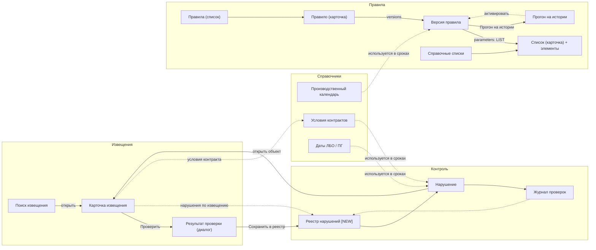

# Интерфейс multi-reestr: экраны и навигация

> Jmix 3.0.3, Flow UI. Это документ-описание без кода. Модель данных описана в [model/OVERVIEW.md](model/OVERVIEW.md), план уроков — в [LESSONS.md](LESSONS.md).
> Номера уроков взяты из [LESSONS.md](LESSONS.md). Всё, что помечено **предложение**, — проектное предложение этого документа: в источниках этого нет или там это не детализировано.

## Содержание

1. [Принципы UI](#1-принципы-ui)
2. [Структура меню](#2-структура-меню)
3. [Экраны](#3-экраны)
4. [Навигация между экранами](#4-навигация-между-экранами)
5. [Сводка: генерируемые и написанные вручную экраны](#5-сводка-генерируемые-и-написанные-вручную-экраны)
6. [Роли](#6-роли)

## 1. Принципы UI

- **Flow UI (Vaadin).** Обычные Jmix-экраны: `StandardListView` / `StandardDetailView` для JPA-сущностей и `StandardView` для своих экранов. Переходы между экранами идут через `ViewNavigators` с route- и query-параметрами.
- **Русские подписи.** Заголовки экранов, атрибутов и значений перечислений берутся из `messages_ru.properties`. Перечисления хранят id (строка или число), а показывают русский заголовок.
- **Список + карточка в стиле Studio.** JPA-сущности main-хранилища получают пару экранов из мастера Studio *Entity list and detail views*: `mtr_X.list` + `mtr_X.detail`, маршруты `x-list` и `x-list/:id`. В проекте так уже сделаны `mtr_User.list` / `UserDetailView`.
- **Подчинённые сущности** (`@Composition`) редактируются внутри карточки владельца, в DataGrid с кнопками «Создать / Изменить / Удалить» и вложенной карточкой. Это относится к `Rule.versions`, `RuleVersion.parameters` и `ReferenceList.items`.
- **Legacy только для чтения.** Экраны извещения пишутся вручную на `StandardView`, а не на `StandardDetailView`: данные из legacy только читаются. Контейнеры объявлены как `<data readOnly="true">`, DTO-контейнеры заполняются через `setItems` из сервиса. Кнопок сохранения на этих экранах нет.
- **Подсказка вместо ссылки.** JPA-сущности ссылаются на legacy только по значению, например `ContractTerm.contractLegacyId` или `PlanScheduleEvent.legacyPlanId`. Поэтому в карточках такие поля заполняются через поиск или выбор из DTO (**предложение**), а не через обычный entity picker.
- **Экспорт.** Платные дополнения (gridexport) не используются. Извещения выгружает кнопка «Excel» в карточке и на экране поиска: свой `NoticeExcelExporter` на Apache POI (`poi-ooxml`), два листа «Извещения» и «Спецификации» в формате образца `notices.xlsx` (урок 3).

## 2. Структура меню

```
Извещения
  ├─ Поиск извещения                (NoticeSearchView)
Правила
  ├─ Правила                        (mtr_Rule.list)
  ├─ Справочные списки              (mtr_ReferenceList.list)
  └─ Прогон на истории              (DryRunView)
Контроль
  ├─ Реестр нарушений  [N]          (mtr_Violation.list; счётчик NEW)
  └─ Журнал проверок                (mtr_CheckRun.list)
Справочники
  ├─ Производственный календарь     (mtr_CalendarDay.list)
  ├─ Условия контрактов             (mtr_ContractTerm.list)
  └─ Даты ЛБО и плана-графика       (mtr_PlanScheduleEvent.list)
Администрирование
  ├─ Пользователи                   (mtr_User.list — уже есть)
  ├─ Подключение к MultiReestr      (mtr_LegacyConnectionView — есть; настройки — урок 1)
  └─ Ресурсные роли / Роли строк    (стандартные экраны Jmix Security)
```

Сейчас в `menu.xml` есть группы `notices`, `application` (с `mtr_User.list`), `rules`, `control`, `catalogs` и `administration` (с `mtr_LegacyConnectionView`). Пункт «Пользователи» переносится из `application` в `administration` (первым пунктом), группа `application` удаляется. Остальные пункты добавляются по ходу уроков.

**Счётчик `[N]`** (урок 9) показывает число нарушений со статусом `NEW` и обновляется после проверок. Это единственное «оповещение в приложении»: add-on Notifications не используется, почта не реализуется. Конкретный способ сделать бейдж у пункта меню **проверить в Jmix 3.0.3 Flow UI (предложение)**.

## 3. Экраны

Обозначения: **CRUD** — экран сгенерирован мастером Studio и доработан; **свой** — экран написан вручную (`StandardView` или диалог). Роли: **С** — специалист, **А** — администратор правил (см. [раздел 6](#6-роли)).

### 3.1. Извещения

#### Поиск извещения — `NoticeSearchView`
| | |
|---|---|
| Назначение | Найти извещение по номеру или, если номера нет, по дате и фрагменту названия. Из дублей и локальных копий выбрать оригинал |
| View id / route | `mtr_NoticeSearchView` / `notices/search` |
| Тип | свой (`StandardView`), не CRUD |
| Поля поиска | номер (19 цифр, нормализуется через `NoticeNumber`), дата, фрагмент названия; кнопка «Найти» |
| Таблица кандидатов | `NoticeCandidateDto`: `number`, `publishedAt`, `subject`, `modifVersion`, `deleted`, `canceled`, `localCopy`, `chosen`, `reason` |
| Действия | «Найти». Двойной клик или «Открыть» ведёт в карточку. Если подходит ровно одно извещение, сразу открывается карточка (**предложение**). Пустой результат — сообщение «Ничего не найдено». «Excel» (урок 3): выгружает выделенную строку, а если ничего не выделено — все оригиналы, не больше 20 (при превышении — уведомление); файл `извещение-{номер}.xlsx` или `извещения-yyyyMMdd-HHmm.xlsx` |
| Редактирование | нет, только чтение |
| Переходы | → карточка извещения (`notices/:number`) |
| Роли | С, А |
| Урок | 2 |

#### Карточка извещения — `NoticeDetailView`
| | |
|---|---|
| Назначение | Полная карточка извещения 44-ФЗ из legacy |
| View id / route | `mtr_NoticeDetailView` / `notices/:number` (номер передаётся параметром маршрута) |
| Тип | свой (`StandardView`, `<data readOnly="true">`), не CRUD |
| Шапка | плашка `warnings`; `number`, `subject`, `law`, `methodName`, `nmck`, `publishedAt`, `modifVersion`, `customer` (OrganizationDto.name / inn), ссылка `eisUrl` |
| Вкладки | **Извещение**: `ikz`, `planPosition`, `applicationsFrom/To`, `biddingDate`, `summarizingDate`, обеспечения (`appGuaranteeAmount/Pct`, `contractGuaranteePct`), `executionTermDays`, `executionEndDate`, `preferences`, `platform`, лоты (`LotDto`: `number`, `maxPrice`, `currency`), финансирование (`NoticeFinanceDto`: `kbk`, `finYear`, `amount`), документы (`NoticeDocumentDto`: `name`, `url`) · **Спецификация**: `SpecPositionDto` (`pos`, `name`, `okpd2`, `ktru`, `qty`, `unit`, `price`, `amount`, `foreignBan`, `foreignRestriction`, `rfPreference`, `banImpossible`, `characteristicsText`), под ней характеристики выбранной позиции (`KtruCharacteristicDto`: `name`, `value`, `fromEis`, `required`) · **Протоколы**: `ProtocolDto` (`number`, `date`, `typeName`) · **Контракт и исполнение**: `ContractDto` (`number`, `registryNumber`, `date`, `endDate`, `price`, `reductionPct`, `paidTotal`, `supplier`), позиции `ContractItemDto`, исполнение `ExecutionDto` (`kind`, `stageNumber`, `stageEndDate`, `docName`, `docNumber`, `docDate`, `acceptDate`, `amount`, `penaltyInfo`, `improperExecution`); под таблицей исполнения — строка «Оплачено» (та же сумма, что в поле `paidTotal` формы контракта) |
| Действия | «Назад к поиску»; «Excel» — свой `NoticeExcelExporter` (два листа, урок 3): выгружает загруженную карточку в файл `извещение-{номер}.xlsx`, кнопка выключена, если извещение не найдено; **«Проверить»** (урок 7) открывает диалог результата проверки; «Нарушения по извещению» ведёт в реестр с фильтром по `objectKey` (**предложение**); «Условия контракта» ведёт в `ContractTerm` с фильтром по `contractLegacyId` (**предложение**) |
| Редактирование | нет |
| Переходы | ← поиск; → диалог проверки; → реестр нарушений; → условия контракта |
| Роли | С, А |
| Урок | 3 (карточка, Excel), 7 (кнопка «Проверить») |

#### Результат проверки — `CheckResultDialog` (**предложение** по имени)
| | |
|---|---|
| Назначение | Сценарий «создал извещение — система проверила»: показать срабатывания правил по одному объекту до записи в реестр |
| View id | `mtr_CheckResultDialog` (диалог, без маршрута) — **предложение** |
| Тип | свой (`StandardView`, открывается как диалог) |
| Таблица | `CheckResultDto`: `severity`, `ruleCode`, `ruleName`, `detail`, `message`, `legalRef` |
| Действия | «Сохранить в реестр» — результаты превращаются в `Violation` (дедупликация по `fingerprint`) и создаётся `CheckRun` с режимом `ON_DEMAND`; «Закрыть» |
| Редактирование | нет |
| Роли | С, А |
| Урок | 7 |

### 3.2. Правила

#### Правила — `mtr_Rule.list` / `mtr_Rule.detail`
| | |
|---|---|
| Назначение | Экземпляры шаблонов проверок (`RuleTemplateType`) |
| Route | `rules` / `rules/:id` (**предложение**) |
| Тип | CRUD, доработанный |
| Колонки списка | `code`, `name`, `templateType`, `objectType`, `severity`, `enabled` |
| Фильтры | `genericFilter` по `templateType`, `objectType`, `severity`, `enabled` |
| Карточка | `code`, `name`, `templateType`, `objectType`, `severity`, `legalRef`, `explanationTemplate`, `enabled`, `description`; вложенная таблица **versions** (`@Composition`): `versionNumber`, `status`, `validFrom`, `validTo`, `approvedBy`, `approvedAt` |
| Действия | Создать, Изменить, Выключить через `enabled`. Удалять правило с нарушениями нельзя: soft delete не используется, отключение идёт флагом. «Новая версия» копирует текущую в DRAFT (**предложение**) |
| Только чтение | трейты аудита (`createdBy/Date`, `lastModifiedBy/Date`). `templateType` после создания менять нельзя (**предложение**) |
| Переходы | → карточка версии; → прогон на истории для DRAFT-версии; → реестр нарушений по правилу (**предложение**) |
| Роли | А — редактирование; С — только чтение (**предложение**) |
| Урок | 6 |

#### Версия правила — `mtr_RuleVersion.detail`
| | |
|---|---|
| Назначение | Параметры правила на период действия |
| Тип | CRUD (detail открывается из карточки Rule) |
| Поля | `versionNumber`, `status`, `validFrom`, `validTo`, `changeNote`; блок **deadline** (`DeadlineSpec`: `anchor`, `offsetValue`, `unit`, `startNextDay`, `shiftRule`, `target`, `compareOperator`, `warnBeforeDays`) показывается для шаблонов DEADLINE и LATE_DELIVERY_PENALTY; вложенная таблица **parameters** (`@Composition`): `code`, `paramType`, `value`, `referenceList` |
| Только чтение | `approvedBy`, `approvedAt` (заполняет действие «Активировать»); версии в статусе ACTIVE и ARCHIVED (**предложение**) |
| Действия | «Активировать»: DRAFT → ACTIVE, сервис проверяет, что периоды ACTIVE-версий одного правила не пересекаются. «В архив». «Прогон на истории» |
| Параметры | Форма параметров строится по схеме шаблона. Для `LIST` выбирается `ReferenceList`, для `BOOLEAN` и `DATE` — соответствующий редактор (**предложение**) |
| Роли | А |
| Урок | 6 |

#### Справочные списки — `mtr_ReferenceList.list` / `mtr_ReferenceList.detail`
| | |
|---|---|
| Назначение | Списки, которые редактирует пользователь: ОКПД2 по ПП 1875 прил. 1, КТРУ, ключевые слова |
| Тип | CRUD |
| Колонки списка | `code`, `name`, `kind`, `legalRef` |
| Карточка | `code`, `name`, `kind`, `legalRef`, `description`; вложенная таблица **items** (`@Composition`): `value`, `prefixMatch`, `excluded`, `groupCode`, `caption`, `validFrom`, `validTo` |
| Действия | CRUD элементов; **«Импорт из Excel»** (урок 6); «Экспорт»; начальная загрузка ПП 1875 из legacy `okpd2_1875_zap` (**предложение** — как кнопка) |
| Фильтры | по `kind`; в элементах — по `value` и `excluded` |
| Роли | А — редактирование; С — чтение (**предложение**) |
| Урок | 6 |

#### Прогон на истории — `DryRunView`
| | |
|---|---|
| Назначение | Запустить DRAFT-версию на старых данных и сравнить с действующей версией |
| View id / route | `mtr_DryRunView` / `dry-run` (**предложение**) |
| Тип | свой |
| Параметры | версия правила (`RuleVersion`, DRAFT), `periodFrom`, `periodTo`, тип объектов |
| Таблица | `CheckResultDto`: `diff` (NEW / UNCHANGED / DISAPPEARED), `objectKey`, `detail`, `message`, `severity` |
| Действия | «Запустить» создаёт `CheckRun` с режимом `DRY_RUN`; сохраняется только статистика, в реестр ничего не пишется. «Экспорт». Переход к версии для активации |
| Роли | А |
| Урок | 10 |

### 3.3. Контроль

#### Реестр нарушений — `mtr_Violation.list` / `mtr_Violation.detail`
| | |
|---|---|
| Назначение | Срабатывания правил по объектам: статус и квитирование |
| Тип | CRUD, доработанный (создавать вручную нельзя) |
| Колонки | `severity`, `status`, `rule`, `objectType`, `objectKey`, `objectCaption`, `detail`, `message`, `dueDate`, `factDate`, `deviationDays`, `firstDetectedAt`, `lastDetectedAt` |
| Фильтры | `status` (по умолчанию NEW + ACKNOWLEDGED — **предложение**), `severity`, `rule`, `objectType`, `objectKey`, период обнаружения |
| Карточка | всё перечисленное, а также `legalRef`, `ruleVersion`, `lastCheckRun`, `resolvedAt`, `acknowledgedBy`, `acknowledgedAt`, `comment` |
| Редактируется | только `status` (через действия) и `comment`. Остальные поля только для чтения: их заполняет проверка |
| Действия | «Принять к сведению» (NEW → ACKNOWLEDGED, заполняет `acknowledgedBy/At`); «Ложное срабатывание» (FALSE_POSITIVE, `comment` обязателен); «Открыть объект» — карточка извещения по `objectKey` для NOTICE; «Экспорт» |
| Меню | счётчик записей NEW (урок 9) |
| Роли | С, А |
| Урок | 7, 9 (счётчик) |

#### Журнал проверок — `mtr_CheckRun.list` / `mtr_CheckRun.detail`
| | |
|---|---|
| Назначение | Журнал запусков: по запросу, по расписанию, dry-run |
| Тип | CRUD, только чтение (без Создать / Изменить / Удалить) |
| Колонки | `startedAt`, `finishedAt`, `mode`, `status`, `objectType`, `objectKey`, `periodFrom`, `periodTo`, `ruleVersion`, `objectsChecked`, `violationsFound`, `createdBy` (кто запустил) |
| Фильтры | `mode`, `status`, период `startedAt` |
| Карточка | все поля и `errorMessage`; список нарушений с этим `lastCheckRun` (**предложение**) |
| Роли | С, А |
| Урок | 7 (ON_DEMAND), 9 (SCHEDULED), 10 (DRY_RUN) |

Расписание плановой проверки настраивается на стандартном экране Quartz add-on («Quartz jobs», урок 9), а не на своём экране.

### 3.4. Справочники

#### Производственный календарь — `mtr_CalendarDay.list` / `mtr_CalendarDay.detail`
| | |
|---|---|
| Назначение | Дни-исключения: праздники, переносы, сокращённые дни |
| Тип | CRUD, доработанный |
| Колонки | `date`, `year`, `dayType`, `source`, `mark`; сортировка по дате по убыванию |
| Фильтры | `genericFilter` по всем атрибутам; конфигурация по умолчанию — «по году» (`year`, равно), значение вводится вручную. Подстановка текущего года по умолчанию — **не сделано (на будущее)** |
| Карточка | `date`, `year`, `dayType`, `source`, `mark` — все поля вводятся вручную. Вычисление `year` из даты и подстановка `source = MANUAL` при ручном вводе — **не сделано (на будущее)** |
| Действия | «Создать», «Изменить», «Удалить»; **«Загрузить год»** (диалог `mtr_CalendarYearLoadDialog`): год, загрузка с xmlcalendar.ru или из XML-файла, сводка перед записью (в том числе число записей `MANUAL`, которые будут заменены), подтверждение, замена исключений года в одной транзакции, сброс кэша `DbWorkingCalendar`. Годы 2024–2027 загружены по умолчанию из CSV в репо (Liquibase 030). «Удалить год» и «Сверить с legacy holidays» — **не сделано (на будущее)** |
| Роли | А — правка; С — чтение (**предложение**) |
| Урок | 4 |

#### Условия контрактов — `mtr_ContractTerm.list` / `mtr_ContractTerm.detail`
| | |
|---|---|
| Назначение | Ручной ввод сроков поставки, приёмки и оплаты, которых нет в legacy |
| Тип | CRUD, доработанный |
| Колонки | `contractNumber`, `purchaseNumber`, `contractLegacyId`, `termType`, `fixedDate`, `sourceClause` |
| Карточка | `contractLegacyId` (выбирается поиском `ContractDto` — **предложение**), `contractNumber`, `purchaseNumber` (подставляются из DTO), `termType`, блок **term** (`DeadlineSpec`) или `fixedDate`, `sourceClause`, `note` |
| Ограничения | одна запись на пару (`contractLegacyId`, `termType`) |
| Роли | С (**предложение**: вводит специалист) |
| Урок | 8 |

#### Даты ЛБО и плана-графика — `mtr_PlanScheduleEvent.list` / `mtr_PlanScheduleEvent.detail`
| | |
|---|---|
| Назначение | Даты доведения ЛБО и утверждения плана-графика (замечание 1) |
| Тип | CRUD |
| Колонки | `finYear`, `planVersion`, `lboDate`, `approvalDate`, `basisDocument` |
| Карточка | те же поля плюс `legacyPlanId` и `note`; подсказка из `PlanScheduleDto` (`finYear`, `version`, `publishDate`) для `planVersion` / `legacyPlanId` (**предложение** — как выпадающий список) |
| Ограничения | уникальная пара (`finYear`, `planVersion`) |
| Роли | С (**предложение**) |
| Урок | 8 |

### 3.5. Администрирование

| Экран | Тип | Примечание |
|---|---|---|
| Пользователи `mtr_User.list` / `UserDetailView` | CRUD из шаблона проекта (уже есть; в меню — группа «Администрирование») | `username`, `firstName`, `lastName`, `email`, `active`, `timeZoneId` |
| Подключение к MultiReestr `mtr_LegacyConnectionView` | свой (урок 1: проверка и настройки) | См. карточку ниже |
| Ресурсные роли, роли строк, назначение ролей | стандартные экраны Jmix Security (`jmix-security-flowui-starter`) | Роли специалиста и администратора правил задаются как `@ResourceRole` в коде (урок 6) |

#### Подключение к MultiReestr — `mtr_LegacyConnectionView`
| | |
|---|---|
| Назначение | Задать и проверить параметры подключения к legacy-БД MultiReestr без правки файлов и без перезапуска |
| View id / route | `mtr_LegacyConnectionView` / `legacy-connection` (уже есть: сейчас только кнопка проверки и поля статуса) |
| Тип | свой (`StandardView`) — экран расширяется, новый не создаётся. Данные — одна запись [LegacyConnectionSettings](model/entities/LegacyConnectionSettings.md) (`code = DEFAULT`), контейнер `instanceContainer` + `instanceLoader` (**предложение**) |
| Блок «Параметры» | `enabled` (флажок «Подключение включено»), `host`, `port` (по умолчанию 5432), `databaseName` (по умолчанию `reestrdb`), `username` (по умолчанию `reestr_ro`), поле «Пароль» (`passwordField`, не привязано к атрибуту). Пустое поле пароля при сохранении означает «оставить прежний»; подсказка «Пароль сохранён» показывается, если `passwordEncrypted` заполнен. Источник текущих значений подписывается: «из настроек в БД» или «из application.properties / переменных окружения» |
| Блок «Состояние» | как сейчас: статус, версия сервера, пользователь, БД, хост:порт, read-only, время ответа, ошибка; плюс `lastCheckAt`, `lastCheckOk`, `lastCheckMessage` |
| Действия | **«Проверить подключение»** — пробует подключиться с параметрами **из формы** (ещё не сохранёнными) отдельным одноразовым соединением, не трогая рабочий пул; проверяет `version()`, `current_user`, `transaction_read_only = on`; если пользователь — суперпользователь или имеет право записи, показывает предупреждение. **«Сохранить и применить»** — шифрует пароль, сохраняет запись, пересобирает пул `legacy` и сразу выполняет проверку уже через новый пул; при ошибке новой конфигурации запись сохраняется, а уведомление предлагает исправить параметры (**предложение**: старый пул в этом случае не возвращается — legacy-экраны показывают «БД MultiReestr недоступна»). **«Сбросить к значениям из свойств»** — `enabled = false` / удаление записи, пул пересобирается из `legacy.datasource.*` (**предложение**) |
| Валидация | `host`, `databaseName`, `username` обязательны; `port` 1–65535; если ключ шифрования (`MTR_SECRET_KEY`) не задан, «Сохранить» недоступно с пояснением |
| Только чтение | блок «Состояние», трейты аудита |
| Роли | только администратор системы (`FullAccessRole`); специалисту и администратору правил пункт меню не виден |
| Урок | 1 (проверка подключения, настройки, пересборка пула) |

## 4. Навигация между экранами



Сплошные стрелки — переходы, которые следуют из источников. Пунктирные — **предложения** или смысловые связи (данные одного экрана используются в расчётах другого).

## 5. Сводка: генерируемые и написанные вручную экраны

| № | Экран | View id | Тип | Урок |
|---|---|---|---|---|
| 1 | Поиск извещения | `mtr_NoticeSearchView` | свой | 2 |
| 2 | Карточка извещения (+ Excel) | `mtr_NoticeDetailView` | свой | 3 |
| 3 | Результат проверки (диалог) | `mtr_CheckResultDialog` (предложение) | свой | 7 |
| 4 | Правила — список | `mtr_Rule.list` | CRUD | 6 |
| 5 | Правило — карточка с версиями | `mtr_Rule.detail` | CRUD + доработка | 6 |
| 6 | Версия правила с параметрами | `mtr_RuleVersion.detail` | CRUD + доработка | 6 |
| 7 | Справочные списки — список | `mtr_ReferenceList.list` | CRUD | 6 |
| 8 | Справочный список — карточка с элементами и импортом | `mtr_ReferenceList.detail` | CRUD + доработка | 6 |
| 9 | Прогон на истории | `mtr_DryRunView` (предложение) | свой | 10 |
| 10 | Реестр нарушений | `mtr_Violation.list` | CRUD + доработка | 7, 9 |
| 11 | Нарушение — карточка | `mtr_Violation.detail` | CRUD + доработка | 7 |
| 12 | Журнал проверок | `mtr_CheckRun.list` | CRUD, только чтение | 7, 9, 10 |
| 13 | Запуск проверки — карточка | `mtr_CheckRun.detail` | CRUD, только чтение | 7, 9, 10 |
| 14 | Производственный календарь | `mtr_CalendarDay.list` | CRUD + «Загрузить год» | 4 |
| 15 | День календаря | `mtr_CalendarDay.detail` | CRUD | 4 |
| 16 | Условия контрактов | `mtr_ContractTerm.list` | CRUD | 8 |
| 17 | Условие контракта | `mtr_ContractTerm.detail` | CRUD + доработка | 8 |
| 18 | Даты ЛБО / ПГ | `mtr_PlanScheduleEvent.list` | CRUD | 8 |
| 19 | Дата ЛБО / ПГ — карточка | `mtr_PlanScheduleEvent.detail` | CRUD | 8 |
| 20 | Пользователи | `mtr_User.list` | CRUD (есть) | 1 |
| 21 | Пользователь | `mtr_User.detail` | CRUD (есть) | 1 |
| 22 | Роли и назначения | стандартные Jmix Security | готовые | 6 |
| 23 | Подключение к MultiReestr (настройки legacy) | `mtr_LegacyConnectionView` | свой (есть, доработка) | 1 |

Итого 23 экрана: 5 своих (включая уже существующий экран подключения к MultiReestr), 15 CRUD (мастер Studio, часть с доработкой), 2 уже есть в проекте (пользователи), а «Роли и назначения» — набор готовых экранов Jmix Security. Отдельных экранов нет у `RuleParameter`, `ReferenceListItem` (редактируются внутри владельца, Studio может сгенерировать для них вложенный detail) и у всех DTO, кроме тех, что показаны внутри карточки и диалогов.

## 6. Роли

По уроку 6 нужны две ресурсные роли (`@ResourceRole`):

| Роль | Видит | Права |
|---|---|---|
| **Специалист** (С) | Извещения, Контроль, Справочники; Правила — только чтение (**предложение**) | Поиск, карточка, Excel, «Проверить», квитирование нарушений, ввод `ContractTerm` / `PlanScheduleEvent` (**предложение**) |
| **Администратор правил** (А) | Всё, что видит специалист, плюс полный доступ к Правилам, Справочным спискам, Календарю и прогону на истории | CRUD правил, версий, параметров и списков; активация версий; импорт календаря |

Пользователи, роли и подключение к MultiReestr (Администрирование) доступны только встроенной `FullAccessRole` (admin), которая уже есть в проекте. Это **предложение**: отдельной роли администратора системы в источниках нет.

По tech_solution: политики на DTO влияют только на UI-компоненты. Доступ к функциям (поиск, экспорт, проверка) дополнительно проверяется в сервисе через `SpecificPolicy` / `AccessManager`. В `@EntityPolicy` маску `mtr_*` не использовать, а перечислять `entityClass` для каждого DTO.
