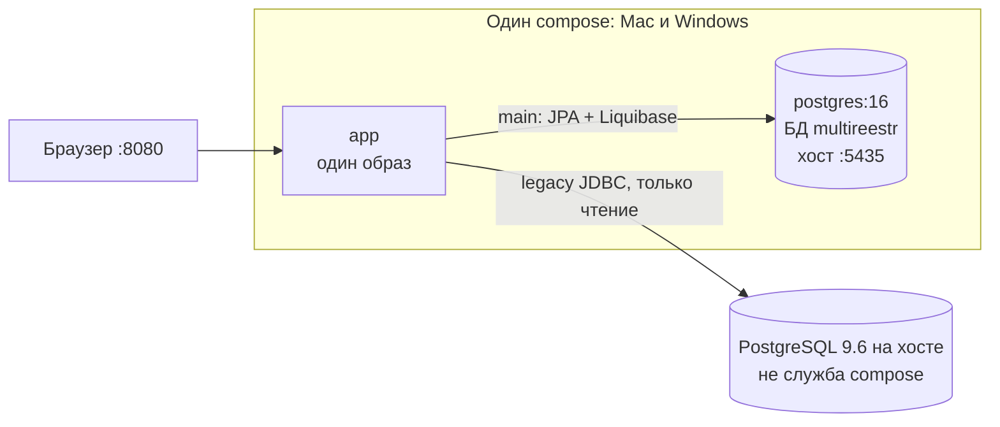

# План: Docker-развёртывание multi-reestr (Mac и Windows)

> Только план. `Dockerfile`, `docker-compose.yml` и правки кода приложения **не входят** в этот документ: реализация — после согласования владельцем.
>
> Уже действующий путь `java -jar` (и при желании только PostgreSQL 16 в контейнере) остаётся: [deploy-windows.md](deploy-windows.md), скрипт [dev/deploy/main-db-docker.ps1](../dev/deploy/main-db-docker.ps1). Docker приложения — **дополнительный** путь, не замена.
>
> Учебный контейнер дампа MultiReestr: [LEGACY_DOCKER.md](LEGACY_DOCKER.md). Модель двух БД: [model/OVERVIEW.md §8](model/OVERVIEW.md#8-развёртывание-и-базы-данных). Экран настроек: [UI.md, «Подключение к MultiReestr»](UI.md#35-администрирование).

## Содержание

1. [Цели](#1-цели)
2. [Состав стека](#2-состав-стека)
3. [Схема: main PostgreSQL 16 и legacy 9.6](#3-схема-main-postgresql-16-и-legacy-96)
4. [Переменные окружения и секреты](#4-переменные-окружения-и-секреты)
5. [Настройки legacy в интерфейсе](#5-настройки-legacy-в-интерфейсе)
6. [Mac и Windows: что отличается](#6-mac-и-windows-что-отличается)
7. [Будущие шаги реализации](#7-будущие-шаги-реализации)
8. [Критерии готовности](#8-критерии-готовности)
9. [Вне объёма](#9-вне-объёма)
10. [Согласовать с текущими документами](#10-согласовать-с-текущими-документами)

## 1. Цели

- Один и тот же образ приложения и один и тот же compose на Mac и на Windows.
- В контейнерах **нет HSQLDB**. HSQLDB остаётся только для локальной разработки в Studio / `bootRun` на Mac.
- Основная БД Jmix в Docker — всегда **PostgreSQL 16** (как в продуктиве на Windows: порт хоста `5435`, БД `multireestr`).
- Живую БД MultiReestr (PostgreSQL 9.6) **не** упаковываем в compose как продуктивный сервис. Приложение ходит к ней только чтением через второй JDBC-источник `legacy` (без JPA и Liquibase).
- Пароль и JDBC URL legacy **не** кладём в `.env` и не в секреты compose. Хост, порт, пользователь и пароль задаёт администратор на экране «Подключение к MultiReestr»; пароль хранится зашифрованным в основной БД.
- Из контейнера `app` до БД на хосте — имя `host.docker.internal` (Docker Desktop на Windows и на Mac).

## 2. Состав стека

Один файл compose, ядро одинаково везде:

| Служба | Образ | Назначение |
|---|---|---|
| `app` | **один** свой образ (будущий multi-stage Dockerfile от production-jar) | Jmix 3 / Spring Boot, порт `8080` |
| `postgres` | официальный `postgres:16` | основная БД Jmix (`multireestr`), публикация на хост **`5435`** — как [deploy-windows.md §3](deploy-windows.md#3-подготовка-windows-jdk-21-и-postgresql-16-порт-5435) и `main-db-docker.ps1` |

Имена роли и БД — те же, что уже в скриптах: пользователь `multireestr`, БД `multireestr`, контейнер/том в духе `multireestr-pg16` (точное имя службы в compose — на шаге реализации, смысл не менять).

Необязательный профиль compose (для учеников на Mac, **не** для живого продукта): служба вроде `reestr-pg96` по [LEGACY_DOCKER.md](LEGACY_DOCKER.md) / `dev/legacy/legacy-db.sh` (дамп `reestrdb`, порт хоста **`5436`**). Профиль не меняет службы `app` и `postgres` и не делает «mac-compose» отдельно от Windows.

HSQLDB в образе и в compose не запускаем.

## 3. Схема: main PostgreSQL 16 и legacy 9.6

| Хранилище | Где в Docker-пути | Как приложение ходит | Что пишет |
|---|---|---|---|
| `main` | служба `postgres` в том же compose | Jmix data store: JPA, Liquibase | пользователи, календарь, правила, журнал, реестр нарушений, ручные данные |
| `legacy` | **вне** ядра compose: живая 9.6 на Windows или учебный `reestr-pg96` на Mac | второй `DataSource` + `legacyJdbc`, обычный JDBC | ничего |

Из контейнера `app` имя `localhost` — это сам контейнер, не хост. До PostgreSQL 9.6 на машине:

| Стенд | Хост в форме UI | Порт | БД / роль |
|---|---|---|---|
| Windows, живая MultiReestr | `host.docker.internal` | `5432` (уточнить на месте, как в [deploy-windows.md](deploy-windows.md)) | `reestrdb` / `reestr_ro` |
| Mac, тестовый набор в `reestr-pg96` | `host.docker.internal` | `5436` | `reestrdb` / `reestr_ro` |

`reestr-pg96` можно поднять как сейчас скриптом `legacy-db.sh` или (позже) необязательным профилем compose. В обоих случаях `app` видит его через `host.docker.internal:5436`, если порт проброшен на хост; либо через имя службы — только если профиль включён и оба контейнера в одной сети. Для единообразия с Windows в плане считаем основным путём **`host.docker.internal` + порт на хосте**.

Роль `reestr_ro` на живой БД по-прежнему создаётся вне Docker приложения: [deploy-windows.md §4](deploy-windows.md#4-роль-reestr_ro-на-живой-бд-96), SQL из `dev/legacy/grant-readonly.sql`.

## 4. Переменные окружения и секреты

В `.env` (или `environment` / `env_file` compose) **только**:

| Переменная | Зачем |
|---|---|
| `MTR_SECRET_KEY` | ключ шифрования пароля legacy, который лежит в основной БД (`Encryptors.delux`, как в уроке 1) |
| учётные данные PostgreSQL 16 | то, без чего compose не поднимет `postgres` и `app` не подключится к **своей** БД: как минимум пароль роли `multireestr`; при необходимости имя БД и пользователя (`POSTGRES_DB` / `POSTGRES_USER` / `POSTGRES_PASSWORD` и зеркало `MAIN_DATASOURCE_*`) |

В `.env` и в секретах compose **не** держим:

- пароль `reestr_ro` и любой другой пароль legacy;
- `LEGACY_DATASOURCE_URL` / JDBC URL legacy;
- хост, порт, имя БД MultiReestr.

Запасной путь `legacy.datasource.*` из свойств (как в jar-установке) для Docker-пути **не используем как постоянный источник**: после старта `app` настройки вводятся в UI. Если для самого первого старта без UI понадобится временный URL — согласовать отдельно; в согласованном плане пароль legacy в файл окружения не кладётся.

`MTR_SECRET_KEY` — 64 hex-символа (как генерирует `set-env.ps1`). Потеряли ключ — пароль в основной БД не расшифровать: задать новый ключ и ввести пароль `reestr_ro` на экране заново.

Файл `.env` в git не коммитим (шаблон `.env.example` без секретов — на шаге реализации).

## 5. Настройки legacy в интерфейсе

После входа `admin` (и смены пароля): Администрирование → **«Подключение к MultiReestr»**.

1. Включить подключение.
2. Указать хост, порт, БД, логин, пароль — см. таблицу в §3. Не `localhost`, если приложение в контейнере.
3. «Проверить подключение» — проба из формы, рабочий пул не меняется.
4. «Сохранить и применить» — пароль шифруется `MTR_SECRET_KEY`, пишется в `MTR_LEGACY_CONNECTION_SETTINGS` в PostgreSQL 16, пул `legacy` пересобирается без перезапуска контейнера.

Порядок источников (уже в модели): включённая запись в основной БД сильнее свойств и переменных окружения. Менять порт 9.6 или пароль `reestr_ro` — снова этот экран, без правки compose.

## 6. Mac и Windows: что отличается

**Не отличается:** образ `app`, файл compose, службы `app` + `postgres`, порт main `5435`, набор переменных в `.env`.

**Отличается только цель JDBC legacy** (куда смотрит форма в UI):

- Windows: живая MultiReestr на хосте, обычно `host.docker.internal:5432`.
- Mac (учёба): дамп в `reestr-pg96`, `host.docker.internal:5436`.

Путь `java -jar` на Windows не отменяется. `main-db-docker.ps1` остаётся способом поднять **только** PostgreSQL 16, если приложение по-прежнему запускают как jar. Полный compose (`app` + `postgres`) — соседний вариант.

Ограничение Docker Desktop на Windows то же, что уже записано в [deploy-windows.md §3.3](deploy-windows.md#33-postgresql-16--docker-альтернатива): Desktop поднимается после входа пользователя.

## 7. Будущие шаги реализации

После утверждения этого плана (отдельный коммит / PR, историю уроков не переписывать):

1. **Dockerfile** (multi-stage): сборка production-jar (`bootJar` + `-Pvaadin.productionMode=true`, как `dev/deploy/build-jar.sh`) → тонкий runtime-образ с JDK 21. HSQLDB в runtime не обязателен для Docker-пути; драйвер PostgreSQL — да.
2. **compose** в корне или в `dev/deploy/`: службы `app` и `postgres:16`, том данных, проброс `8080` и `5435`, `depends_on` с ожиданием готовности Postgres. Один файл для обеих ОС.
3. **`.env.example`**: только `MTR_SECRET_KEY` и поля основной БД. Без legacy URL и пароля.
4. Необязательный профиль `legacy-pg96` (или отдельная пометка «для учёбы») — не ломая ядро.
5. Документы: раздел в [deploy-windows.md](deploy-windows.md) «путь Docker», правка [README.md](../README.md) (сейчас в тексте продуктивный порт main указан как `5433` — расходится с `5435`), ссылка из [LEGACY_DOCKER.md](LEGACY_DOCKER.md), что живую 9.6 в этот compose не переносим.
6. Проверка на Docker Desktop: Windows — `app` + `postgres`, UI на живую `:5432`; Mac — тот же compose, UI на `:5436`.

Код приложения (второй DataSource, шифрование, экран) в этом плане не меняем. Если понадобится явно прописать `extra_hosts` или таймаут JDBC — только после проверки на обеих ОС.

## 8. Критерии готовности

Считать Docker-путь готовым, когда:

- [ ] Один образ и один compose поднимают `app` + PostgreSQL 16 на Mac и на Windows без правок файла под ОС.
- [ ] В контейнерах нет HSQLDB; таблицы `MTR_*` появляются в `multireestr` на `:5435`.
- [ ] Живая MultiReestr не описана как служба compose и не требует своего контейнера в продуктиве.
- [ ] В `.env` нет пароля и URL legacy; `MTR_SECRET_KEY` и пароль main-Postgres заданы.
- [ ] С контейнера `app` поиск извещения работает после настройки UI: Windows — `host.docker.internal:5432`, Mac — `host.docker.internal:5436`.
- [ ] Инструкция `java -jar` в [deploy-windows.md](deploy-windows.md) по-прежнему верна.
- [ ] Теги уроков `lesson-01`…`lesson-10` не переписаны.

## 9. Вне объёма

- Docker-образ или служба compose для **живой** БД MultiReestr (PostgreSQL 9.6 в продуктиве).
- Пароль legacy, JDBC URL legacy, логин `reestr_ro` в `.env` / секретах compose / образе.
- Замена HSQLDB в Studio / `bootRun` на Mac.
- Служба Windows, Kubernetes, отдельный compose «только для Mac».
- Перенос `reestr-pg96` с дампом как обязательной части продуктивного стека.
- Правки истории уроков и тегов.
- Реализация Dockerfile / compose в этом PR.

## 10. Согласовать с текущими документами

Не чиним в коде, только фиксируем расхождения:

| Где | Что | Как в этом плане |
|---|---|---|
| [README.md](../README.md) | продуктивный main как `localhost:5433` | ориентир — **`5435`**, как [deploy-windows.md](deploy-windows.md) и `main-db-docker.ps1` |
| [dev/deploy/application-windows.properties.example](../dev/deploy/application-windows.properties.example) | комментарий: в jar по умолчанию `:5435` | в `application.properties` сейчас `:5436` (Mac `reestr-pg96`); на Windows jar-путь по-прежнему переопределяет legacy на `:5432` |
| [LEGACY_DOCKER.md](LEGACY_DOCKER.md) §4 | имена `LEGACY_DB_URL` / `LEGACY_DB_USER` / `LEGACY_DB_PASSWORD` | в приложении — `legacy.datasource.*` / `LEGACY_DATASOURCE_*`; для Docker-пути постоянный источник — UI, не эти переменные |
| `main-db-docker.ps1` vs будущий compose | сейчас только Postgres 16, без `app` | compose добавит `app`; скрипт можно оставить для jar-пути |

Пометки **проверить** из [deploy-windows.md](deploy-windows.md) (поведение Desktop после входа, `pg_hba` только localhost) относятся и к будущему compose.
