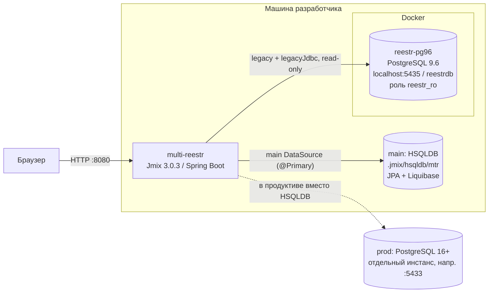

# Урок 1. Проект и подключение legacy-БД (read-only)

> Курс multi-reestr, Jmix 3.0.3. План уроков: [../LESSONS.md](../LESSONS.md). Модель данных: [../model/OVERVIEW.md](../model/OVERVIEW.md). Docker-стенд legacy: [../LEGACY_DOCKER.md](../LEGACY_DOCKER.md).
> Тег в конце урока: `lesson-01`.

## О чём этот курс

**Исходная ситуация.** Заказчик ведёт закупки по 44-ФЗ. Данные из ЕИС давно собираются программой MultiReestr: она по ИНН и периоду загружает извещения, протоколы, контракты и сведения об исполнении и складывает всё в собственную базу на PostgreSQL 9.6. С базой работает только сама программа. Найти закупку, увидеть её целиком (извещение, протоколы, контракт, оплаты) и проверить, всё ли сделано вовремя, по-прежнему приходится вручную.

**Проблема.** При проверках у заказчика находят одни и те же нарушения: пропущенные сроки, ошибки в извещениях, незакрытые этапы исполнения. Правила, по которым эти нарушения можно поймать заранее, в головах у специалистов есть, а в системе их нет.

**Что мы строим.** Мы делаем приложение multi-reestr на Jmix 3.0.3. Оно:

- **читает** базу MultiReestr и ничего в неё не пишет. Старая программа остаётся главной, мы к ней надстраиваемся;
- даёт **поиск и карточку закупки**: по номеру или по дате и названию, с выбором настоящего оригинала среди дублей и копий, со всеми блоками от извещения до оплат, с выгрузкой в Excel;
- считает **сроки по ГК РФ** (ст. 191–193) с учётом производственного календаря;
- проверяет закупки по **правилам, которые пишут сами пользователи**, и складывает нарушения в реестр. Так проблему видно до прихода проверки.

**Как устроен курс.** Курс состоит из десяти уроков, каждый заканчивается рабочим состоянием проекта и git-тегом `lesson-NN`. Первые три урока закладывают фундамент: доступ к старой базе, поиск и карточку закупки. Дальше идут календарь, сроки, правила и роли.

**Этот урок.** Здесь мы решаем первую задачу: как безопасно подключиться к чужой базе на PostgreSQL 9.6, с которой Jmix работать не умеет. Мы подключаемся так, чтобы данные нельзя было испортить даже по ошибке и чтобы приложение не падало, если эта база недоступна.

## Содержание

1. [Цель урока](#1-цель-урока)
2. [Архитектура](#2-архитектура)
3. [Подготовка окружения](#3-подготовка-окружения)
4. [Шаги реализации](#4-шаги-реализации)
5. [Защита от записи: три уровня](#5-защита-от-записи-три-уровня)
6. [Экран «Подключение к MultiReestr»](#6-экран-подключение-к-multireestr)
7. [Тесты](#7-тесты)
8. [Типичные ошибки](#8-типичные-ошибки)
9. [Контрольные вопросы и задания](#9-контрольные-вопросы-и-задания)
10. [Чеклист «урок завершён»](#10-чеклист-урок-завершён)

## 1. Цель урока

После урока приложение:

- работает на своей основной БД (`main`): в разработке это HSQLDB, в продуктиве — отдельный PostgreSQL 16+;
- **читает** унаследованную БД MultiReestr (`reestrdb`, PostgreSQL 9.6) через отдельный JDBC-пул `legacy` и `NamedParameterJdbcTemplate` с квалификатором `legacyJdbc`;
- **не может записать** в legacy: запись запрещена на трёх уровнях (драйвер, Hikari, роль БД);
- **стартует, даже если legacy недоступна**: в лог пишется предупреждение, остальные экраны работают;
- показывает в меню «Администрирование» экран **«Подключение к MultiReestr»** с кнопкой «Проверить подключение».

Почему legacy подключается не как хранилище Jmix. Jmix 3 не поддерживает PostgreSQL 9.6 в качестве своей БД. Кроме того, чужую схему нельзя трогать: Liquibase и JPA к ней не подключаем. Legacy — это обычный JDBC, а данные из неё в следующих уроках будут складываться в DTO-сущности (`@JmixEntity` без `@Store`).

## 2. Архитектура



| Хранилище | Где | Как | Что пишет |
|---|---|---|---|
| `main` | dev: HSQLDB-файл `.jmix/hsqldb/mtr`; prod: PostgreSQL 16+ | Jmix data store: JPA, Liquibase, `DataManager` | пользователи, модель данных курса |
| `legacy` | Docker `reestr-pg96`, `localhost:5435/reestrdb` | бин `DataSource` с именем `legacy` + `NamedParameterJdbcTemplate` с именем `legacyJdbc` | ничего — только чтение |

## 3. Подготовка окружения

**Порты на машине автора:** 5432 занят локальным Postgres, 5433 и 5434 тоже заняты, поэтому контейнер legacy пробрасывается на **5435**. Если у вас порт свободен, можно выбрать другой, но тогда поправьте URL (шаг 4.4).

Всё окружение поднимается одним скриптом из репозитория, [`dev/legacy/legacy-db.sh`](../../dev/legacy/legacy-db.sh). Дамп `reestrdb.dump` нужно заранее положить в `dev/legacy/`.

```bash
dev/legacy/legacy-db.sh          # то же, что up: поднять контейнер (при первом запуске — создать и восстановить дамп)
dev/legacy/legacy-db.sh status   # URL подключения и число извещений
dev/legacy/legacy-db.sh down     # остановить
dev/legacy/legacy-db.sh reset    # удалить контейнер и том, развернуть заново из дампа
```

При первом запуске `up` делает следующее:

1. создаёт контейнер `reestr-pg96` (`postgres:9.6`, порт `5435:5432`, том `reestr-pg96`) с политикой `--restart unless-stopped`;
2. ждёт `pg_isready`;
3. если базы `reestrdb` нет, создаёт её, восстанавливает дамп и заводит роль `reestr_ro` только для чтения;
4. выводит URL подключения и число строк в `notices`.

Скрипт идемпотентен: повторный запуск ничего не ломает. Благодаря политике перезапуска контейнер поднимается вместе с Docker после перезагрузки компьютера (если в Docker Desktop включён автозапуск при входе). Ручные команды, которые выполняет скрипт, разобраны в [LEGACY_DOCKER.md](../LEGACY_DOCKER.md).

Роль только для чтения создаёт `legacy-db.sh` (те же команды есть в `LEGACY_DOCKER.md`, раздел 3). В продуктиве используется [`docs/sql/legacy_readonly_user.sql`](../sql/legacy_readonly_user.sql) с другим паролем. Оба скрипта создают роль и выдают `CONNECT`, а права на таблицы берут из одного общего файла [`dev/legacy/grant-readonly.sql`](../../dev/legacy/grant-readonly.sql):

```sql
CREATE ROLE reestr_ro LOGIN PASSWORD 'CHANGE_ME';
GRANT CONNECT ON DATABASE reestrdb TO reestr_ro;
-- dev/legacy/grant-readonly.sql:
GRANT USAGE ON SCHEMA public TO reestr_ro;
GRANT SELECT ON TABLE
    notices, owners, spdogovortypes, noticeprocedureinfo, noticelots,
    noticecustomerrequirements, noticepurchaseprefs, sppurchasepreferences,
    noticeextdocs, noticespec, noticektruharacts, noticektruharactvalues,
    noticefinances, protocols, protocol_types,
    reestr, reestrspec, reestrprocedures, reestrprocexecutions
TO reestr_ro;
```

> **Правило (решение проекта).** `reestr_ro` получает `CONNECT`, `USAGE` и `SELECT` **только на таблицы, которые читают наши SQL-файлы** `src/main/resources/sql/legacy/**`. `GRANT SELECT ON ALL TABLES` и `ALTER DEFAULT PRIVILEGES` не используются. Остальные таблицы дампа, в том числе `userinfo` с учётными данными, роли не видны. В списке 19 таблиц: столько читают запросы уроков 1–3 (поиск и карточка извещения). Список задан сразу целиком, чтобы не перевыдавать права в каждом уроке. Если в следующих уроках появится запрос к новой таблице, её нужно добавить в `grant-readonly.sql` и выполнить `dev/legacy/legacy-db.sh grant` (на продуктиве — `psql -f dev/legacy/grant-readonly.sql` под владельцем базы). Скрипт сначала снимает с роли все табличные права, поэтому его можно запускать повторно, лишнего не останется.

Проверьте, что всё на месте: должно быть 335 таблиц, в `notices` — 40 строк, в `reestr` — 28. Команда приведена в `LEGACY_DOCKER.md`, раздел 5.

Дамп не хранится в репозитории. В `.gitignore` добавлено:

```
# Legacy DB dump (dev only)
dev/legacy/*.dump
```

> **Байка из жизни: откуда взялся дамп.** Исходный кластер (архив Reestr.zip) был создан **32-битной** сборкой PostgreSQL 9.6. Деревья выражений, сохранённые в системном каталоге (значения по умолчанию колонок, правила системных представлений), 64-битная сборка прочитать не смогла, и `pg_dump` падал с `expected "]" to end datum`. Деревья пришлось сконвертировать в копии кластера (оригинал не трогали), после чего дамп был снят и проверен восстановлением в чистый 9.6: 335 таблиц, число строк во всех таблицах совпало. Вывод: «старая БД» может оказаться старой не только по версии, но и по разрядности.

## 4. Шаги реализации

### 4.1. Зависимости (`build.gradle`)

```groovy
runtimeOnly 'org.hsqldb:hsqldb'
runtimeOnly 'org.postgresql:postgresql'
...
testImplementation 'org.testcontainers:testcontainers-junit-jupiter'
testImplementation 'org.testcontainers:testcontainers-postgresql'
```

Драйвер PostgreSQL нужен только во время выполнения. Версии берутся из BOM Spring Boot / Jmix. Testcontainers понадобится в тестах (раздел 7).

### 4.2. Настройки: `LegacyDataSourceProperties`

Все параметры legacy собраны в одном классе с префиксом `legacy.datasource`. В нём же заданы безопасные значения по умолчанию:

```java
@ConfigurationProperties(prefix = "legacy.datasource")
public class LegacyDataSourceProperties {
    private String url = "";
    ...
    public static class Hikari {
        private boolean readOnly = true;
        private int maximumPoolSize = 5;
        private long connectionTimeout = 10_000;
        private long initializationFailTimeout = -1;
```

**Почему так.** Пустой `url` по умолчанию означает «legacy не настроена»: на этом построено условное создание бинов (шаг 4.3). `initializationFailTimeout = -1` говорит Hikari не проверять соединение при создании пула, поэтому приложение стартует и без legacy.

### 4.3. Пул и шаблон: `LegacyDataSourceConfiguration`

```java
@Configuration
@ConditionalOnExpression("'${legacy.datasource.url:}'.length() > 0")
@EnableConfigurationProperties(LegacyDataSourceProperties.class)
public class LegacyDataSourceConfiguration {

    @Bean("legacy")
    DataSource legacyDataSource(LegacyDataSourceProperties properties) {
        HikariDataSource dataSource = new HikariDataSource();
        dataSource.setJdbcUrl(properties.getUrl());
        ...
        dataSource.setReadOnly(true);
        dataSource.addDataSourceProperty("readOnly", "true");
        dataSource.addDataSourceProperty("readOnlyMode", "always");

        LegacyDataSourceProperties.Hikari hikari = properties.getHikari();
        dataSource.setReadOnly(hikari.isReadOnly());
        ...
        dataSource.setInitializationFailTimeout(hikari.getInitializationFailTimeout());
        return dataSource;
    }

    @Bean("legacyJdbc")
    NamedParameterJdbcTemplate legacyJdbc(@Qualifier("legacy") DataSource legacyDataSource) {
        return new NamedParameterJdbcTemplate(legacyDataSource);
    }
}
```

Что здесь важно:

- **`@ConditionalOnExpression`**: если URL пуст, бинов `legacy` и `legacyJdbc` в контексте нет вообще.
- **Параметры драйвера `readOnly` / `readOnlyMode` заданы в Java** через `addDataSourceProperty`, а не в URL. Так их невозможно «забыть» в конфиге конкретного стенда.
- **Пул не помечен `@Primary`.** Основным остаётся DataSource `main`, который сгенерировал Studio. Поэтому Jmix создаёт JPA и Liquibase только для main.
- **`legacy` не прописан в `jmix.core.additional-stores`**: для Jmix это просто Spring-бин, а не хранилище.

### 4.4. `application.properties`

```properties
main.datasource.url=jdbc:hsqldb:file:.jmix/hsqldb/mtr

legacy.datasource.url=jdbc:postgresql://localhost:5435/reestrdb
legacy.datasource.username=reestr_ro
legacy.datasource.password=reestr_ro
legacy.datasource.hikari.read-only=true
legacy.datasource.hikari.maximum-pool-size=5
legacy.datasource.hikari.connection-timeout=10000
legacy.datasource.hikari.initialization-fail-timeout=-1
```

Учётные данные записаны прямо в файле: это учебный проект без секретов, а у `reestr_ro` и так есть только `SELECT`. В реальном проекте пароль хранится в переменной окружения или в хранилище секретов.

### 4.5. Информация о подключении: `LegacyDbInfo` и `LegacyDbStatus`

`LegacyDbInfo` получает `legacyJdbc` как **необязательную** зависимость, потому что бина может не быть:

```java
public LegacyDbInfo(
        @Autowired(required = false) @Qualifier("legacyJdbc") NamedParameterJdbcTemplate legacyJdbc,
        @Autowired(required = false) @Qualifier("legacy") DataSource legacyDataSource
) {
```

Метод `check()` одним запросом узнаёт всё нужное для экрана:

```java
select version() as server_version,
       current_user as db_user,
       current_database() as db_name,
       current_setting('transaction_read_only') as tx_read_only
```

Результат складывается в record `LegacyDbStatus(ok, serverVersion, currentUser, database, host, port, readOnly, responseMs, error)`. Метод **никогда не бросает исключение**: ошибка подключения превращается в `ok=false` и текст `error`. Пароль в тексте ошибки маскируется (`password=***`). Если бина `legacyJdbc` нет, в `error` попадает строка `"Legacy DataSource is not configured"`.

### 4.6. Предупреждение при старте: `LegacyAvailabilityListener`

```java
@EventListener
public void onApplicationStarted(ApplicationStartedEvent event) {
    String url = environment.getProperty("legacy.datasource.url", "");
    if (url.isBlank()) {
        log.warn("Legacy MultiReestr database is not configured (...). Application continues without it.");
        return;
    }
    try {
        Optional<String> version = legacyDbInfo.fetchPostgresVersion();
        ...
    } catch (Exception e) {
        log.warn("Legacy MultiReestr database is configured but not available: {}. Application continues without it.", ...);
    }
}
```

**Почему так.** Пул не проверяет соединение при создании (`initializationFailTimeout = -1`), а слушатель после старта делает одну пробную выборку `select version()`. Если legacy доступна, в логе появляется `INFO Connected to legacy MultiReestr database: PostgreSQL 9.6...`. Если нет — `WARN`, и приложение продолжает работать.

### 4.7. Экран и пункт меню

Экран описан в разделе 6. В `menu.xml` добавлена группа «Администрирование»:

```xml
<menu id="administration" title="msg://com.digitilius.multireestr/menu.administration.title" opened="true">
    <item view="mtr_LegacyConnectionView"
          title="msg://com.digitilius.multireestr.view.legacyconnection/legacyConnectionView.title"/>
</menu>
```

## 5. Защита от записи: три уровня

| Уровень | Где задан | Как проверить |
|---|---|---|
| **1. Драйвер pgjdbc** | `addDataSourceProperty("readOnly", "true")` и `("readOnlyMode", "always")` в `LegacyDataSourceConfiguration` | Тест `insertThroughLegacyJdbcFailsAsReadOnly`: `INSERT` через `legacyJdbc` падает с `cannot execute INSERT in a read-only transaction`. На экране поле «Только чтение» показывает `current_setting('transaction_read_only')` |
| **2. Hikari** | `dataSource.setReadOnly(hikari.isReadOnly())`, свойство `legacy.datasource.hikari.read-only=true` | Hikari вызывает `Connection.setReadOnly(true)` для каждого соединения из пула. Вместе с `readOnlyMode=always` драйвер переводит транзакции в READ ONLY и в режиме autocommit |
| **3. Роль БД `reestr_ro`** | `docs/sql/legacy_readonly_user.sql`: только `CONNECT`, `USAGE`, `SELECT` | Из psql под `reestr_ro`: `DELETE FROM notices WHERE false;` → `permission denied for relation notices`. Тест `createTableThroughLegacyJdbcFailsAsReadOnly` |

Уровни дополняют друг друга. Первые два защищают от ошибки в коде приложения. Третий защищает от всего остального, в том числе от неправильно настроенного пула или чужой утилиты, запущенной под тем же пользователем.

Самопроверка на работающем стенде:

```bash
# уровень 3: роль не может писать
docker exec -e PGPASSWORD=reestr_ro reestr-pg96 \
  psql -h localhost -U reestr_ro -d reestrdb -c "DELETE FROM notices WHERE false;"
# ожидается: ERROR:  permission denied for relation notices
```

## 6. Экран «Подключение к MultiReestr»

| | |
|---|---|
| Меню | Администрирование → Подключение к MultiReestr |
| View id / route | `mtr_LegacyConnectionView` / `legacy-connection` |
| Тип | свой `StandardView`, без данных Jmix |
| Кнопка | «Проверить подключение» (`checkButton`) |
| Поля (только чтение) | Статус, Версия сервера, Пользователь, База, Хост:порт, Только чтение, Время ответа (мс), Ошибка |

Обработчик кнопки вызывает `LegacyDbInfo.check()` и раскладывает `LegacyDbStatus` по полям:

```java
@Subscribe("checkButton")
public void onCheckButtonClick(final ClickEvent<JmixButton> event) {
    LegacyDbStatus status = legacyDbInfo.check();
    statusField.setValue(messageBundle.getMessage(status.ok() ? "status.ok" : "status.fail"));
    ...
    readOnlyField.setValue(messageBundle.getMessage(status.readOnly() ? "readOnly.yes" : "readOnly.no"));
```

Затем показывается всплывающее уведомление: зелёное «Подключено» или красное «Ошибка подключения: …» (текст обрезается до 180 символов). Разметка `legacy-connection-view.xml` — это `hbox` с кнопкой и `formLayout` из восьми `textField readOnly="true"`. Подписи лежат в `messages_ru.properties`.

Ожидаемый результат на стенде: Статус `OK`, версия `PostgreSQL 9.6.x…`, пользователь `reestr_ro`, база `reestrdb`, `localhost:5435`, «Только чтение» — `да`.

## 7. Тесты

Нужен Docker: Testcontainers сам поднимает `postgres:9.6`. Локальный стенд на 5435 для тестов не нужен.

```bash
./gradlew test
```

| Тест | Что проверяет |
|---|---|
| `LegacyDataSourceIntegrationTest` (`@SpringBootTest`, профиль `test`) | Поднимает контейнер 9.6, создаёт роль `reestr_ro` и таблицу `legacy_probe`, подставляет URL через `@DynamicPropertySource`. Проверяет, что `version()` содержит «9.6», что `INSERT` через `legacyJdbc` падает (`read-only` / `cannot execute`) и что `CREATE TABLE` падает (`read-only` / `permission denied`) |
| `LegacyDbInfoCheckTest` (без Spring) | `check()` на контейнере 9.6 возвращает `ok`, `readOnly = true`, версию 9.6, хост, порт и имя БД. На недоступном хосте `127.0.0.1:1` `check()` **не бросает исключение**, а возвращает `ok=false` с текстом ошибки |
| `LegacyOptionalStartupTest` | Контекст Jmix стартует без legacy: бина `legacyJdbc` нет, `fetchPostgresVersion()` пустой |
| `LegacyConnectionViewUiTest` (`@UiTest`) | Экран открывается, нажатие кнопки без legacy не роняет UI: «Статус» и «Ошибка» заполнены |

Фрагмент подготовки роли в интеграционном тесте:

```java
statement.execute("CREATE ROLE " + RO_USER + " LOGIN PASSWORD '" + RO_PASSWORD + "'");
...
statement.execute("CREATE TABLE legacy_probe(id int)");
statement.execute("GRANT SELECT ON legacy_probe TO " + RO_USER);
```

> Обратите внимание: `LegacyOptionalStartupTest` и `LegacyConnectionViewUiTest` рассчитаны на запуск **без** legacy. Если `legacy.datasource.url` прописан в основном `application.properties`, профиль `test` должен его переопределить пустым значением, иначе бины legacy создадутся и тесты упадут.

## 8. Типичные ошибки

| Симптом | Причина | Что делать |
|---|---|---|
| `docker: ... port is already allocated` / `bind: address already in use` | Порт занят локальным Postgres или другим контейнером | `lsof -i :5435`; выберите свободный порт в `-p` и поправьте `legacy.datasource.url` |
| На экране «Ошибка: Legacy DataSource is not configured» | `legacy.datasource.url` пуст, и бины не создались (`@ConditionalOnExpression`) | Проверьте `application.properties` и активный профиль, который мог переопределить URL пустым значением |
| `Connection refused` / timeout | Контейнер не запущен или ещё стартует | `dev/legacy/legacy-db.sh status`, затем `dev/legacy/legacy-db.sh up` |
| `password authentication failed for user "reestr_ro"` | Роль не создана или у неё другой пароль | Выполните раздел 3 `LEGACY_DOCKER.md` |
| `permission denied for relation ...` при **чтении** | Новый SQL читает таблицу, которой нет в `dev/legacy/grant-readonly.sql` (`SELECT` выдаётся только на таблицы из `sql/legacy/**`) | Добавьте таблицу в `grant-readonly.sql` и выполните `dev/legacy/legacy-db.sh grant`. `GRANT SELECT ON ALL TABLES` не используйте |
| `permission denied` при **записи** | Так и должно быть: сработал уровень 3 | — |
| «Только чтение: нет» | `transaction_read_only` в сессии выключен: Hikari read-only или `readOnlyMode` не применились (например, `legacy.datasource.hikari.read-only=false`), либо проверочный запрос выполнился вне READ ONLY-транзакции | Проверьте свойство `hikari.read-only`. Попробуйте `INSERT` через `legacyJdbc`: если он проходит до уровня роли и падает с `permission denied`, а не `read-only transaction`, значит уровни 1–2 не работают. Уровень 3 всё равно защищает |
| `pg_restore`: ошибки про `uuid-ossp` | Нестандартный образ без расширения | Используйте официальный `postgres:9.6` |

## 9. Контрольные вопросы и задания

1. Почему legacy-БД не подключается как дополнительное хранилище Jmix (`jmix.core.additional-stores`)? Назовите две причины.
2. Что произойдёт при старте, если убрать `initialization-fail-timeout=-1`, а контейнер остановлен?
3. Зачем задавать `readOnlyMode=always` в Java, а не в URL?
4. Какой из трёх уровней защиты сработает, если кто-то подключится к `reestrdb` из DBeaver под `reestr_ro`?
5. **Задание.** Остановите контейнер (`docker stop reestr-pg96`), запустите приложение и найдите в логе предупреждение. Откройте экран и нажмите «Проверить подключение». Какие поля заполнены?
6. **Задание.** Временно поставьте `legacy.datasource.hikari.read-only=false` и посмотрите, как изменится поле «Только чтение» и с какой ошибкой теперь падает `INSERT` (тест `insertThroughLegacyJdbcFailsAsReadOnly`). Верните значение обратно.
7. **Задание.** Добавьте на экран поле «Число таблиц в public» (`select count(*) from pg_tables where schemaname='public'`); ожидается 335.

## 10. Чеклист «урок завершён»

- [ ] Контейнер `reestr-pg96` работает на `localhost:5435`, `reestrdb` восстановлена (335 таблиц).
- [ ] Роль `reestr_ro` создана, `DELETE` под ней даёт `permission denied`.
- [ ] Права роли выданы через `dev/legacy/grant-readonly.sql`: `SELECT` только на 19 таблиц, `SELECT count(*) FROM userinfo` под `reestr_ro` даёт `permission denied`.
- [ ] `application.properties`: main на HSQLDB, legacy на `localhost:5435/reestrdb`.
- [ ] Бины `legacy` и `legacyJdbc` создаются только при непустом URL; `@Primary` остался у main.
- [ ] Драйвер получает `readOnly=true` и `readOnlyMode=always` из Java; Hikari `read-only=true`.
- [ ] Приложение стартует при остановленном контейнере (в логе есть `WARN ... continues without it`).
- [ ] Экран «Администрирование → Подключение к MultiReestr» показывает `OK`, `reestr_ro`, «Только чтение: да».
- [ ] `./gradlew test` зелёный.
- [ ] `dev/legacy/*.dump` не попал в git (`git status`).
- [ ] Коммит и тег:

```bash
git add -A && git commit -m "Lesson 01: legacy MultiReestr read-only DataSource"
git tag lesson-01
```
