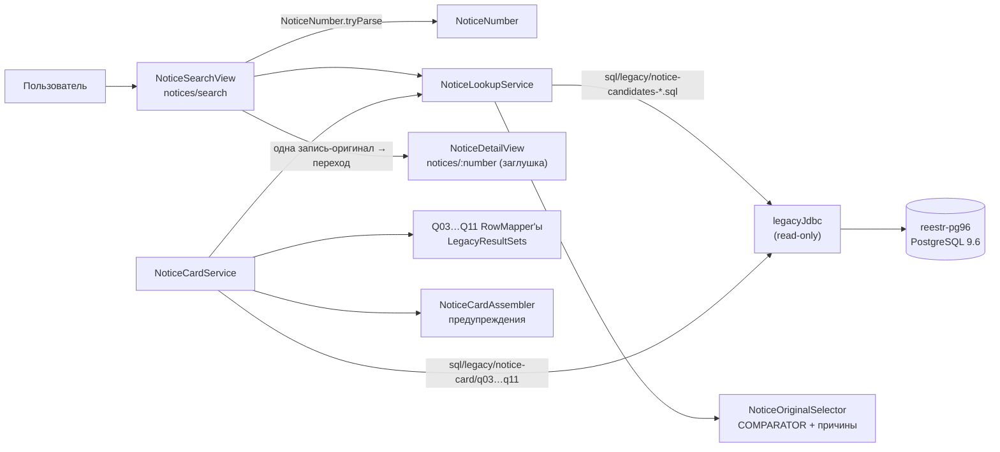

# Урок 2. DTO-модель извещения и поиск

> Курс multi-reestr, Jmix 3.0.3. План уроков: [../LESSONS.md](../LESSONS.md). Модель данных: [../model/OVERVIEW.md](../model/OVERVIEW.md). Спецификация поиска: [../legacy/notice_lookup_spec.md](../legacy/notice_lookup_spec.md), эталон: [../legacy/notice_golden.md](../legacy/notice_golden.md), запросы: [../legacy/notice_lookup.sql](../legacy/notice_lookup.sql).
> Предыдущий урок: [lesson-01-legacy.md](lesson-01-legacy.md). Тег в конце урока: `lesson-02`.

## Зачем этот урок

**Где мы.** В уроке 1 приложение научилось безопасно читать базу MultiReestr. Но пока оно умеет только проверить подключение, пользы для человека в этом ещё нет.

**Задача пользователя.** Специалисту по закупкам нужно быстро найти закупку. Обычно у него на руках номер извещения, скопированный из письма, приказа или ЕИС. Номер может быть с пробелами, со знаком «№», разбитый на группы. Иногда номера нет совсем, и человек помнит только примерную дату и что закупали.

**В чём подвох.** Старая база хранит не одну запись на закупку. В ней есть удалённые записи, локальные копии (их делают в MultiReestr, чтобы готовить документы), отменённые извещения и несколько редакций одного извещения. Если показать первую попавшуюся запись, пользователь увидит не те данные, а все дальнейшие проверки сроков и правил будут строиться на ошибке. Поэтому главное в уроке — честно выбрать **оригинал** и объяснить, почему остальные записи отброшены.

**Что получится в конце.** Будет экран поиска по номеру, а если номера нет, то по дате и названию. Из найденных записей приложение выберет оригинал и покажет причину для каждой отброшенной («Удалено», «Локальная копия», «Более старая редакция» и так далее). Ещё появится сервис, который собирает по оригиналу карточку извещения: заказчика, сроки, лоты, требования, документы и спецификацию с КТРУ. Саму карточку как экран сделаем в уроке 3, а сейчас закладываем данные для неё.

**Как проверяем.** Всё сверяется с эталоном. Это 10 реальных номеров, для каждого заранее вручную определён правильный оригинал. Тесты работают на настоящем фрагменте старой базы, а не на придуманных данных.

## Содержание

1. [Цель урока](#1-цель-урока)
2. [Архитектура](#2-архитектура)
3. [Подготовка окружения](#3-подготовка-окружения)
4. [Шаги реализации](#4-шаги-реализации)
5. [Тесты](#5-тесты)
6. [Типичные ошибки](#6-типичные-ошибки)
7. [Контрольные вопросы и задания](#7-контрольные-вопросы-и-задания)
8. [Чеклист «урок завершён»](#8-чеклист-урок-завершён)

## 1. Цель урока

После урока приложение:

- понимает номер извещения в любом «человеческом» виде (`№ 0173 1000 1702 6000 015`, с неразрывными пробелами, тире, точками) и приводит его к 19 цифрам — value object `NoticeNumber`;
- находит в legacy все записи с этим номером и **выбирает оригинал** среди дублей, удалённых записей и локальных копий, с пояснением для каждой проигравшей записи — `NoticeLookupService` + `NoticeOriginalSelector`;
- ищет без номера — по дате размещения и/или фрагменту объекта закупки;
- собирает **карточку извещения** из legacy (заказчик, сроки, лоты, требования, преференции, документы, спецификация с КТРУ и характеристиками) — `NoticeCardService`;
- показывает экран **«Извещения → Поиск извещения»**; экран карточки пока заглушка (полноценная карточка — урок 3);
- даёт доступ к поиску отдельной ролью `notice-viewer`.

**Почему DTO-сущности, а не JPA.** Данные живут в чужой БД PostgreSQL 9.6, которую Jmix не поддерживает как хранилище и которую нельзя менять (урок 1). Поэтому все классы модели этого урока — `@JmixEntity` **без** `@Store` и без таблиц: Jmix знает их метаданные (подписи, `@InstanceName`, права, отображение в гриде), а заполняем их мы сами из `NamedParameterJdbcTemplate`:

```java
@JmixEntity(name = "mtr_NoticeCandidateDto")
public class NoticeCandidateDto {

    @JmixId
    @JmixProperty(mandatory = true)
    private Integer id;

    @InstanceName
    @JmixProperty(mandatory = true)
    private String number;
```

Ключ — legacy-id типа `Integer` (в визарде Studio тип id меняется с UUID на Integer). Экземпляры создаются через `metadata.create(...)`, а не `new`, чтобы Jmix корректно инициализировал сущность.

## 2. Архитектура



| Класс | Пакет | Роль |
|---|---|---|
| `NoticeNumber` | `legacy.notice` | Value object: 19 цифр, разбор ввода. Без Spring и Jmix |
| `NoticeLookupService` | `legacy.notice` | Поиск кандидатов по номеру или по дате/предмету |
| `NoticeOriginalSelector` | `legacy.notice` | Порядок выбора оригинала и тексты причин |
| `NoticeCandidateRowMapper` | `legacy.notice` | Строка `notices` → `NoticeCandidateDto`, признак локальной копии |
| `NoticeCardService` | `legacy.notice` | Карточка: Q3–Q6, Q8–Q11 |
| `NoticeCardQ03…Q11RowMapper` | `legacy.notice` | По мапперу на запрос |
| `NoticeCardAssembler` | `legacy.notice` | Предупреждения сборки карточки |
| `LegacySqlLoader`, `LegacyResultSets` | `legacy.notice` | Загрузка SQL из ресурсов, null-безопасное чтение `ResultSet` |
| `NoticeSearchView`, `NoticeDetailView` | `view.notice` | Экраны |
| `NoticeViewerRole` | `security` | Ресурсная роль `notice-viewer` |

## 3. Подготовка окружения

Стенд тот же, что в уроке 1: контейнер `reestr-pg96` на `localhost:5436`, роль `reestr_ro`.

```bash
dev/legacy/legacy-db.sh          # поднять (при первом запуске — восстановить дамп)
dev/legacy/legacy-db.sh status   # URL и число извещений (40)
```

Новое в этом уроке — **тестовый набор данных** `src/test/resources/legacy/reestr-golden-fixture.sql`. Это не рукописный файл: его генерирует скрипт [`dev/legacy/make-test-fixture.sh`](../../dev/legacy/make-test-fixture.sh) из живой legacy-БД.

```bash
dev/legacy/legacy-db.sh up
dev/legacy/make-test-fixture.sh                 # перезаписывает тестовый набор
# другой источник или набор id:
PSQL="psql -h localhost -p 5436 -U reestr_ro -d reestrdb" IDS=3,4,10 dev/legacy/make-test-fixture.sh /tmp/f.sql
```

Что делает скрипт (только `SELECT`):

1. для каждой таблицы, которую читают SQL-файлы `src/main/resources/sql/legacy/**`, строит `CREATE TABLE` по `pg_attribute` — с настоящими типами (`character varying(19)`, `numeric(29,11)`, `timestamp(6) without time zone` …) и `NOT NULL`;
2. выгружает `INSERT` для извещений `id IN (3,4,10,17,18,21,33,37,38,40,41,42)` и всех связанных строк (по `noticeid`, по `noticektruharactid`), заказчиков из `owners`, весь `spdogovortypes` и используемые строки `sppurchasepreferences`;
3. из `owners` берёт **только** `id, name, fullname, ownerinn, ownerkpp`; `userinfo` не выгружается вообще — в тестовом наборе нет логинов и паролей;
4. выгружает только таблицы из `dev/legacy/grant-readonly.sql` (урок 1): то, что `reestr_ro` не может прочитать, в тестовый набор и не нужно. Поэтому, например, `reestroplat` и `members` не выгружаются;
5. **обезличивает персональные данные** прямо в `SELECT` (см. правило ниже).

> **Правило: персональные данные в репозиторий не попадают.** ФИО поставщиков-физлиц и 12-значные ИНН физлиц нельзя хранить в репозитории: ни в тестовом наборе, ни в эталонах, ни в документации. Физлицо определяется по 12-значному ИНН (`owners.ownerinn`, `reestr.winnerinn`). Выгружаемые ИНН физлиц нумеруются по возрастанию (N = 1, 2, …), и скрипт заменяет:
>
> - ИНН — на фиктивный, но корректный 12-значный: `lpad(N, 10, '0')` и две контрольные цифры (`000000000184` для N = 1);
> - ФИО (`owners.name`, `owners.fullname`, `reestr.winnername`, `reestr.winnerfio`) — на «Поставщик-физлицо N»;
> - адреса и телефон поставщика-физлица в `reestr` — на `NULL`.
>
> Замена детерминированная: повторный запуск скрипта даёт тот же файл (кроме строки с датой в заголовке), а тесты и эталоны ссылаются на фиктивные значения.

Результат — около 1000 `INSERT`, 19 таблиц. Файл совместим с PostgreSQL 9.6, на нём работают Testcontainers-тесты.

> **Байка из жизни: синтетический тестовый набор.** Первая версия тестового набора была написана руками: таблица `notices` из десятка колонок, предметы вида «Извещение 2026-0014», `srcguid = 'abc'`, круглые даты, а связанные строки — только для одного извещения. Все тесты были зелёными… и проверяли ровно те данные, которые придумал автор теста. Реальные типы колонок, реальные `NULL`, реальные дубли в справочнике преференций в такой тестовый набор не попадают — значит, и ошибки на них не ловятся. Правило: эталонные тесты работают на **выгрузке из настоящих данных**, а выгрузка делается скриптом, который можно перезапустить.

## 4. Шаги реализации

### 4.1. DTO-сущности

В Studio: *New → DTO Entity* для `OrganizationDto`, `NoticeCandidateDto`, `NoticeDto`, `LotDto`, `SpecPositionDto`, `KtruCharacteristicDto`, `NoticeDocumentDto`. Атрибуты, типы и **колонка «Источник (legacy)»** — в карточках `docs/model/entities/*.md`; маппинг в коде делается строго по этой колонке. Подписи атрибутов — в `messages.properties` (`com.digitilius.multireestr.entity.legacy/NoticeDto.nmck=НМЦК` и т. п.).

### 4.2. `NoticeNumber`: нормализация номера

Номер извещения 44-ФЗ — ровно 19 цифр. Пользователь вставляет его из ЕИС, из письма, из Excel — с «№», пробелами (включая неразрывный `\u00A0`), дефисами и длинными тире. Value object — обычный `record`, без Spring и Jmix:

```java
public record NoticeNumber(String value) {

    private static final Pattern DIGITS_19 = Pattern.compile("\\d{19}");
    private static final Pattern STRIP = Pattern.compile("[\\s\\u00A0]+");
    private static final Pattern PREFIX = Pattern.compile("(?i)^(?:№|no\\.?|n)\\s*");
    private static final Pattern NOISE = Pattern.compile("[\\s\\u00A0\\u2010-\\u2015\\-.]+");
```

```java
String stripped = STRIP.matcher(raw).replaceAll("");
String withoutPrefix = PREFIX.matcher(stripped).replaceFirst("");
String cleaned = NOISE.matcher(withoutPrefix).replaceAll("");
```

Порядок важен: **сначала** убираем пробелы, **потом** префикс. Иначе `" № 0173…"` с ведущим пробелом не совпадёт с якорем `^`. Конструктор record проверяет инвариант, поэтому невалидный `NoticeNumber` создать нельзя. Два входа:

- `parse(raw)` — бросает `IllegalArgumentException` («Номер извещения не задан» / «…должен содержать 19 цифр»);
- `tryParse(raw)` — возвращает `Optional`, удобно для экрана.

### 4.3. Загрузка SQL: `LegacySqlLoader`

Запросы не пишутся строками в Java — они лежат в `src/main/resources/sql/legacy/` и читаются один раз в конструкторе сервиса:

```java
static String load(ResourceLoader resourceLoader, String location) {
    Resource resource = resourceLoader.getResource(location);
    try {
        return StreamUtils.copyToString(resource.getInputStream(), StandardCharsets.UTF_8);
```

Так SQL можно открыть в DBeaver и выполнить как есть, а сравнить с эталонным `docs/legacy/notice_lookup.sql` — простым diff. В конце файлов нет `;`.

### 4.4. `NoticeCandidateRowMapper` и `LegacyResultSets`

Legacy хранит флаги как `integer` (0/1/NULL), а даты — как `timestamp without time zone`. Чтобы не повторять проверки на `NULL` в каждом маппере, они собраны в `LegacyResultSets`:

```java
static LocalDateTime localDateTime(ResultSet rs, String column) throws SQLException {
    return rs.getObject(column, LocalDateTime.class);
}
...
static Boolean flag(ResultSet rs, String column) throws SQLException {
    Integer value = integer(rs, column);
    if (value == null) {
        return null;
    }
    return value != 0;
}
```

- **Почему `getObject(..., LocalDateTime.class)`, а не `getTimestamp().toLocalDateTime()`.** `Timestamp` проходит через часовой пояс JVM; если сервер приложения и БД в разных поясах, время «уедет». pgjdbc отдаёт `timestamp without time zone` прямо как `LocalDateTime` — без пересчёта.
- **Почему не `rs.getInt()`.** Для `NULL` он вернёт `0`, и «редакция неизвестна» превратится в «редакция 0».

Признак локальной копии (запись, созданная в MultiReestr вручную, а не загруженная из ЕИС):

```java
private static final Pattern LOCAL_COPY_SUBJECT = Pattern.compile(
        "^[\\s\\u00A0]*Копия",
        Pattern.CASE_INSENSITIVE | Pattern.UNICODE_CASE
);
...
boolean delphiGuid = srcGuid != null && srcGuid.startsWith("{");
```

Без `UNICODE_CASE` флаг `CASE_INSENSITIVE` в Java работает только для латиницы: «копия» и «КОПИЯ» не совпали бы, хотя в PostgreSQL `~* '^\s*Копия'` их находит.

### 4.5. Выбор оригинала: `NoticeOriginalSelector`

Под одним номером в legacy бывает несколько записей: удалённая, локальная копия, несколько редакций. Правило описано в [notice_lookup_spec.md](../legacy/notice_lookup_spec.md) и реализовано **в Java одним компаратором** (а не в SQL), чтобы его можно было покрыть юнит-тестами и объяснить пользователю:

```java
static final Comparator<NoticeCandidateDto> COMPARATOR =
        Comparator.comparing((NoticeCandidateDto c) -> Boolean.TRUE.equals(c.getDeleted()))
                .thenComparing(c -> Boolean.TRUE.equals(c.getLocalCopy()))
                .thenComparing(c -> Boolean.TRUE.equals(c.getCanceled()))
                .thenComparing(NoticeCandidateDto::getModifVersion,
                        Comparator.nullsLast(Comparator.reverseOrder()))
                .thenComparing(NoticeCandidateDto::getPublishedAt,
                        Comparator.nullsLast(Comparator.reverseOrder()))
                .thenComparing(NoticeCandidateDto::getId,
                        Comparator.nullsLast(Comparator.naturalOrder()));
```

| Шаг | Побеждает | Причина у проигравшего |
|---|---|---|
| 1 | не удалённая | «Удалено» |
| 2 | не локальная копия (`srcguid LIKE '{%'` или предмет начинается с «Копия») | «Локальная копия» |
| 3 | не отменённая | «Отменено» |
| 4 | больший `modifversion`, `NULL` в конце | «Более старая редакция» |
| 5 | более поздний `docpublishdate`, `NULL` в конце | «Опубликовано раньше» |
| 6 | меньший `id` | «Дубль (больший id)» |

Победитель получает `chosen = true` и причину «Оригинал». `markAndSort` возвращает список, где оригинал первый. Ожидаемые результаты на реальном дампе — в [notice_golden.md](../legacy/notice_golden.md): например, `0173100017025000006` → 41 (запись 33 удалена), `0173100017026000015` → 3 (запись 42 — локальная копия).

### 4.6. `NoticeLookupService`

Сервис зависит только от `@Qualifier("legacyJdbc") NamedParameterJdbcTemplate` и создаётся, только если legacy настроена:

```java
@Service
@ConditionalOnBean(name = "legacyJdbc")
public class NoticeLookupService {
```

**Поиск по номеру** (`notice-candidates-by-number.sql`) сравнивает с тремя полями — номер мог попасть в любое из них:

```sql
WHERE trim(n.purchasenumber) = :pn
   OR regexp_replace(coalesce(n.docnumber,''),'[^0-9]','','g') = :pn
   OR trim(n.internalnumber) = :pn
```

**Поиск по дате и/или предмету** требует хотя бы одно условие (иначе `IllegalArgumentException`). Фрагмент экранируется для `ILIKE`, чтобы `%` и `_` во вводе пользователя были просто символами:

```java
return fragment
        .replace("\\", "\\\\")
        .replace("%", "\\%")
        .replace("_", "\\_");
```

Лимит — **200 номеров, а не 200 строк**. Если ограничить строки, группа дублей одного номера может обрезаться, и оригинал будет выбран из неполного набора. Поэтому SQL сначала берёт номера, потом всех кандидатов по ним:

```sql
WITH keys AS (
    SELECT trim(n.purchasenumber) AS pn,
           row_number() OVER (ORDER BY max(n.docpublishdate) DESC, trim(n.purchasenumber)) AS rn
    FROM notices n
    WHERE n.purchasenumber IS NOT NULL
      AND (CAST(:date AS date) IS NULL
           OR (n.docpublishdate >= CAST(:date AS date)
               AND n.docpublishdate < CAST(:date AS date) + 1))
      AND (CAST(:subject AS text) IS NULL OR n.predmet ILIKE '%' || CAST(:subject AS text) || '%' ESCAPE '\')
    GROUP BY trim(n.purchasenumber)
)
SELECT ... FROM notices n
JOIN keys k ON trim(n.purchasenumber) = k.pn
WHERE k.rn <= 201
```

Если номеров больше 200, UI сообщает, что результат усечён.

**Записи без номера в поиск по дате не попадают.** Строки с `purchasenumber IS NULL` — это черновики и локальные шаблоны MultiReestr, а не опубликованные извещения. Условие `n.purchasenumber IS NOT NULL` отбрасывает их уже в CTE `keys`. Без него черновики попадали бы в `keys` с `pn = NULL` и занимали место в лимите 200, а `JOIN` по `NULL` потом молча их терял: пользователь недосчитался бы настоящего номера.

`CAST(:date AS date) IS NULL` — приём для необязательного параметра: PostgreSQL должен знать тип параметра, даже когда он `NULL`.

В Java кандидаты группируются по номеру, и оригинал выбирается **в каждой группе отдельно**. Ключ группы null-безопасен (`Collectors.groupingBy` не принимает `null`):

```java
static String groupKey(NoticeCandidateDto candidate) {
    return Objects.toString(candidate.getNumber(), "#" + candidate.getId());
}
```

### 4.7. Карточка: `NoticeCardService`, Q-мапперы, `NoticeCardAssembler`

`NoticeCardService` даёт два метода:

- `loadOriginal(NoticeNumber)` — находит кандидатов через `NoticeLookupService`, берёт `chosen` и загружает карточку;
- `loadNotice(Integer)` — карточка по legacy-id; `Optional.empty()`, если извещения нет.

Каждый запрос — отдельный файл в `sql/legacy/notice-card/`, перенесённый из [notice_lookup.sql](../legacy/notice_lookup.sql), и свой `RowMapper`:

| Файл | Что читает | Тонкость |
|---|---|---|
| `q03-notice.sql` | `notices` + `owners` + способ закупки | `notices.dogovortype` — это **код ЕИС** (`spdogovortypes.rel44type`), а не `id` справочника. Отсюда `LEFT JOIN LATERAL (... WHERE d.rel44type = n.dogovortype ORDER BY d.isvisible DESC, d.id LIMIT 1)` |
| `q04-procedure.sql` | сроки подачи и процедуры | `biddingdate::date`, `summarizingdate::date` |
| `q05-lots.sql` | лоты | — |
| `q06-requirements.sql` | ИКЗ, план-график, обеспечение, срок | `relativelen` записывается, только если `≠ 0`; если строк несколько — берётся первая и пишется предупреждение |
| `q08-preferences.sql` | преференции | см. ниже |
| `q09-documents.sql` | документы | — |
| `q10-spec.sql` | спецификация | код КТРУ собирается |
| `q11-ktru.sql` | характеристики КТРУ | значения агрегируются `string_agg` |

**Код КТРУ.** В legacy он хранится частями: ОКПД2-часть и числовой суффикс. Позиция «по КТРУ», только если суффикс не 0 и не `NULL`:

```sql
CASE WHEN coalesce(s.ktrusuffixcode, 0) <> 0
     THEN coalesce(nullif(trim(s.okpd4ktru), ''), s.okpdcode) || '-' || lpad(s.ktrusuffixcode::text, 8, '0')
END AS ktru_code
```

Получается `17.23.13.193-00000002`, как в ЕИС.

**Дубли в Q8.** В справочнике `sppurchasepreferences` поле `oosid` **не уникально**. Простой `JOIN` размножает строки преференций. Поэтому группировка по коду и `min(shortname)`:

```sql
SELECT p.preftype, p.prefcode, coalesce(min(s.shortname), 'код ' || p.prefcode) AS pref_name
FROM noticepurchaseprefs p
LEFT JOIN sppurchasepreferences s ON s.oosid = p.prefcode
WHERE p.noticeid = :nid
GROUP BY p.preftype, p.prefcode
ORDER BY min(p.id)
```

Для id 3 получается «код 56116975; ET44; TR442».

**Значения характеристик (Q11)**: текстовое значение, или точное число без хвостовых нулей, или диапазон со знаками — `>= 220 < 260`. Характеристики привязываются к позициям по `noticespecid`, а для грида собирается `characteristicsText` («Плотность картона, г/м2: >= 220 < 260; …»).

**Предупреждения** вынесены в чистую функцию, чтобы их было легко тестировать без БД:

```java
static List<String> warnings(
        NoticeDto notice,
        boolean hasProcedure,
        int requirementCount,
        boolean hasSpec
) {
```

Тексты: «Нет заказчика», «Нет сведений о сроках процедуры», «Несколько блоков требований заказчика, показан первый», «Нет спецификации».

**Что отложено до урока 3.** Q7 (финансирование, `noticefinances`) в этом уроке не читается. Протоколы и контракт: `notice.setProtocols(List.of())` и `notice.setContract(null)` — их DTO и запросы (Q12–Q18) появятся вместе с полноценной карточкой.

### 4.8. Экран `NoticeSearchView`

```java
@Route(value = "notices/search", layout = MainView.class)
@ViewController(id = "mtr_NoticeSearchView")
@ViewDescriptor(path = "notice-search-view.xml")
public class NoticeSearchView extends StandardView {
```

- Пункт меню — в группе «Извещения» (`menu.xml`, `menu id="notices"`).
- Контейнер данных только для чтения: `<data readOnly="true">`; элементы кладутся через `candidatesDc.setItems(found)`.
- Кнопка «Найти» с `clickShortcut="Enter"`: поиск по Enter из любого поля.
- Если номер введён, но не разбирается — ошибка прямо на поле (`numberField.setInvalid(true)`, «Номер извещения должен содержать 19 цифр»), грид не меняется. Без номера и без даты/предмета — уведомление «Укажите номер, или дату, или фрагмент названия».
- Если найдена одна запись и она оригинал — сразу переход в карточку.
- Ошибки БД перехватываются как `DataAccessException` и показываются уведомлением «Нет подключения к MultiReestr». Сервис внедрён с `@Autowired(required = false)`: без legacy бина нет, и экран показывает то же сообщение, а не падает.
- Строка-оригинал выделяется через `partNameGenerator` и CSS темы:

```java
@Install(to = "candidatesGrid", subject = "partNameGenerator")
private String candidatesGridPartNameGenerator(final NoticeCandidateDto candidate) {
    return candidate != null && Boolean.TRUE.equals(candidate.getChosen()) ? "chosen-row" : null;
}
```

```css
vaadin-grid::part(chosen-row) {
    font-weight: var(--aura-font-weight-semibold);
}
```

(`META-INF/resources/themes/multi-reestr-aura/view/notice-search-view.css`, подключён в `styles.css`). Колонки грида: номер, дата размещения, объект закупки, редакция, удалено, отменено, копия, оригинал, пояснение; булевы колонки — иконка-галочка. Все тексты — в `messages.properties` (`com.digitilius.multireestr.view.notice/...`).

### 4.9. Заглушка `NoticeDetailView`

```java
@Route(value = "notices/:number", layout = MainView.class)
@ViewController(id = "mtr_NoticeDetailView")
```

Пока экран показывает номер из параметра маршрута и кнопку «Назад к поиску». `NoticeCardService` к нему подключим в уроке 3, когда появятся вкладки карточки.

### 4.10. Роль `NoticeViewerRole`

```java
@ResourceRole(name = "Notice viewer", code = NoticeViewerRole.CODE)
public interface NoticeViewerRole {

    String CODE = "notice-viewer";

    @ViewPolicy(viewIds = {"mtr_NoticeSearchView", "mtr_NoticeDetailView"})
    @MenuPolicy(menuIds = {"mtr_NoticeSearchView", "mtr_NoticeDetailView"})
    void screens();
```

плюс `@EntityPolicy(READ)` и `@EntityAttributePolicy(VIEW)` для всех DTO урока. Роль **не включает** `UiMinimalRole` (вход в систему, главный экран). Пользователю назначаются **обе** роли: `ui-minimal` + `notice-viewer`. Только с `notice-viewer` пользователь не сможет войти.

## 5. Тесты

Запуск: `./gradlew test`. Тесты, которым нужна БД, поднимают Testcontainers `postgres:9.6` через общий `LegacyPostgresTestSupport`:

```java
static {
    if (dockerAvailable()) {
        POSTGRES.start();
        prepareReadOnlySchema();
    }
}
```

`prepareReadOnlySchema()` создаёт роль `reestr_ro`, таблицу `legacy_probe` (урок 1), **загружает тестовый набор** и затем выдаёт права тем же скриптом, что и на стенде: `dev/legacy/grant-readonly.sql` (`SELECT` только на 19 таблиц, урок 1) плюс `SELECT` на `legacy_probe`. Если новый запрос читает таблицу не из списка, тест упадёт с `permission denied` так же, как упало бы приложение на продуктиве. Тестовый набор читается явно в UTF-8 — иначе кириллица зависела бы от `file.encoding` JVM:

```java
ScriptUtils.executeSqlScript(connection, new EncodedResource(fixture, StandardCharsets.UTF_8));
```

Классы с БД помечены `@RequireDocker`: без Docker они **падают**. Явный пропуск: `./gradlew test -PallowNoDocker` (урок 1).

| Тест | Что проверяет |
|---|---|
| `NoticeNumberTest` (без Spring) | Канонический вид, `№`, `N`, пробелы, nbsp, дефисы, длинные тире, ведущий пробел перед `№`; отказ на пустом вводе и неверной длине; `tryParse`; конструктор отклоняет невалидное значение |
| `NoticeOriginalSelectorTest` (без Spring) | Каждый шаг компаратора отдельно, `NULL` в конце, меньший id; группировка при `number = null` |
| `NoticeCandidateRowMapperTest` | «копия», «КОПИЯ», nbsp перед «Копия», `srcguid` с `{` |
| `NoticeCardAssemblerTest` | Все предупреждения при пустых блоках; ни одного — при полной карточке |
| `NoticeLookupGoldenTest` (БД) | 10 номеров из `notice-golden.csv`: число кандидатов, ровно один `chosen`, он первый, у остальных есть причина |
| `NoticeLookupServiceTest` (БД) | Поиск по номеру; неизвестный номер; только дата (`2026-04-03` → id 4); только предмет («папки» → id 3); без условий — исключение; черновик без номера не занимает место в лимите 200; при 201 номере `truncated=true` и в выдаче 200 |
| `NoticeCardServiceTest` (БД) | Карточка `0173100017026000015`: id 3, ИНН 7714841940, НМЦК 43360.20, окончание подачи 15.04.2026 10:00, «Электронный аукцион», ET44, КТРУ `17.23.13.193-00000002` с характеристиками; неизвестный id → пусто |
| `NoticeSearchViewTest` (`@UiTest`, БД) | Экран открывается; номер обычный и с пробелами → 2 строки, первая — оригинал id 3; неверный номер → ошибка поля, грид пуст |

Параметризованный эталонный тест:

```java
@ParameterizedTest(name = "{0} -> {1} ({3})")
@CsvFileSource(resources = "/legacy/notice-golden.csv", delimiter = ';', numLinesToSkip = 1)
void findByNumberChoosesGoldenOriginal(
```

> Если меняете правило выбора оригинала — сначала пересчитайте эталон запросом из `notice_golden.md` на полном дампе, потом правьте CSV, потом код. Не наоборот.

## 6. Типичные ошибки

| Симптом | Причина | Что делать |
|---|---|---|
| `" № 0173…"` не разбирается, а `"№0173…"` разбирается | Префикс снимается раньше пробелов, якорь `^` не совпадает | Сначала `STRIP`, потом `PREFIX` (шаг 4.2) |
| «копия 16» не помечается как локальная копия | `CASE_INSENSITIVE` без `UNICODE_CASE` не работает для кириллицы | Добавить `Pattern.UNICODE_CASE` |
| Преференции в карточке повторяются («ET44; ET44») | `oosid` в `sppurchasepreferences` не уникален | `GROUP BY p.preftype, p.prefcode` + `min(shortname)` |
| Способ закупки пустой или чужой | `notices.dogovortype` соединили с `spdogovortypes.id` | Соединять по `rel44type` через `LATERAL … LIMIT 1` |
| `NullPointerException: element cannot be mapped to a null key` | `groupingBy` по номеру, а `purchasenumber` бывает `NULL` | Ключ `Objects.toString(number, "#" + id)` |
| Лимит 200 в поиске по дате «съедают» черновики без номера | Нет условия `purchasenumber IS NOT NULL` | Отбрасывать строки без номера в CTE `keys` |
| В тестовом наборе видны ФИО поставщика или 12-значный ИНН физлица | Набор выгружен старой версией скрипта, без обезличивания | Перегенерировать `make-test-fixture.sh`: он заменяет ФИО на «Поставщик-физлицо N», ИНН на фиктивный |
| В поиске по дате у номера «пропал» оригинал | Лимит 200 применён к строкам, группа обрезана | Лимит на номера (CTE `keys`) |
| Время в гриде сдвинуто на несколько часов | `getTimestamp().toLocalDateTime()` при разных часовых поясах JVM и сервера | `rs.getObject(col, LocalDateTime.class)` |
| Редакция «0» вместо пустого | `rs.getInt()` для `NULL` возвращает 0 | `LegacyResultSets.integer` |
| `ERROR: could not determine data type of parameter $1` | `NULL`-параметр без типа | `CAST(:date AS date) IS NULL OR …` |
| Пользователь с ролью `notice-viewer` не может войти | Нет `UiMinimalRole` | Назначить обе роли |
| Тесты с Docker падают с «Docker is required» | Docker не запущен | Запустить Docker или `./gradlew test -PallowNoDocker` |
| Тесты зелёные, а на реальной БД ошибка | Синтетический тестовый набор | Перегенерировать `make-test-fixture.sh` |
| `permission denied for relation noticespec` в тестах | Таблицы нет в `dev/legacy/grant-readonly.sql`, или тестовый набор загружен после выдачи прав | Добавить таблицу в `grant-readonly.sql`; загружать тестовый набор до `grant-readonly.sql`. `GRANT SELECT ON ALL TABLES` не использовать |

## 7. Контрольные вопросы и задания

1. Почему DTO этого урока — `@JmixEntity` без `@Store`, а не JPA-сущности? Что Jmix даёт нам для них, а что мы делаем сами?
2. Почему выбор оригинала сделан в Java, а не `ORDER BY … LIMIT 1` в SQL?
3. Под номером `0173100017025000006` две записи. Какая станет оригиналом и какую причину получит вторая?
4. Почему лимит в поиске по дате — на номера, а не на строки?
5. Чем опасна рукописный тестовый набор, если все тесты с ней проходят?
6. **Задание.** В `NoticeNumberTest` добавьте случаи `"No. 0173100017026000015"` и `"0173.1000.1702.6000.015"`. Проходят ли они без изменения кода?
7. **Задание.** На стенде найдите запросом извещение с `modifversion IS NULL` (или временно поставьте `NULL` в копии тестового набора) и убедитесь, что `NoticeOriginalSelectorTest#prefersGreaterModifVersionAndNullsLast` описывает именно это поведение.
8. **Задание.** Добавьте в `NoticeCardServiceTest` проверку `getWarnings()` для id 3 (ожидается пустой список) и для одного из 12 извещений тестового набора, у которого нет спецификации или сроков процедуры (найдите его запросом).
9. **Задание.** Перегенерируйте тестовый набор с `IDS=3,4` и посмотрите `git diff`: какие тесты упадут и почему?

## 8. Чеклист «урок завершён»

- [ ] DTO-сущности созданы в Studio, атрибуты соответствуют `docs/model/entities/*.md`.
- [ ] `NoticeNumber` разбирает `№`, пробелы, nbsp, дефисы и тире; `NoticeNumberTest` зелёный.
- [ ] `NoticeLookupService` использует только `legacyJdbc`; SQL лежит в `sql/legacy/`, загружается `LegacySqlLoader`.
- [ ] Оригинал выбирается `NoticeOriginalSelector.COMPARATOR`, у проигравших есть причина.
- [ ] Поиск по дате/предмету: экранирование `%`/`_`, диапазон даты `>= d AND < d + 1`, лимит 200 номеров с сообщением об усечении.
- [ ] `NoticeCardService` собирает карточку id 3: заказчик, сроки, лоты, ИКЗ, преференции без дублей, документы, КТРУ `17.23.13.193-00000002` с характеристиками.
- [ ] Экран «Извещения → Поиск извещения» работает: Enter, ошибки ввода, «Нет подключения к MultiReestr», выделение оригинала, автопереход.
- [ ] Роль `notice-viewer` создана; тестовый пользователь с `ui-minimal` + `notice-viewer` видит только поиск.
- [ ] Тестовый набор сгенерирован `dev/legacy/make-test-fixture.sh`, в нём нет `userinfo` и учётных данных.
- [ ] Docker запущен, `./gradlew test` зелёный **без пропущенных** тестов.
- [ ] Коммит и тег:

```bash
git add -A && git commit -m "Lesson 02: notice DTO model, lookup and search screen"
git tag lesson-02
```
