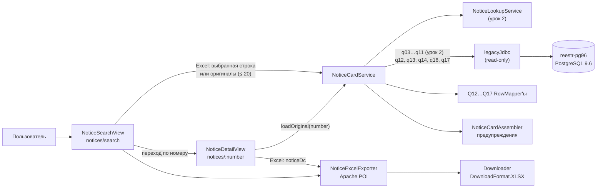

# Урок 3. Карточка извещения и выгрузка в Excel

> Курс multi-reestr, Jmix 3.0.3. План уроков: [../LESSONS.md](../LESSONS.md). Экраны: [../UI.md](../UI.md). Модель данных: [../model/OVERVIEW.md](../model/OVERVIEW.md), DTO урока: [ProtocolDto](../model/entities/ProtocolDto.md), [ContractDto](../model/entities/ContractDto.md), [ContractItemDto](../model/entities/ContractItemDto.md), [ExecutionDto](../model/entities/ExecutionDto.md). Спецификация запросов: [../legacy/notice_lookup_spec.md](../legacy/notice_lookup_spec.md), эталон: [../legacy/notice_golden.md](../legacy/notice_golden.md), запросы: [../legacy/notice_lookup.sql](../legacy/notice_lookup.sql).
> Предыдущий урок: [lesson-02-notice-search.md](lesson-02-notice-search.md). Тег в конце урока: `lesson-03`.

## Зачем этот урок

**Где мы.** После урока 2 приложение находит извещение по номеру и честно выбирает оригинал среди дублей и копий. `NoticeCardService` уже собирает данные извещения, но смотреть их негде: экран `notices/:number` пока заглушка, которая показывает только номер.

**Задача пользователя.** Специалисту нужно открыть закупку и на одном экране увидеть всё: что закупали, какие сроки, какие протоколы были, с кем и на какую сумму заключили контракт, что принято и что оплачено. А потом выгрузить это в Excel, чтобы приложить к служебной записке или сверить с отчётом.

**В чём подвох.** Контракт, протоколы и исполнение в старой базе связаны с извещением не ключом, а **текстом номера** (`trim(...) = номер`). Контрактов по номеру бывает несколько, в том числе удалённые. Приёмки и оплаты лежат в одной таблице `reestrprocexecutions` и различаются только полем `executiontype`, а у каждого вида свои колонки номера, даты и суммы. Если их перепутать, «Оплачено» превратится в сумму приёмок. Есть и ловушка самого Jmix 3.0.3: метод, в котором удобно читать параметр маршрута, у `StandardView` просто не вызывается, и карточка открывается пустой.

**Что получится в конце.** Будет карточка извещения с плашкой предупреждений, шапкой и четырьмя вкладками: «Извещение», «Спецификация», «Протоколы», «Контракт и исполнение». Если контракта нет, вместо него будет надпись «Контракт не найден». Если номер неверный или извещения нет, будет понятное сообщение вместо пустого экрана. Кнопка «Excel» есть в карточке и на экране поиска. Файл получается на своём экспортёре на Apache POI, в нём два листа, как в образце `notices.xlsx`.

**Как проверяем.** Значения карточки и Excel сверяются с эталоном урока 3 из `notice_golden.md` (протоколы, контракт, снижение, приёмки, оплачено). UI-тесты открывают карточку через навигацию по маршруту, как это делает пользователь. Всё работает на том же тестовом наборе данных из настоящей базы, что и в уроке 2.

## Содержание

1. [Цель урока](#1-цель-урока)
2. [Архитектура](#2-архитектура)
3. [Подготовка окружения](#3-подготовка-окружения)
4. [Шаги реализации](#4-шаги-реализации)
5. [Тесты](#5-тесты)
6. [Типичные ошибки](#6-типичные-ошибки)
7. [Контрольные вопросы и задания](#7-контрольные-вопросы-и-задания)
8. [Чеклист «урок завершён»](#8-чеклист-урок-завершён)

## 1. Цель урока

После урока приложение:

- дочитывает к карточке **протоколы** (Q12), **контракт** с позициями (Q13–Q14), **исполнение** (Q16) и **сумму оплат** (Q17). Всё это делает `NoticeCardService`, по одному RowMapper'у на запрос;
- показывает **карточку извещения** `NoticeDetailView` (маршрут `notices/:number`): плашка предупреждений, шапка, вкладки «Извещение» (лоты, финансирование, документы), «Спецификация» (позиции и характеристики КТРУ), «Протоколы», «Контракт и исполнение»;
- загружает карточку **один раз** при открытии и аккуратно показывает «не найдено», «неверный номер» и «нет подключения»;
- выгружает извещения в **Excel** (`NoticeExcelExporter`). Выгрузить можно одно извещение из карточки или до 20 оригиналов с экрана поиска.

Модель та же, что в уроке 2: все новые классы (`ProtocolDto`, `ContractDto`, `ContractItemDto`, `ExecutionDto`, `NoticeFinanceDto`) — `@JmixEntity` **без** `@Store`. Мы заполняем их из `legacyJdbc` и создаём через `metadata.create(...)`:

```java
@Override
public ProtocolDto mapRow(ResultSet rs, int rowNum) throws SQLException {
    ProtocolDto protocol = metadata.create(ProtocolDto.class);
    protocol.setId(rs.getInt("id"));
    protocol.setNumber(rs.getString("protocolnumber"));
    protocol.setDate(LegacyResultSets.localDate(rs, "protocoldate"));
    protocol.setTypeCode(LegacyResultSets.integer(rs, "protocoltype"));
    protocol.setTypeName(rs.getString("protocol_type_name"));
    return protocol;
}
```

## 2. Архитектура



| Класс / файл | Пакет | Роль |
|---|---|---|
| `NoticeCardService` | `legacy.notice` | Карточка: Q3–Q11 из урока 2, плюс протоколы, контракт, исполнение, оплачено |
| `NoticeCardQ12RowMapper` | `legacy.notice` | `protocols` → `ProtocolDto` |
| `NoticeCardQ13RowMapper` | `legacy.notice` | `reestr` + `owners` → `ContractDto` с заказчиком и поставщиком |
| `NoticeCardQ14RowMapper` | `legacy.notice` | `reestrspec` → `ContractItemDto` |
| `NoticeCardQ16RowMapper` | `legacy.notice` | `reestrprocexecutions` + `reestrprocedures` → `ExecutionDto` (приёмка или оплата) |
| `NoticeCardQ17RowMapper` | `legacy.notice` | Сумма оплат, `NULL` → `0` |
| `NoticeCardSql` | `legacy.notice` | Пути к SQL-файлам, добавлены `Q12`, `Q13`, `Q14`, `Q16`, `Q17` |
| `NoticeExcelExporter` | `legacy.notice` | Книга `.xlsx`, листы «Извещения» и «Спецификации» |
| `NoticeDetailView` | `view.notice` | Карточка извещения, кнопка «Excel» |
| `NoticeSearchView` | `view.notice` | Добавлена кнопка «Excel» |
| `sql/legacy/notice-card/q12…q17*.sql` | ресурсы | Запросы урока |
| `view/notice-detail-view.css` | тема `multi-reestr-aura` | Плашка предупреждений, заголовки разделов, строка «Оплачено» |

Q15 (участники, `members`) в этом уроке не читается: участники в базе почти не загружены, известен только победитель (см. `notice_lookup_spec.md`).

## 3. Подготовка окружения

Стенд тот же, что в уроках 1–2: контейнер `reestr-pg96` на `localhost:5435`, роль `reestr_ro`.

```bash
dev/legacy/legacy-db.sh          # поднять
dev/legacy/legacy-db.sh status   # URL и число извещений
```

Тестовый набор данных `src/test/resources/legacy/reestr-golden-fixture.sql` перегенерировать не нужно. Скрипт [`dev/legacy/make-test-fixture.sh`](../../dev/legacy/make-test-fixture.sh) уже выгружает все таблицы, которые читают SQL-файлы `sql/legacy/**`, в том числе `protocols`, `reestr`, `reestrspec`, `reestrprocedures`, `reestrprocexecutions`. Если вы добавите запрос к новой таблице, перезапустите скрипт.

Новая зависимость в `build.gradle`, **без версии**:

```groovy
implementation 'org.apache.poi:poi-ooxml'
```

Версию задаёт BOM Jmix, через него Apache POI уже приходит в проект. Платные дополнения (например, `gridexport`) не нужны: свою книгу мы собираем сами, потому что формат задан образцом `notices.xlsx`, а не колонками грида.

Для тестов нужен запущенный **Docker**: тесты с БД поднимают Testcontainers `postgres:9.6`, а без Docker они пропускаются.

## 4. Шаги реализации

### 4.1. DTO протоколов, контракта и исполнения

В Studio: *New → DTO Entity* для `ProtocolDto`, `ContractDto`, `ContractItemDto`, `ExecutionDto` (и `NoticeFinanceDto` для финансирования). Атрибуты и колонку «Источник (legacy)» берите из `docs/model/entities/*.md`. Связи:

- `NoticeDto.protocols` → `List<ProtocolDto>`;
- `NoticeDto.contract` → `ContractDto`, а в нём `supplier`, `items`, `executions`;
- `ExecutionDto.kind` — enum `ExecutionKind` (`ACCEPTANCE` / `PAYMENT`).

### 4.2. Протоколы (Q12)

Протоколы ищутся по **тексту номера** извещения, а не по `noticeid`:

```sql
SELECT p.id,
       p.protocolnumber,
       p.protocoldate,
       p.protocoltype,
       coalesce(t.name, 'тип ' || coalesce(p.protocoltype::text, '?') || ' (нет в справочнике)') AS protocol_type_name
FROM protocols p
LEFT JOIN protocol_types t ON t.id = p.protocoltype
WHERE trim(p.purchasenumber) = trim(:npn)
ORDER BY p.protocolnumber, p.id
```

Если типа нет в справочнике, строка не теряется. В колонке типа будет, например, «тип 7 (нет в справочнике)». Если у извещения нет номера, сервис сразу возвращает пустой список и в базу не ходит.

### 4.3. Контракт и его позиции (Q13–Q14)

```sql
SELECT r.id,
       trim(r.contractnumber) AS contract_number,
       ...
       round((1 - r.contractcena / nullif(n.firstmaxcena, 0)) * 100, 1) AS reduction_pct,
       ...
FROM reestr r
LEFT JOIN notices n ON n.id = :nid
LEFT JOIN owners o ON o.id = r.ownerid
LEFT JOIN owners w ON w.id = r.winnerid
WHERE trim(r.tendernumber) = trim(:npn)
  AND coalesce(r.isdeleted, 0) = 0
ORDER BY r.contractdate DESC NULLS LAST, r.id DESC
LIMIT 1
```

Правила отбора контракта:

1. связь с извещением — `trim(reestr.tendernumber) = trim(номер)`;
2. удалённые не берём: `coalesce(isdeleted, 0) = 0` (`NULL` считается «не удалён»);
3. из оставшихся берём самый поздний `contractdate` (`NULL` в конце), при равенстве — больший `id`;
4. снижение, % = `round((1 − contractcena / firstmaxcena) · 100, 1)`, где НМЦК (`firstmaxcena`) берётся из **извещения-оригинала** (`:nid`). Если НМЦК равна 0, `nullif` даёт `NULL`, и снижение остаётся пустым, без деления на ноль;
5. заказчик — `owners` по `reestr.ownerid`, поставщик — `owners` по `reestr.winnerid`. Если `id` пустой, маппер возвращает `null`, а не пустую организацию.

Позиции контракта (Q14) берутся из `reestrspec` по `reestrid`. Код КТРУ собирается так: если `ktrusuffixcode` не 0, то это `okpd4ktru` (или `okpdcode`, если `okpd4ktru` пустой) + `-` + суффикс, дополненный нулями до 8 знаков. Иначе код пустой:

```sql
CASE WHEN coalesce(s.ktrusuffixcode, 0) <> 0
     THEN coalesce(nullif(trim(s.okpd4ktru), ''), s.okpdcode) || '-' || lpad(s.ktrusuffixcode::text, 8, '0')
END AS ktru_code
```

В сервисе позиции, исполнение и оплаченную сумму читаем только тогда, когда контракт найден:

```java
ContractDto contract = found.get(0);
Map<String, Object> contractParams = Map.of("rid", contract.getId());
contract.setItems(legacyJdbc.query(q14Sql, contractParams, q14RowMapper));
contract.setExecutions(legacyJdbc.query(q16Sql, contractParams, q16RowMapper));
contract.setPaidTotal(loadPaidTotal(contractParams));
return contract;
```

### 4.4. Исполнение: приёмки и оплаты (Q16)

Документы исполнения лежат в `reestrprocexecutions` и привязаны к этапам `reestrprocedures`, а этапы — к контракту:

```sql
FROM reestrprocexecutions e
JOIN reestrprocedures p ON p.id = e.reestrproceduresid
WHERE p.reestrid = :rid
ORDER BY coalesce(e.pd_documentdate, e.de_documentdate), e.id
```

У приёмки и оплаты разные колонки. Правило в `NoticeCardQ16RowMapper`:

```java
Integer executionType = LegacyResultSets.integer(rs, "executiontype");
boolean payment = executionType != null && executionType == 1;
execution.setKind(payment ? ExecutionKind.PAYMENT : ExecutionKind.ACCEPTANCE);
execution.setStageNumber(LegacyResultSets.integer(rs, "ordinalnumber"));
execution.setStageEndDate(LegacyResultSets.localDate(rs, "stageenddate"));
execution.setPenaltyInfo(rs.getString("penaltyinfo"));
execution.setDocName(rs.getString("pd_documentname"));
if (payment) {
    execution.setDocNumber(rs.getString("pd_documentnum"));
    execution.setDocDate(LegacyResultSets.localDate(rs, "pd_documentdate"));
    execution.setAmount(rs.getBigDecimal("paid"));
} else {
    execution.setDocNumber(rs.getString("de_documentnum"));
    execution.setDocDate(LegacyResultSets.localDate(rs, "de_documentdate"));
    execution.setAmount(rs.getBigDecimal("de_fulfilmentsum"));
}
execution.setAcceptDate(LegacyResultSets.localDate(rs, "de_deliveryacceptdate"));
execution.setImproperExecution(rs.getString("improperexecutiontext"));
```

Что здесь важно:

- **оплата** — только `executiontype = 1`. Всё остальное, включая `NULL`, считается **приёмкой**;
- у оплаты номер, дата и сумма берутся из `pd_documentnum`, `pd_documentdate`, `paid`, у приёмки — из `de_documentnum`, `de_documentdate`, `de_fulfilmentsum`;
- `docName` («Платежное поручение» и т. п.) всегда читается из `pd_documentname`, для обоих видов. У приёмок это поле обычно пустое;
- `acceptDate` всегда читается из `de_deliveryacceptdate`;
- приёмки с нулевой суммой **не отбрасываются**: они остаются в списке (так же в эталоне `notice_golden.md`);
- порядок — по дате документа (платёжного или приёмки), затем по `id`.

### 4.5. «Оплачено» (Q17)

```sql
SELECT coalesce(sum(e.paid) FILTER (WHERE e.executiontype = 1), 0) AS paid_total
FROM reestrprocexecutions e
JOIN reestrprocedures p ON p.id = e.reestrproceduresid
WHERE p.reestrid = :rid
```

«Оплачено» — это сумма `paid` **только по оплатам** (`executiontype = 1`), а не сумма приёмок. Если оплат нет, получается `0`: так делает `coalesce` в SQL, а `NoticeCardQ17RowMapper` и `loadPaidTotal` ещё раз заменяют `NULL` на `BigDecimal.ZERO`. На эталоне это хорошо видно у `0173100017024000008`: 12 документов приёмки и 13 платёжных документов, «Оплачено» = сумма 13 платежей.

`FILTER (WHERE …)` есть в PostgreSQL начиная с 9.4, поэтому на 9.6 запрос работает.

### 4.6. Правило Q4: пустые сроки

Сроки процедуры (Q4, `noticeprocedureinfo`) читаются как в уроке 2: даты начала и окончания подачи заявок — `LocalDateTime`, дата аукциона и дата подведения итогов приводятся к дате (`biddingdate::date`, `summarizingdate::date`). Берётся первая строка. Если строки нет, поля карточки остаются пустыми.

Предупреждение «Нет сведений о сроках процедуры» `NoticeCardAssembler` выдаёт, когда **все четыре** даты пустые. Неважно, нет ли строки совсем или строка есть, но даты в ней `NULL`:

```java
private static boolean hasProcedure(NoticeDto notice) {
    return notice.getApplicationsFrom() != null
            || notice.getApplicationsTo() != null
            || notice.getBiddingDate() != null
            || notice.getSummarizingDate() != null;
}
```

Достаточно одной заполненной даты, и предупреждения не будет. В Excel пустой срок даёт пустую ячейку, а не «01.01.1900».

Полный список предупреждений сборки: «Нет заказчика», «Нет сведений о сроках процедуры», «Несколько блоков требований заказчика, показан первый», «Нет спецификации», «Нет данных о финансировании».

### 4.7. Экран `NoticeDetailView`: разметка

Данные экрана — одно дерево контейнеров вокруг `noticeDc`, только для чтения:

```xml
<data readOnly="true">
    <instance id="noticeDc" class="com.digitilius.multireestr.entity.legacy.NoticeDto">
        <instance id="customerDc" property="customer"/>
        <collection id="lotsDc" property="lots"/>
        <collection id="financesDc" property="finances"/>
        <collection id="documentsDc" property="documents"/>
        <collection id="itemsDc" property="items">
            <collection id="characteristicsDc" property="characteristics"/>
        </collection>
        <collection id="protocolsDc" property="protocols"/>
        <instance id="contractDc" property="contract">
            <instance id="supplierDc" property="supplier"/>
            <collection id="contractItemsDc" property="items"/>
            <collection id="executionsDc" property="executions"/>
        </instance>
    </instance>
</data>
```

`characteristicsDc` вложен в `itemsDc`. Поэтому при выборе позиции в гриде спецификации внизу сами показываются её характеристики КТРУ.

Компоновка экрана:

- **Кнопки:** «Назад к поиску» (`backBtn`, переход через `ViewNavigators`) и «Excel» (`excelBtn`, `enabled="false"` в XML).
- **`notFoundBox`** — сообщение вместо карточки (`notFoundSpan`).
- **`cardBox`**, внутри него:
  - **`warningsBox`** — плашка предупреждений, по одному `Span` на предупреждение. Если предупреждений нет, плашка скрыта;
  - **шапка** `headerForm`: номер, закон, способ (`methodName`), НМЦК, дата публикации, редакция, заказчик (название и ИНН), объект закупки и ссылка на ЕИС (`Anchor` с `target=_blank`, скрывается при пустом `eisUrl`);
  - вкладка **«Извещение»**: ИКЗ, позиция плана, сроки подачи заявок, дата аукциона и подведения итогов, обеспечения, срок исполнения, площадка, преференции. Под ними три грида: «Лоты», «Финансирование» (КБК, год, сумма) и «Документы» (ссылка-`Anchor` из `@Supply` рендерера);
  - вкладка **«Спецификация»**: «Позиции спецификации» (`itemsGrid`, включая запреты и ограничения и текст характеристик) и «Характеристики позиции» (`characteristicsGrid`: название, значение, из ЕИС, обязательная);
  - вкладка **«Протоколы»**: номер, дата (`dd.MM.yyyy`), тип;
  - вкладка **«Контракт и исполнение»**: `noContractBox` с текстом «Контракт не найден» или `contractBox`. В `contractBox` есть форма контракта (номер, реестровый номер, даты, цена, снижение, оплачено, поставщик и ИНН), «Позиции контракта», «Исполнение» (вид, этап, окончание этапа, документ `docName`, номер, дата документа, дата приёмки, сумма, неустойка, ненадлежащее исполнение) и строка «Оплачено» (`paidTotalValue`).

### 4.8. Ловушка: параметр маршрута в Jmix 3.0.3

В уроке 2 заглушка читала номер так:

```java
// НЕПРАВИЛЬНО: в Jmix 3.0.3 StandardView этот метод не вызывает
@Override
protected void processBeforeEnterInternal(BeforeEnterEvent event) {
    super.processBeforeEnterInternal(event);
    number = event.getRouteParameters().get("number").orElse("");
}
```

Код компилируется, ошибок нет, но `number` остаётся пустой строкой: карточка всегда открывается с сообщением «Номер извещения должен содержать 19 цифр». Сначала это пытались обойти: номер дополнительно передавали через `withAfterNavigationHandler` и перезагружали карточку. Так карточка грузилась дважды, а UI-тест проверял обходной путь, а не настоящий переход. В итоговом коде обход убран, номер читается в `beforeEnter`, **до** `super.beforeEnter`:

```java
// ПРАВИЛЬНО
private String number = "";

@Override
public void beforeEnter(BeforeEnterEvent event) {
    number = event.getRouteParameters().get("number").orElse("");
    super.beforeEnter(event);
}

@Subscribe
public void onBeforeShow(final BeforeShowEvent event) {
    setPageTitle(messageBundle.formatMessage("noticeDetailView.title", number));
    loadCard();
}
```

Порядок важен: `super.beforeEnter` запускает жизненный цикл экрана, и `BeforeShowEvent` уже должен видеть номер. Карточка загружается **один раз**, в `onBeforeShow`. Экран поиска переходит в карточку обычным `withRouteParameters(new RouteParameters("number", ...))`, без дополнительных обработчиков.

### 4.9. Загрузка и отображение карточки

```java
private void loadCard() {
    Optional<NoticeNumber> parsed = NoticeNumber.tryParse(number);
    if (parsed.isEmpty()) {
        showNotFound(messageBundle.getMessage("noticeNumberInvalid"));
        return;
    }
    if (noticeCardService == null) {
        log.error("Legacy MultiReestr is not configured");
        showNotFound(messageBundle.getMessage("legacyConnectionError"));
        return;
    }
    try {
        Optional<NoticeDto> found = noticeCardService.loadOriginal(parsed.get());
        if (found.isEmpty()) {
            showNotFound(messageBundle.getMessage("noticeNotFound"));
            return;
        }
        showNotice(found.get());
    } catch (DataAccessException e) {
        log.error("Legacy MultiReestr is not available", e);
        showNotFound(messageBundle.getMessage("legacyConnectionError"));
    }
}
```

- Номер из адресной строки разбирается тем же `NoticeNumber.tryParse`, что и в поиске. Если он не разобрался — «Номер извещения должен содержать 19 цифр».
- `loadOriginal` выбирает **оригинал** по правилам урока 2 (`chosen = true`) и собирает по нему карточку. Если номера нет в базе — «Извещение не найдено».
- Если бина `NoticeCardService` нет (`@Autowired(required = false)`) или база недоступна (`DataAccessException`) — «Нет подключения к MultiReestr».
- `showNotFound` показывает `notFoundBox`, скрывает `cardBox` и выключает «Excel».

`showNotice` включает «Excel» и раскладывает данные по контейнерам. `null`-списки заменяются пустыми (`orEmpty`). Если контракта нет:

```java
ContractDto contract = notice.getContract();
if (contract == null) {
    contractBox.setVisible(false);
    noContractBox.setVisible(true);
    contractDc.setItem(null);
    supplierDc.setItem(null);
    contractItemsDc.setItems(List.of());
    executionsDc.setItems(List.of());
    paidTotalValue.setText("");
    selectFirstItem();
    return;
}
```

Иначе контракт показывается, а «Оплачено» выводится как `amount.stripTrailingZeros().toPlainString()`, то есть `16000`, а не `16000.00000000000`. В конце `selectFirstItem()` выделяет первую позицию спецификации, чтобы характеристики были видны сразу. Если контейнер характеристик после этого пуст, он заполняется характеристиками первой позиции вручную.

Стили (`view/notice-detail-view.css`, подключён в `styles.css`): `.notice-warnings` — плашка с цветом предупреждения и полосой слева, `.notice-empty-message`, `.section-title`, `.paid-total-row` (полужирный).

### 4.10. `NoticeExcelExporter`

Компонент Spring в пакете `legacy.notice`. Он не зависит от экрана: получает `List<NoticeDto>`, возвращает `byte[]` (`writeBytes`) или пишет в `OutputStream` (`write`). Книга — `XSSFWorkbook`, два листа:

```java
public static final String SHEET_NOTICES = "Извещения";
public static final String SHEET_SPECIFICATIONS = "Спецификации";
public static final int MAX_NOTICES = 20;
public static final String NO_CONTRACT_NOTE = "Контракт не найден";
```

**Лист «Извещения»** — одна строка на извещение, 18 колонок:

| № | Заголовок | Значение |
|---|---|---|
| 1 | Номер извещения | `number` |
| 2 | Дата публикации | `publishedAt`, дата-время |
| 3 | Объект закупки | `subject` |
| 4 | Способ | `methodName` |
| 5 | НМЦК, руб. | `nmck`, `#,##0.00` |
| 6 | Заказчик | `customer.name` |
| 7 | Лотов | число лотов |
| 8 | Позиций | число позиций спецификации |
| 9 | Окончание подачи заявок | `applicationsTo`, дата-время |
| 10 | Протоколы | номера протоколов через `", "` |
| 11 | Победитель / поставщик | `«название (ИНН …)»` поставщика контракта |
| 12 | № контракта | `contract.number` |
| 13 | Дата контракта | `contract.date`, `dd.MM.yyyy` |
| 14 | Цена контракта, руб. | `#,##0.00` |
| 15 | Снижение, % | `0.0` |
| 16 | Оплачено, руб. | `paidTotal`, `#,##0.00` |
| 17 | Документов приёмки | число `ExecutionDto` с `kind = ACCEPTANCE` (с нулевыми суммами тоже) |
| 18 | Примечания | см. ниже |

Если контракта нет, колонки 11–17 остаются **пустыми** (`col += 7`), а в «Примечания» добавляется «Контракт не найден».

**Лист «Спецификации»** — одна строка на позицию спецификации каждого извещения, 11 колонок: «Номер извещения», «Дата» (дата публикации), «№ п/п», «Наименование», «ОКПД2», «КТРУ», «Кол-во», «Ед.», «Цена, руб.», «Сумма, руб.», «Характеристики КТРУ» (`characteristicsText`).

Правила ячеек:

- **Даты — настоящие даты Excel**, а не строки. Дата-время обрезается до минут (`truncatedTo(ChronoUnit.MINUTES)`), формат `dd.MM.yyyy HH:mm`. Дата контракта записывается в формате `dd.MM.yyyy`. По таким колонкам в Excel работают сортировка и фильтр по датам.
- **Деньги** — число с форматом `#,##0.00`, снижение — `0.0`. Счётчики и количество — числа без формата.
- `null` и пустые строки не пишутся вовсе: ячейка остаётся пустой.

```java
private static void writeDateTime(Row row, int col, LocalDateTime value, CellStyle style) {
    if (value == null) {
        return;
    }
    Cell cell = row.createCell(col);
    cell.setCellValue(value.truncatedTo(ChronoUnit.MINUTES));
    cell.setCellStyle(style);
}
```

**«Примечания»** — предупреждения сборки карточки (`warnings`, без пустых) и, если контракта нет, «Контракт не найден». Всё соединяется через `"; "`. Если частей нет, ячейка пустая:

```java
if (notice.getContract() == null) {
    parts.add(NO_CONTRACT_NOTE);
}
if (parts.isEmpty()) {
    return null;
}
return String.join("; ", parts);
```

**Оформление листа** (`finishSheet`): заголовки полужирные, с переносом; первая строка закреплена (`createFreezePane(0, 1)`); автофильтр на диапазоне от заголовка до последней строки; ширина каждой колонки = `min(max(10, длина + 2), 60)` символов. Длина — самый длинный текст в колонке, как его показывает `DataFormatter`:

```java
int width = Math.min(Math.max(10, maxLen + 2), 60);
sheet.setColumnWidth(col, width * 256);
```

Пустой список даёт книгу с двумя листами, в которых только заголовки.

### 4.11. Кнопка «Excel» в карточке

Выгружается ровно то, что лежит в `noticeDc`: повторной загрузки из базы нет.

```java
@Subscribe("excelBtn")
public void onExcelBtnClick(final ClickEvent<JmixButton> event) {
    NoticeDto notice = noticeDc.getItemOrNull();
    if (notice == null) {
        return;
    }
    String fileName = "извещение-" + notice.getNumber() + ".xlsx";
    downloader.download(noticeExcelExporter.writeBytes(List.of(notice)), fileName, DownloadFormat.XLSX);
}
```

Если карточка не загрузилась (неверный номер, не найдено, нет подключения), кнопка выключена.

### 4.12. Кнопка «Excel» на экране поиска

`<button id="excelBtn" text="msg://excelBtn.text" enabled="false"/>`. Кнопка включается, когда поиск что-то нашёл (`excelBtn.setEnabled(!found.isEmpty())`). Что выгружается:

- если в гриде выделена строка — только она;
- иначе — все строки-**оригиналы** (`chosen = true`);
- если выгружать нечего — уведомление «Нечего выгружать»;
- если строк больше 20 (`MAX_NOTICES`) — уведомление «Слишком много извещений (N), выгружены первые 20», и в файл идут первые 20.

```java
List<NoticeDto> notices = new ArrayList<>();
try {
    for (NoticeCandidateDto candidate : source) {
        Optional<NoticeDto> loaded = noticeCardService.loadNotice(candidate.getId());
        loaded.ifPresent(notices::add);
    }
} catch (DataAccessException e) {
    showLegacyConnectionError(e);
    return;
}
```

Каждая строка дочитывается полной карточкой по `id` (`loadNotice`). Ошибка базы перехватывается как `DataAccessException` и показывается тем же уведомлением, что и в поиске; без бина сервиса тоже. Имя файла: для одного извещения `извещение-{номер}.xlsx`, для нескольких `извещения-yyyyMMdd-HHmm.xlsx` (время скачивания).

### 4.13. Тексты

Новые ключи в `messages*.properties` (`com.digitilius.multireestr.view.notice/...`): `tab.notice`, `tab.specification`, `tab.protocols`, `tab.contract`, `lots.title`, `finances.title`, `documents.title`, `items.title`, `characteristics.title`, `contractItems.title`, `executions.title`, `paidTotal.label`, `eisUrl.label`, `noContract`, `noticeNotFound`, `noticeNumberInvalid`, `excelBtn.text`, `excelNothingToExport`, `excelLimitExceeded`. Добавлены во все три файла: `messages.properties`, `messages_ru.properties`, `messages_en.properties`.

## 5. Тесты

Запуск: `./gradlew test`. Нужен запущенный Docker: классы с БД помечены `@EnabledIf("…LegacyPostgresTestSupport#dockerAvailable")`, и без Docker они **пропускаются**. Полный прогон на ветке урока: **126 passed, 0 skipped, 0 failed**. Если видите skipped, проверьте Docker.

| Тест | Что проверяет |
|---|---|
| `NoticeCardServiceTest` (БД) | Для id 3: 2 протокола; контракт id 30, даты 27.04.2026 и 27.05.2026, цена 16000, снижение 63.1, реестровый номер, поставщик есть, 1 позиция; 2 документа исполнения: приёмка id 98 (этап 1) и оплата id 97 «Платежное поручение» (этап 2); «Оплачено» 16000. Параметризованные проверки по эталону: число протоколов, контракт (id, цена, снижение, позиции), число приёмок и «Оплачено»; для извещений без контракта `contract == null`. Для id 17 приёмка с нулевой суммой остаётся в списке |
| `NoticeDetailViewTest` (`@UiTest`, БД), 4 теста | Открывает карточку **через навигацию** по маршруту (`withRouteParameters`). `0173100017026000015`: номер, ИНН заказчика 7714841940, видна `cardBox`, есть лоты, позиции, позиции контракта, 2 протокола, 2 документа исполнения, «Оплачено» = `16000`, виден `contractBox`. `0173100017024000010`: `noContractBox` виден, протоколов нет. `0000000000000000001`: `notFoundBox`. `123`: `notFoundBox` с непустым текстом |
| `NoticeExcelExporterTest` (без БД) | Имена листов, заголовки, число строк; пустой список — только заголовки; даты Excel (секунды отброшены), форматы `#,##0.00` и `0.0`, примечания; без контракта колонки 11–17 пустые и есть «Контракт не найден»; закреплённая строка, автофильтр на 18 и 11 колонок, границы ширины |
| `NoticeExcelExporterGoldenTest` (БД) | id 3: по одной строке на листах; дата публикации 07.04.2026 16:57, «Электронный аукцион», НМЦК 43360.20, 1 лот, 1 позиция, окончание подачи 15.04.2026 10:00, протоколы `0173100017026000015-2, 0173100017026000015-3`, дата контракта 27.04.2026, цена 16000, снижение 63.1, оплачено 16000, 1 документ приёмки, «Примечания» пустые; спецификация: «Папка картонная», ОКПД2 `17.23.13.193`, КТРУ `17.23.13.193-00000002`, 3060 «Штука», 14.17, 43360.20, текст характеристик. id 38: колонки 11–17 пустые, в «Примечания» — «Контракт не найден» |

Фрагмент UI-теста. В нём нет никаких обходов, только тот же переход, что делает пользователь:

```java
private NoticeDetailView openDetail(String number) {
    viewNavigators.view(UiTestUtils.getCurrentView(), NoticeDetailView.class)
            .withRouteParameters(new RouteParameters("number", number))
            .navigate();
    return UiTestUtils.getCurrentView();
}
```

Фрагмент эталонного теста Excel:

```java
assertThat(row.getCell(1).getLocalDateTimeCellValue()).isEqualTo(LocalDateTime.of(2026, 4, 7, 16, 57));
assertThat(row.getCell(4).getNumericCellValue()).isEqualTo(43360.20);
assertThat(row.getCell(14).getNumericCellValue()).isEqualTo(63.1);
assertThat(row.getCell(16).getNumericCellValue()).isEqualTo(1);
```

> Ожидаемые значения взяты из эталона урока 3 в `notice_golden.md`, а он посчитан запросом на полном дампе. Если меняете правило отбора контракта или подсчёта оплат, сначала пересчитайте эталон, потом правьте тесты, потом код.

## 6. Типичные ошибки

| Симптом | Причина | Что делать |
|---|---|---|
| Карточка всегда пишет «Номер извещения должен содержать 19 цифр» | Номер читается в `processBeforeEnterInternal`, а `StandardView` в Jmix 3.0.3 его не вызывает | Читать в `beforeEnter` до `super.beforeEnter` (шаг 4.8) |
| Карточка грузится дважды, UI-тест зелёный, а в приложении пусто | Обходной `withAfterNavigationHandler` маскирует неверное чтение параметра | Убрать обход, грузить один раз в `onBeforeShow` |
| «Оплачено» равно сумме приёмок | Суммируется `de_fulfilmentsum` или все строки без фильтра | `sum(paid) FILTER (WHERE executiontype = 1)` |
| У приёмки пустые номер и сумма | Читаются `pd_*` колонки для всех строк | Для `executiontype <> 1` брать `de_documentnum`, `de_documentdate`, `de_fulfilmentsum` |
| Строки исполнения с `executiontype = NULL` пропали или стали оплатами | Не обработан `NULL` | `NULL` — приёмка (`executionType != null && executionType == 1` для оплаты) |
| В карточке удалённый контракт | Нет фильтра `isdeleted` | `coalesce(r.isdeleted, 0) = 0` |
| Контракт не находится, хотя он есть | Сравнение без `trim` | `trim(r.tendernumber) = trim(:npn)` |
| `division by zero` в Q13 | НМЦК = 0 | `nullif(n.firstmaxcena, 0)` |
| «Оплачено» показывает `16000.00000000000` | `toString()` у `numeric(29,11)` | `stripTrailingZeros().toPlainString()` |
| Характеристики позиции пустые до клика | Позиция не выделена | `selectFirstItem()` после заполнения контейнеров |
| В Excel даты — текст, сортировка ломается | Даты записаны строкой | `setCellValue(LocalDateTime)` + стиль `dd.MM.yyyy HH:mm` |
| В Excel «16:57:55» вместо «16:57» | Секунды не отброшены | `truncatedTo(ChronoUnit.MINUTES)` |
| Gradle не находит `poi-ooxml` или тянет другую версию | Указана своя версия или опечатка в координатах | `implementation 'org.apache.poi:poi-ooxml'` без версии, версию даёт BOM Jmix |
| Выгрузка с поиска падает с ошибкой БД | `DataAccessException` не перехвачен | Ловить и показывать «Нет подключения к MultiReestr» |
| Тесты карточки skipped | Docker не запущен | Запустить Docker Desktop, ожидается 0 skipped |

## 7. Контрольные вопросы и задания

1. Почему протоколы и контракт ищутся по тексту номера, а не по `noticeid`? Что будет, если убрать `trim`?
2. По номеру нашлись три контракта: удалённый от 10.05, неудалённый от 01.05 и неудалённый без даты. Какой попадёт в карточку?
3. Строка `reestrprocexecutions` с `executiontype = NULL`: это приёмка или оплата? Откуда возьмутся её номер и сумма?
4. Почему «Оплачено» считается отдельным запросом Q17, а не суммой `amount` по списку исполнения?
5. У извещения есть строка `noticeprocedureinfo`, но все четыре даты в ней `NULL`. Будет ли предупреждение? А если заполнена только дата аукциона?
6. Почему в Jmix 3.0.3 номер надо прочитать **до** `super.beforeEnter`, а не после?
7. Почему кнопка «Excel» в карточке берёт данные из `noticeDc`, а кнопка на поиске заново грузит карточки?
8. **Задание.** Добавьте в `NoticeExcelExporterTest` проверку, что при 21 извещении экспортёр всё равно пишет 21 строку. Лимит 20 — правило экрана поиска, а не экспортёра. Убедитесь в этом по коду.
9. **Задание.** На стенде найдите запросом контракт, у которого есть приёмка с `de_fulfilmentsum = 0`, откройте карточку и сверьте колонку «Документов приёмки» в Excel с числом строк-приёмок на вкладке «Контракт и исполнение».
10. **Задание.** Временно верните `processBeforeEnterInternal` вместо `beforeEnter` и запустите `NoticeDetailViewTest`. Какие тесты упадут и с каким сообщением на экране?

## 8. Чеклист «урок завершён»

- [ ] DTO `ProtocolDto`, `ContractDto`, `ContractItemDto`, `ExecutionDto`, `NoticeFinanceDto` созданы в Studio по `docs/model/entities/*.md`.
- [ ] Запросы `q12`, `q13`, `q14`, `q16`, `q17` лежат в `sql/legacy/notice-card/`, пути — в `NoticeCardSql`.
- [ ] Контракт: связь по `trim` номера, без удалённых, самый поздний `contractdate`, потом больший `id`; снижение через `nullif`.
- [ ] Исполнение: оплата только `executiontype = 1`, у оплаты и приёмки свои колонки, нулевые приёмки в списке.
- [ ] «Оплачено» = `sum(paid)` по оплатам, `0` при их отсутствии.
- [ ] Карточка `notices/:number`: плашка предупреждений, шапка, 4 вкладки, `noContractBox`, `notFoundBox`.
- [ ] Номер читается в `beforeEnter` до `super.beforeEnter`, карточка грузится один раз.
- [ ] `NoticeExcelExporter` на `poi-ooxml` без версии; листы «Извещения» и «Спецификации», настоящие даты, форматы `#,##0.00` и `0.0`, закреплённая строка, автофильтр, ширина колонок.
- [ ] «Excel» в карточке выключен, если извещение не загружено; на поиске — выделенная строка или оригиналы, не больше 20.
- [ ] Docker запущен, `./gradlew test`: 126 passed, 0 skipped, 0 failed.
- [ ] Коммит и тег:

```bash
git add -A && git commit -m "Lesson 03: notice card and Excel export"
git tag lesson-03
```
