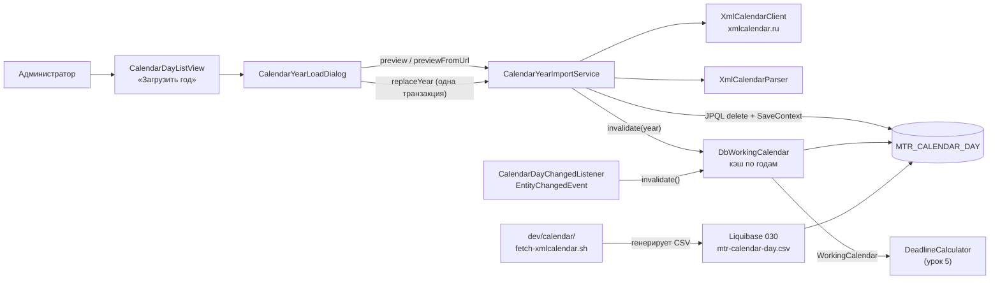

# Урок 4. Производственный календарь

> Курс multi-reestr, Jmix 3.0.3. План уроков: [../LESSONS.md](../LESSONS.md). Экраны: [../UI.md](../UI.md). Модель данных: [../model/OVERVIEW.md](../model/OVERVIEW.md), сущность: [CalendarDay](../model/entities/CalendarDay.md), перечисления: [DayType](../model/enums/DayType.md), [CalendarSource](../model/enums/CalendarSource.md). Начальные данные: [../model/README.md](../model/README.md#начальные-данные).
> Предыдущий урок: [lesson-03-notice-card.md](lesson-03-notice-card.md). Тег в конце урока: `lesson-04`.

## Зачем этот урок

**Где мы.** После урока 3 приложение показывает карточку извещения с контрактом и исполнением. Следующий шаг — проверять сроки: подачу заявок, подписание контракта, оплату. Почти все сроки в 44-ФЗ считаются в **рабочих днях**, а без календаря рабочий день не определить.

**Задача пользователя.** Специалист хочет знать, укладывается ли заказчик в «10 рабочих дней», и не считать праздники и переносы вручную. Администратор хочет раз в год обновить календарь одной кнопкой, а в закрытом контуре без интернета — загрузить его из файла.

**В чём подвох.** «Сб и Вс — выходные» неверно в обе стороны: бывают рабочие субботы (перенос) и праздники посреди недели. В legacy есть таблица `holidays`, но она неполная: после 2021 года в ней нет рабочих суббот. Готовый аддон Jmix Business Calendar требует подписки Enterprise. И ещё одна ловушка уже в коде: при замене года через `SaveContext` EclipseLink сначала вставляет новые строки, потом удаляет старые, и падает на уникальном индексе по дате.

**Что получится в конце.** Будет таблица `CalendarDay`, в которой хранятся **только исключения** из правила Сб/Вс. Интерфейс `WorkingCalendar` отвечает на вопросы «рабочий ли день» и «какая дата через N рабочих дней», а его реализация `DbWorkingCalendar` держит год в кэше. Годы 2024–2027 приходят при первом запуске из CSV в репозитории. Кнопка «Загрузить год» берёт год с xmlcalendar.ru или из XML-файла, сначала показывает сводку и заменяет год одной транзакцией.

**Как проверяем.** Тесты проверяют реальные переносы 2024 года: рабочую субботу 27.04.2024, майские праздники, сокращённый день. Есть проверка, что CSV в репозитории совпадает с разбором XML, и что начальные данные покрывают все четыре года. Повторная загрузка года проверяется отдельно.

## Содержание

1. [Цель урока](#1-цель-урока)
2. [Архитектура](#2-архитектура)
3. [Подготовка окружения](#3-подготовка-окружения)
4. [Шаги реализации](#4-шаги-реализации)
5. [Тесты](#5-тесты)
6. [Типичные ошибки](#6-типичные-ошибки)
7. [Контрольные вопросы и задания](#7-контрольные-вопросы-и-задания)
8. [Чеклист «урок завершён»](#8-чеклист-урок-завершён)

## 1. Цель урока

После урока приложение:

- хранит производственный календарь РФ в JPA-сущности `CalendarDay` (хранилище `main`). В таблице лежат только дни, которые отличаются от правила «Пн–Пт рабочие, Сб–Вс выходные»;
- отвечает на вопросы о днях через интерфейс `WorkingCalendar`: `isBusinessDay`, `getDayInfo`, `plus`, `minus`;
- кэширует год в `DbWorkingCalendar` и сбрасывает кэш при любой правке `CalendarDay`;
- разбирает XML xmlcalendar.ru (`XmlCalendarParser`) и скачивает его (`XmlCalendarClient`);
- при первом запуске загружает 2024–2027 годы из CSV через Liquibase, без интернета;
- даёт кнопку **«Загрузить год»** на списке календаря: с сайта или из файла, со сводкой и подтверждением.

Расчёт сроков по ст. 191–193 ГК РФ (`DeadlineCalculator`) — это урок 5. Здесь только календарь, на который он будет опираться.

**Почему не аддон Business Calendar.** В Jmix есть аддон Business Calendar, но он входит в Enterprise. Учебный проект от платных аддонов не зависит (см. `LESSONS.md` и `OVERVIEW.md`). Поэтому календарь свой, но интерфейс `WorkingCalendar` повторяет API аддона (`BusinessCalendar`): проверка рабочего дня, сведения о дне, сдвиг на N рабочих дней. Если проект когда-нибудь перейдёт на аддон, достаточно будет подставить другую реализацию интерфейса. Рабочие часы, CRON-праздники и несколько календарей из аддона сознательно не взяты.

## 2. Архитектура



| Класс / файл | Пакет / место | Роль |
|---|---|---|
| `CalendarDay` | `entity` | JPA-сущность дня-исключения: `date`, `year`, `dayType`, `source`, `mark` |
| `DayType`, `CalendarSource` | `entity` | Тип дня; источник записи (`XMLCALENDAR`, `MANUAL`) |
| `WorkingCalendar` | `calendar` | Интерфейс календаря по образцу API Business Calendar |
| `DayInfo` | `calendar` | `record`: дата, рабочий ли, тип, пометка, взят ли из таблицы |
| `DbWorkingCalendar` | `calendar` | Реализация на `CalendarDay`, кэш по годам |
| `CalendarDayChangedListener` | `calendar` | Сбрасывает кэш при любом изменении `CalendarDay` |
| `XmlCalendarParser` | `calendar` | XML xmlcalendar.ru → `List<ParsedCalendarDay>` |
| `XmlCalendarClient` | `calendar` | Скачивает `https://xmlcalendar.ru/data/ru/{год}/calendar.xml` |
| `ParsedCalendarDay`, `CalendarYearPreview` | `calendar` | Разобранный день; сводка перед записью |
| `CalendarYearImportService` | `calendar` | Сводка и замена года |
| `CalendarDayListView`, `CalendarYearLoadDialog` | `view.calendarday` | Список календаря и диалог «Загрузить год» |
| `030-calendar-days.xml`, `mtr-calendar-day.csv` | `liquibase/changelog`, `liquibase/data` | Начальные данные 2024–2027 |
| `dev/calendar/fetch-xmlcalendar.sh` / `.py` | `dev/calendar` | Генератор CSV |

## 3. Подготовка окружения

Для урока legacy-база не нужна: календарь хранится в основной БД приложения. Стенд `reestr-pg96` нужен только для остальных тестов проекта.

Скрипт генерации CSV требует Python 3 и доступ в интернет. Запускать его нужно, только если вы меняете набор лет или xmlcalendar.ru исправил данные:

```bash
dev/calendar/fetch-xmlcalendar.sh                 # 2024 2025 2026 2027 → mtr-calendar-day.csv
dev/calendar/fetch-xmlcalendar.sh 2026 2027 --out /tmp/cal.csv
```

Для тестов нужен запущенный **Docker**: тесты legacy поднимают Testcontainers `postgres:9.6`, без Docker они пропускаются. Тесты календаря работают на основной тестовой БД и Docker сами не требуют.

## 4. Шаги реализации

### 4.1. Сущность `CalendarDay`: только исключения

В Studio: *New → JPA Entity* с трейтами Audit of creation и Audit of modification. Атрибуты — по [CalendarDay.md](../model/entities/CalendarDay.md):

```java
@JmixEntity
@Table(name = "MTR_CALENDAR_DAY", indexes = {
        @Index(name = "IDX_MTR_CALENDAR_DAY_UNQ", columnList = "DATE_", unique = true),
        @Index(name = "IDX_MTR_CALENDAR_DAY_YEAR", columnList = "YEAR_")
})
@Entity(name = "mtr_CalendarDay")
public class CalendarDay {
    ...
    @InstanceName
    @Column(name = "DATE_", nullable = false)
    private LocalDate date;

    @Column(name = "YEAR_", nullable = false)
    private Integer year;
```

`date` и `year` — зарезервированные слова SQL, поэтому у колонок суффикс `_`. Дата уникальна. Год хранится отдельной колонкой с индексом: по нему календарь читает год в кэш, работает фильтр списка и удаляется год при импорте.

Таблица хранит **только исключения**. Если даты в таблице нет, действует правило по умолчанию: Сб и Вс — выходные, остальные дни рабочие. Если дата есть, запись важнее правила: `WORKING_TRANSFER` делает субботу рабочей, `HOLIDAY` делает среду выходной. Рабочими считаются три типа:

```java
public boolean isBusiness() {
    return this == WORKING || this == SHORTENED || this == WORKING_TRANSFER;
}
```

В год получается около 22–26 строк вместо 365.

### 4.2. Интерфейс `WorkingCalendar` и `DayInfo`

```java
public interface WorkingCalendar {
    boolean isBusinessDay(LocalDate date);
    DayInfo getDayInfo(LocalDate date);
    LocalDate plus(LocalDate date, int businessDays);
    LocalDate minus(LocalDate date, int businessDays);
}

public record DayInfo(LocalDate date, boolean businessDay, DayType dayType,
                      @Nullable String mark, boolean fromTable) {
}
```

`fromTable` показывает, откуда ответ: из таблицы или из правила по умолчанию. Это пригодится в уроке 5, чтобы объяснить пользователю, почему срок сдвинулся.

### 4.3. `DbWorkingCalendar`: кэш по годам

```java
private final ConcurrentHashMap<Integer, Map<LocalDate, CalendarDay>> cache = new ConcurrentHashMap<>();

@Override
public DayInfo getDayInfo(LocalDate date) {
    CalendarDay row = yearMap(date.getYear()).get(date);
    if (row != null) {
        DayType dayType = row.getDayType();
        return new DayInfo(date, dayType.isBusiness(), dayType, row.getMark(), true);
    }
    boolean weekend = date.getDayOfWeek() == DayOfWeek.SATURDAY
            || date.getDayOfWeek() == DayOfWeek.SUNDAY;
    DayType dayType = weekend ? DayType.WEEKEND : DayType.WORKING;
    return new DayInfo(date, !weekend, dayType, null, false);
}
```

- При первом обращении к году выполняется один запрос `select e from mtr_CalendarDay e where e.year = :year` (`computeIfAbsent`). Если строк нет, бросается `IllegalStateException` «Год N не загружен в производственный календарь» — пустой год нельзя молча считать пятидневкой. Дальше год берётся из памяти. В UI исключение показывают уведомлением, а не падением экрана.
- `plus` и `minus` идут по дням с шагом +1 или −1 и считают только рабочие дни. Начальная дата не считается: `plus(пятница, 1)` — следующий рабочий день. При `businessDays = 0` возвращается та же дата, при отрицательном значении `plus` вызывает `minus` и наоборот.
- Защита от бесконечного цикла: не больше `max(366, businessDays * 3 + 14)` шагов, иначе `IllegalStateException`.

Сбросить кэш можно двумя методами: `invalidate()` очищает всё, `invalidate(year)` — один год.

### 4.4. Сброс кэша при правке: `CalendarDayChangedListener`

Администратор может поправить день вручную в карточке. Кэш должен об этом узнать, поэтому подписываемся на `EntityChangedEvent` Jmix:

```java
@EventListener
public void onCalendarDayChanged(EntityChangedEvent<CalendarDay> event) {
    workingCalendar.invalidate();
}
```

Событие приходит на создание, изменение и удаление через `DataManager`. Сбрасывается весь кэш, потому что при изменении даты запись может переехать в другой год. JPQL `delete` при импорте событий не порождает, поэтому `replaceYear` сбрасывает кэш года сам (шаг 4.8).

### 4.5. Формат xmlcalendar.ru и разбор XML

Файл за год выглядит так (фрагмент тестового набора `src/test/resources/calendar/xmlcalendar-2024.xml`):

```xml
<calendar year="2024" lang="ru" date="2023.09.30">
  <holidays>
    <holiday id="1" title="Новогодние каникулы"/>
    ...
  </holidays>
  <days>
    <day d="01.01" t="1" h="1"/>
    <day d="03.07" t="2"/>
    <day d="04.27" t="3" />
    <day d="04.29" t="1" f="04.27"/>
    ...
  </days>
</calendar>
```

`d` — дата в виде `ММ.ДД`, `t` — тип дня, `h` — ссылка на праздник из `<holidays>`, `f` — дата, *с которой* перенесён выходной. Разбор в `XmlCalendarParser.toParsedDay`:

| XML | `DayType` | `mark` |
|---|---|---|
| `t="1"` с `h` | `HOLIDAY` | название праздника (`title` по `h`) |
| `t="1"` без `h`, с `f` | `WEEKEND` | «Перенос с ДД.ММ» (дата из `f`) |
| `t="1"` без `h` и без `f` | `WEEKEND` | пусто |
| `t="2"` | `SHORTENED` | название праздника или «Перенос с ДД.ММ», если они есть, иначе «Предпраздничный день» |
| `t="3"` | `WORKING_TRANSFER` | «Перенос на ДД.ММ[, ДД.ММ]» — даты дней, у которых `f` указывает на этот день; если таких нет — «Рабочий день (перенос)» |
| другое `t` | — | `IllegalArgumentException("Неизвестный тип дня xmlcalendar t=…")` |

Обратные ссылки для `t="3"` собираются заранее, одним проходом по всем `<day>`:

```java
String from = blankToNull(day.getAttribute("f"));
if (from != null) {
    reverse.computeIfAbsent(from, key -> new ArrayList<>()).add(day.getAttribute("d"));
}
```

Так 27.04.2024 (рабочая суббота) получает пометку «Перенос на 29.04», а 29.04.2024 — «Перенос с 27.04».

Проверки разбора: корневой элемент должен быть `<calendar>`, атрибут `year` должен совпадать с запрошенным годом («Год в XML 2025 не совпадает с запрошенным 2024»), элемент `<days>` обязателен, а `h` должен ссылаться на существующий праздник. Внешние сущности XML не раскрываются (`setExpandEntityReferences(false)`).

`XmlCalendarClient` скачивает `https://xmlcalendar.ru/data/ru/%d/calendar.xml` через `java.net.http.HttpClient`: таймаут соединения 15 с, запроса 30 с, `User-Agent: multi-reestr-calendar`. Ответ не 200 превращается в `IllegalStateException("xmlcalendar.ru вернул HTTP …")`.

### 4.6. Скрипт `dev/calendar` и CSV

`dev/calendar/fetch-xmlcalendar.sh` запускает `fetch-xmlcalendar.py`. Скрипт скачивает XML за годы (по умолчанию 2024, 2025, 2026, 2027), разбирает их **по тем же правилам**, что и `XmlCalendarParser` (те же тексты пометок), сортирует по дате и пишет `src/main/resources/com/digitilius/multireestr/liquibase/data/mtr-calendar-day.csv`:

```
ID,DATE_,YEAR_,DAY_TYPE,SOURCE,MARK,CREATED_BY,CREATED_DATE,LAST_MODIFIED_BY,LAST_MODIFIED_DATE
d1a93487-8bad-5cc9-a6b7-b4d41c5d36e3,2024-01-01,2024,HOLIDAY,XMLCALENDAR,Новогодние каникулы,system,2026-01-01T00:00:00,,
```

**ID — стабильный UUID v5** от даты:

```python
UUID_NAMESPACE = uuid.UUID("6ba7b810-9dad-11d1-80b4-00c04fd430c8")

def row_id(parsed_date: date) -> str:
    return str(uuid.uuid5(UUID_NAMESPACE, f"mtr-calendar-day:{parsed_date.isoformat()}"))
```

Повторный запуск скрипта даёт те же ID и ту же `CREATED_DATE` (`2026-01-01T00:00:00`). Если данные на сайте не изменились, `git diff` пустой, а изменившиеся дни видны построчно.

### 4.7. Liquibase 030: обязательные начальные данные

```xml
<changeSet id="1" author="multi-reestr">
    <loadData tableName="MTR_CALENDAR_DAY"
              file="com/digitilius/multireestr/liquibase/data/mtr-calendar-day.csv"
              separator=","
              encoding="UTF-8">
        <column name="ID" type="UUID"/>
        <column name="DATE_" type="DATE"/>
        <column name="YEAR_" type="NUMERIC"/>
        ...
    </loadData>
</changeSet>
```

У ченджсета **нет `context`**. По правилу из [model/README.md, «Начальные данные»](../model/README.md#начальные-данные) обязательные данные загружаются без контекста, а `context="demo"` ставится только у демо-данных. Без календаря сроки считаются неверно, значит, это обязательные данные. Файл подключается через `includeAll` в `changelog.xml`, отдельный `include` не нужен.

В CSV 95 строк: 2024 — 26, 2025 — 23, 2026 — 22, 2027 — 24.

**Почему до 2027 года.** Извещения тестового набора данных относятся к 2024–2026 годам, а сроки контрактов и исполнения, которые будет проверять урок 5, переходят в следующий год. Календарь на 2027 год уже опубликован на xmlcalendar.ru, поэтому он загружается сразу. Следующие годы администратор загрузит кнопкой «Загрузить год».

### 4.8. Диалог «Загрузить год»

На списке `CalendarDayListView` есть кнопка `loadYearButton` («Загрузить год»). Она открывает `CalendarYearLoadDialog` через `DialogWindows`. Если диалог закрыт с `StandardOutcome.SAVE`, список перезагружается (`calendarDaysDl.load()`).

Порядок работы в диалоге:

1. **Год** (`yearField`, от 2013 до 2100, по умолчанию текущий).
2. **«Из XML-файла»** (`fromFileField`). Если флажок снят, год скачивается с xmlcalendar.ru. Если поставлен, появляется `Upload` для одного `.xml` — вариант для закрытого контура.
3. **«Показать сводку»** разбирает XML и считает, что будет записано и что заменено. Кнопка «Загрузить» включается только после успешной сводки. Если сменить источник или загрузить другой файл, сводка сбрасывается.
4. **«Загрузить»** показывает диалог подтверждения «Заменить исключения года?» с той же сводкой. Только после «Да» вызывается `replaceYear`.

Текст сводки (`loadYearDialog.summary`):

```
Год %s: праздников %s, выходных/переносов %s, сокращённых %s, рабочих переносов %s.
Будет заменено записей: %s, из них введённых вручную (MANUAL): %s.
```

Число записей `MANUAL` показывается отдельно: ручные правки года **тоже будут заменены**, и администратор должен увидеть это до подтверждения.

Замена года — одна транзакция:

```java
@Transactional
public void replaceYear(CalendarYearPreview preview) {
    entityManager.createQuery("delete from mtr_CalendarDay e where e.year = :year")
            .setParameter("year", preview.year())
            .executeUpdate();
    entityManager.flush();
    SaveContext saveContext = new SaveContext();
    for (ParsedCalendarDay parsed : preview.days()) {
        CalendarDay entity = dataManager.create(CalendarDay.class);
        entity.setDate(parsed.date());
        entity.setYear(parsed.date().getYear());
        entity.setDayType(parsed.dayType());
        entity.setSource(CalendarSource.XMLCALENDAR);
        entity.setMark(blankToNull(parsed.mark()));
        saveContext.saving(entity);
    }
    dataManager.save(saveContext);
    workingCalendar.invalidate(preview.year());
}
```

- **Почему JPQL `delete`, а не `saveContext.removing(...)`.** В первой версии старые строки удалялись в том же `SaveContext`. EclipseLink выполняет вставки раньше удалений, поэтому новая строка с той же датой нарушала `IDX_MTR_CALENDAR_DAY_UNQ`. Теперь старые строки года удаляются JPQL-запросом, `flush()` отправляет удаление в БД, и только потом вставляются новые.
- Ошибка на любом шаге откатывает всю транзакцию: год остаётся в прежнем виде.
- Все новые строки получают `source = XMLCALENDAR`, пустая пометка записывается как `NULL`.
- **Повторная загрузка безопасна.** Тот же файл даёт тот же набор дат, а сводка показывает, сколько строк будет заменено.
- После записи сбрасывается кэш этого года.

Ошибки (нет года, нет файла, HTTP, неверный XML) показываются уведомлением, и диалог остаётся открытым.

### 4.9. Список календаря

Колонки грида: `date`, `year`, `dayType`, `source`, `mark`. Сортировка — `order by e.date desc`. У `genericFilter` есть конфигурация по умолчанию «по году» (`propertyFilter` по `year`, `EQUAL`), значение пользователь вводит сам. Кнопки: «Создать», «Изменить», «Удалить», «Загрузить год». В карточке дня поля `date`, `year`, `dayType`, `source`, `mark` заполняются вручную.

## 5. Тесты

Запуск: `./gradlew test` при запущенном Docker. Результат прогона на ветке урока: **135 passed, 0 skipped, 0 failed** (из них 5 классов этого урока).

| Тест | Что проверяет |
|---|---|
| `XmlCalendarParserTest` (без Spring) | Разбор `xmlcalendar-2024.xml`: 01.01 — `HOLIDAY` «Новогодние каникулы»; 07.03 — `SHORTENED` «Предпраздничный день»; 27.04 — `WORKING_TRANSFER` «Перенос на 29.04»; 29.04 — `WEEKEND` «Перенос с 27.04»; 09.05 — `HOLIDAY` «День Победы»; 28.12 — `WORKING_TRANSFER` «Перенос на 30.12». Неизвестный `t` и год, не совпадающий с запрошенным, дают ошибку |
| `XmlCalendarCsvMatchTest` (без Spring) | Строки 2024 года в `mtr-calendar-day.csv` в точности совпадают с разбором `xmlcalendar-2024.xml` (дата, тип, пометка). Если скрипт и Java-парсер разойдутся, тест упадёт |
| `CalendarLiquibaseCoverageTest` (`@SpringBootTest`) | После Liquibase в таблице есть строки `XMLCALENDAR` за 2024, 2025, 2026 и 2027; 27.04.2024 — `WORKING_TRANSFER`, год 2024 |
| `DbWorkingCalendarTest` (`@SpringBootTest`) | Таблица важнее правила: суббота 27.04.2024 рабочая (`WORKING_TRANSFER`), среда 01.05.2024 — праздник, 08.05.2024 — сокращённый и рабочий, 21.04.2024 — обычное воскресенье, 25.04.2024 — обычный четверг. Арифметика: `plus(26.04, 1) = 27.04`, `plus(26.04, 2) = 02.05` (через майские), `minus(02.05, 2) = 26.04`, `plus(08.05, 1) = 13.05`, `plus(d, 0) = d`. Год без строк `CalendarDay` (2099) — исключение, не пятидневка |
| `CalendarYearImportServiceTest` (`@SpringBootTest`) | Ручная запись `MANUAL` на 01.06.2024 делает субботу рабочей. Сводка видит её (`existingManualCount ≥ 1`), рабочих переносов 2. После `replaceYear` все строки года — `XMLCALENDAR`, ручной записи нет, кэш сброшен (01.06 снова выходной). Повторная загрузка того же файла заменяет тот же набор дат, `MANUAL` = 0, ошибки уникальности нет |

Пример проверки арифметики через праздники:

```java
LocalDate friday = LocalDate.of(2024, 4, 26);
assertThat(workingCalendar.plus(friday, 1)).isEqualTo(LocalDate.of(2024, 4, 27));
assertThat(workingCalendar.plus(friday, 2)).isEqualTo(LocalDate.of(2024, 5, 2));
assertThat(workingCalendar.minus(LocalDate.of(2024, 5, 2), 2)).isEqualTo(friday);
```

> Тесты сверяются с настоящим XML xmlcalendar.ru за 2024 год из тестового набора `src/test/resources/calendar/`, а не с придуманными датами. 2024 год выбран потому, что в нём есть всё сразу: рабочие субботы, длинные майские, перенос на 30.12.

## 6. Типичные ошибки

| Симптом | Причина | Что делать |
|---|---|---|
| `duplicate key … IDX_MTR_CALENDAR_DAY_UNQ` при повторной загрузке года | Удаление и вставка в одном `SaveContext`: EclipseLink вставляет раньше, чем удаляет | JPQL `delete` по году + `flush()`, потом вставка (шаг 4.8) |
| После правки дня в карточке срок считается по-старому | Кэш `DbWorkingCalendar` не сброшен | `CalendarDayChangedListener` на `EntityChangedEvent<CalendarDay>` |
| После загрузки года кэш устарел | JPQL `delete` не порождает `EntityChangedEvent` | `workingCalendar.invalidate(year)` в конце `replaceYear` |
| Рабочая суббота считается выходной | В таблице нет `WORKING_TRANSFER`, или правило Сб/Вс проверяется раньше таблицы | Сначала таблица, потом правило по умолчанию |
| Сокращённый день считается выходным | `SHORTENED` не включён в `isBusiness()` | Рабочие: `WORKING`, `SHORTENED`, `WORKING_TRANSFER` |
| `IllegalArgumentException: Неизвестный тип дня xmlcalendar t=…` | Новый тип в формате сайта | Разобраться с типом, добавить в парсер **и** в скрипт |
| `XmlCalendarCsvMatchTest` падает | Правила или тексты в Python-скрипте и в `XmlCalendarParser` разошлись | Синхронизировать оба, перегенерировать CSV |
| В `git diff` CSV меняются все ID | ID генерируются случайно | UUID v5 от даты (шаг 4.6) |
| На проде нет календаря | Ченджсет помечен `context="demo"` | Обязательные данные — без контекста |
| Ручные правки пропали после «Загрузить год» | Так и задумано: год заменяется целиком | Смотреть число `MANUAL` в сводке до подтверждения |
| Загрузка с сайта не работает в закрытом контуре | Нет доступа к xmlcalendar.ru | Флажок «Из XML-файла» |

## 7. Контрольные вопросы и задания

1. Почему таблица хранит только исключения? Какой тип будет у среды, которой нет в таблице, и у субботы, которой нет в таблице?
2. Чем `DayInfo.fromTable` поможет в уроке 5?
3. Почему календарь свой, а не аддон Business Calendar? Что даёт совпадение сигнатур `WorkingCalendar` с API аддона?
4. Как в XML отличить праздник от выходного из-за переноса? Откуда берётся пометка «Перенос на 29.04» у 27.04.2024?
5. Зачем ID в CSV — UUID v5 от даты, а не случайный UUID?
6. Почему ченджсет 030 без `context`?
7. Почему при замене года нельзя удалять старые строки через тот же `SaveContext`?
8. Почему `CalendarDayChangedListener` сбрасывает весь кэш, а `replaceYear` — только свой год?
9. **Задание.** Добавьте в `DbWorkingCalendarTest` проверку `minus(LocalDate.of(2024, 5, 13), 1)`. Какой день получится и почему?
10. **Задание.** Скачайте `calendar.xml` за 2025 год, загрузите его через диалог из файла и сравните сводку с числом строк 2025 года в CSV.
11. **Задание.** Временно замените JPQL `delete` на `saveContext.removing(...)` и запустите `CalendarYearImportServiceTest`. Какое сообщение об ошибке вы увидите?

## 8. Чеклист «урок завершён»

- [ ] `CalendarDay` создана в Studio по `CalendarDay.md`: уникальный `DATE_`, индекс `YEAR_`, трейты аудита.
- [ ] `WorkingCalendar` / `DayInfo` повторяют API Business Calendar, аддон не подключён.
- [ ] `DbWorkingCalendar`: таблица важнее правила Сб/Вс, кэш по годам, `invalidate()` / `invalidate(year)`.
- [ ] `CalendarDayChangedListener` сбрасывает кэш при правке.
- [ ] `XmlCalendarParser` разбирает `t=1` (с `h` и без), `t=2`, `t=3`, `f`; неизвестный `t` — ошибка.
- [ ] CSV сгенерирован `dev/calendar/fetch-xmlcalendar.sh`, ID стабильные, 2024–2027.
- [ ] Ченджсет `030-calendar-days.xml` без контекста.
- [ ] «Загрузить год»: сайт или файл, сводка с числом `MANUAL`, подтверждение, одна транзакция, повторная загрузка без ошибки.
- [ ] Docker запущен, `./gradlew test` зелёный без пропущенных.
- [ ] Коммит и тег:

```bash
git add <файлы урока> && git commit -m "Lesson 04: production calendar"
git tag lesson-04
```
