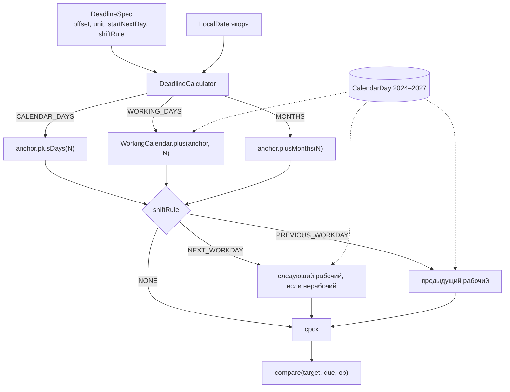

# Урок 5. Движок сроков (ст. 191–193 ГК)

> Курс multi-reestr-helper, Jmix 3.0.3. План уроков: [../LESSONS.md](../LESSONS.md). Экраны: [../UI.md](../UI.md) (новый экран в этом уроке не появляется). Модель: [../model/OVERVIEW.md](../model/OVERVIEW.md) §6, [DeadlineSpec](../model/entities/DeadlineSpec.md), [DayCountUnit](../model/enums/DayCountUnit.md), [ShiftRule](../model/enums/ShiftRule.md), [DeadlineAnchor](../model/enums/DeadlineAnchor.md), [CompareOperator](../model/enums/CompareOperator.md). Календарь, на который опирается расчёт: [CalendarDay](../model/entities/CalendarDay.md), урок [lesson-04-calendar.md](lesson-04-calendar.md).
> Предыдущий урок: [lesson-04-calendar.md](lesson-04-calendar.md). Тег в конце урока: `lesson-05`.

## Зачем этот урок

**Где мы.** После урока 4 приложение знает, какой день рабочий: таблица `CalendarDay` хранит исключения, `WorkingCalendar` отвечает «рабочий ли день» и «какая дата через N рабочих дней». Сами сроки по Гражданскому кодексу ещё никто не считает.

**Задача пользователя.** Специалист хочет задать формулу вроде «10 рабочих дней от доведения ЛБО» или «30 календарных дней от заключения контракта» и получить **дату окончания** и ответ «уложились или нет». Считать праздники и «срок с пятницы заканчивается в субботу» вручную нельзя: именно на этом ловят на проверках.

**В чём подвох.** Календарь и срок — разные вещи. `WorkingCalendar.plus` уже не считает день якоря, и если поверх него ещё сдвинуть «на следующий день» по ст. 191, получится лишний день. Месяцы истекают в то же число, а если числа нет (31 января + 1 месяц) — в последний день февраля. Если последний день срока нерабочий, ст. 193 переносит его на следующий рабочий. Правило «суббота всегда выходной» снова ломается: 27.04.2024 — рабочая суббота.

**Что получится в конце.** Сервис `DeadlineCalculator` поверх уже готового `WorkingCalendar`. Формула срока — встраиваемый `DeadlineSpec` (создан в начале курса вместе с моделью). Новых сущностей, перечислений и экранов нет: блок `DeadlineSpec` на карточках правила и условия контракта появится в уроках 6 и 8. Калькулятор только считает дату и сравнивает её с фактом.

**Как проверяем.** Тесты на seed-календаре 2024–2027: пятница/суббота, майские, Новый год (ожидаемая дата — первый рабочий день по таблице, без догадки), конец месяца, `startNextDay=false`, `PREVIOUS_WORKDAY`. Замечания 1, 6 и 9 — с датами из документации и из тестового набора (данных).

## Содержание

1. [Цель урока](#1-цель-урока)
2. [Архитектура](#2-архитектура)
3. [Теория: ст. 191–193 ГК простыми словами](#3-теория-ст-191193-гк-простыми-словами)
4. [Формула `DeadlineSpec`](#4-формула-deadlinespec)
5. [Решения A–I](#5-решения-ai)
6. [Подготовка окружения](#6-подготовка-окружения)
7. [Шаги реализации](#7-шаги-реализации)
8. [Тесты](#8-тесты)
9. [Типичные ошибки](#9-типичные-ошибки)
10. [Контрольные вопросы и задания](#10-контрольные-вопросы-и-задания)
11. [Чеклист «урок завершён»](#11-чеклист-урок-завершён)

## 1. Цель урока

После урока приложение:

- считает срок через `DeadlineCalculator` и календарь, **не** вшивая ст. 191/193 в `WorkingCalendar`;
- принимает уже известную дату якоря и `DeadlineSpec` (якорь из DTO или `PlanScheduleEvent` здесь не ищется — это уроки 6–8);
- умеет три единицы: календарные дни, рабочие дни, месяцы;
- учитывает `startNextDay` (ст. 191), перенос окончания (`ShiftRule`, ст. 193) и сравнение `compare(target, due, op)`;
- не пишет `Violation`, не смотрит `warnBeforeDays` (уроки 7 и 9).

`DeadlineSpec`, `DayCountUnit`, `ShiftRule`, `DeadlineAnchor`, `CompareOperator` уже есть в модели. **Новых JPA-сущностей, перечислений и DTO не создаём.**

## 2. Архитектура



| Класс / файл | Пакет / место | Роль |
|---|---|---|
| `DeadlineSpec` | `entity` | Embeddable: якорь, смещение, единица, `startNextDay`, перенос, цель, сравнение, `warnBeforeDays` |
| `DayCountUnit`, `ShiftRule`, `DeadlineAnchor`, `CompareOperator` | `entity` | Единица, перенос, событие, оператор |
| `WorkingCalendar` / `DbWorkingCalendar` | `calendar` | «Рабочий ли день» и арифметика в рабочих днях (урок 4) |
| `DeadlineCalculator` | `deadline` | Ст. 191–193 поверх календаря |
| `DeadlineCalculatorTest` | `deadline` (тест) | Календарные случаи и замечание 1 |
| `DeadlineCalculatorLegacyTest` | `deadline` (тест) | Замечания 6 и 9 из тестового набора (данных) |

Правила ГК живут в пакете `deadline`, а не в `calendar`: календарь отвечает только «рабочий ли день».

## 3. Теория: ст. 191–193 ГК простыми словами

Тексты статей длинные, для кода достаточно трёх правил.

**Статья 191.** Срок, определённый периодом времени, начинается **на следующий день** после календарной даты или события, которым определено его начало. День события в период **не входит**.

Пример. Событие в пятницу. «Один календарный день» — это суббота, не пятница.

**Статья 192.** Срок в днях истекает в последний день периода. Срок в месяцах — в **то же число** последнего месяца срока. Если такого числа нет (31 января + 1 месяц), срок истекает в **последний день** этого месяца (28 или 29 февраля). В Java это уже делает `LocalDate.plusMonths`.

**Статья 193.** Если последний день срока приходится на нерабочий день, днём окончания считается **ближайший следующий рабочий день**. Для внутренних контрольных дат в модели есть ещё перенос **назад** (`PREVIOUS_WORKDAY`) — это не ст. 193, а отдельное значение `ShiftRule`.

Рабочий день здесь — день календаря урока 4: типы `WORKING`, `SHORTENED`, `WORKING_TRANSFER`. Сокращённый — рабочий. Рабочая суббота важнее правила «Сб выходной».

Как это стыкуется с `WorkingCalendar.plus`. Метод `plus(дата, N)` уже не считает саму дату: `plus(пятница, 1)` — следующий рабочий. Поэтому «N рабочих дней со следующего дня после события» — это `calendar.plus(якорь, N)`, а не `plus(якорь.plusDays(1), N)`. Иначе появится лишний день. То же для календарных: `якорь.plusDays(N)`, не `якорь.plusDays(1).plusDays(N)`.

Проверка на цифрах из модели. ЛБО 26.03.2025 (среда) + 10 рабочих дней → 09.04.2025. Заключение 23.12.2025 + 30 календарных дней → 22.01.2026. Изменение извещения 26.02.2026 + 7 календарных дней → 05.03.2026.

## 4. Формула `DeadlineSpec`

Все поля необязательные: встраивание nullable, срок есть не у каждого правила. Колонки получают префикс у владельца (`DEADLINE_` в `RuleVersion`, `TERM_` в `ContractTerm`).

| Поле | Тип | Смысл |
|---|---|---|
| `anchor` | `DeadlineAnchor` | От какого события считать (ЛБО, публикация изменений, заключение…) |
| `offsetValue` | `Integer` | Смещение N |
| `unit` | `DayCountUnit` | `CALENDAR_DAYS`, `WORKING_DAYS`, `MONTHS` |
| `startNextDay` | `Boolean` | Течение со следующего дня (ст. 191), в сущности по умолчанию `true` |
| `shiftRule` | `ShiftRule` | `NONE`, `NEXT_WORKDAY` (ст. 193), `PREVIOUS_WORKDAY` |
| `target` | `DeadlineAnchor` | Какую дату сравниваем со сроком |
| `compareOperator` | `CompareOperator` | `NOT_LATER` (факт ≤ срок) или `NOT_EARLIER` (факт ≥ срок) |
| `warnBeforeDays` | `Integer` | За сколько дней предупреждать; в этом уроке не используется |

В калькулятор передают уже готовую `LocalDate` якоря. Поля `anchor` и `target` понадобятся шаблонам правил, когда они достанут даты из DTO.

Примеры формул (замечания аудита):

| Зам. | Якорь | N | Единица | Перенос | Цель | Сравнение |
|---|---|---|---|---|---|---|
| 1 | `LBO_DATE` | 10 | `WORKING_DAYS` | `NONE` | `PLAN_APPROVAL_DATE` | `NOT_LATER` |
| 6 | `NOTICE_CHANGE_PUBLISHED` | 7 | `CALENDAR_DAYS` | не задан → по умолчанию `NEXT_WORKDAY` | `APPLICATIONS_END` | `NOT_EARLIER` |
| 9 | `CONTRACT_SIGNED` | 30 | `CALENDAR_DAYS` | `NEXT_WORKDAY` | `DELIVERY_DOCUMENT` | `NOT_LATER` |

Дата поставки для замечания 9 — `ExecutionDto.docDate` приёмки (`de_documentdate`), не дата платёжного поручения и не `acceptDate`.

## 5. Решения A–I

Документация оставляла развилки. Ниже — зафиксированные решения, как в коде.

| | Тема | Решение |
|---|---|---|
| **A** | Ст. 191 и `plus` | `startNextDay=true` (и `null`): N единиц **после** дня события, день события не входит. Календарные: `anchor.plusDays(N)`. Рабочие: `calendar.plus(anchor, N)`. `startNextDay=false`: день события — день 1. Календарные: `anchor.plusDays(N − 1)`. Рабочие: если якорь рабочий — он день 1, дальше `plus(anchor, N − 1)`; если нет — `plus(anchor, N)`. По одному тесту на календарные и на рабочие. |
| **B** | Месяцы | `startNextDay=true`: `anchor.plusMonths(N)` (ст. 192). `startNextDay=false`: `anchor.plusMonths(N).minusDays(1)`. Нет числа — последний день месяца (`plusMonths`). |
| **C** | `shiftRule == null` | Как в [ShiftRule.md](../model/enums/ShiftRule.md): для `CALENDAR_DAYS` и `MONTHS` — `NEXT_WORKDAY` (ст. 193); для `WORKING_DAYS` — `NONE`. Записать в javadoc класса. Срок замечания 6 (05.03.2026) — рабочий, перенос его не двигает; это проверяет тест. |
| **D** | `PREVIOUS_WORKDAY` | Реализовать: идти назад, пока день нерабочий; если уже рабочий — оставить. Есть тест (пятница + 1 календарный день → суббота → назад на пятницу). |
| **E** | Рабочие дни + `NEXT_WORKDAY` | Разрешено. Последний день `plus` уже рабочий, перенос — пустая операция. Есть тест. |
| **F** | Ноль и ошибки | `N = 0` — дата якоря, затем перенос. Отрицательное смещение, `null` у `offsetValue` или `unit` — `IllegalArgumentException`. |
| **G** | Сравнение | Только `compare(target, due, op)`. `target == due` — успех. Отдельного DTO результата и `deviationDays` нет (это урок 7). |
| **H** | Откуда даты замечаний | Замечание 1: константы из docs (ЛБО нет в legacy). Замечания 6 и 9: живые даты из тестового набора (данных) через `NoticeCardService` и Testcontainers, как остальные legacy-тесты. |
| **I** | API | Два `deadline(...)`, плюс `nextBusinessDayIfNonWorking` и `compare`. Пакет `com.digitilius.multireestr.deadline`. |

## 6. Подготовка окружения

Календарь 2024–2027 уже в основной БД (Liquibase урока 4). Новых ченджсетов нет.

Для `DeadlineCalculatorTest` Docker не нужен: работает seed `CalendarDay`.

Для `DeadlineCalculatorLegacyTest` нужен **Docker**: Testcontainers поднимает `postgres:9.6` и загружает тестовый набор (данных). Без Docker этот класс пропускается (`@EnabledIf dockerAvailable`). На зелёной ветке урока пропущенных быть не должно.

Новый экран не делаем. Блок `DeadlineSpec` в UI — уроки 6 (`RuleVersion`) и 8 (`ContractTerm`).

## 7. Шаги реализации

### 7.1. Не трогать модель

Сущность, перечисления и встраивание в `RuleVersion` / `ContractTerm` уже созданы в визарде. Если чего-то нет — свериться с карточками в `docs/model`, **не** придумывать поля. В этом уроке расхождений не было.

### 7.2. Класс `DeadlineCalculator`

Пакет `com.digitilius.multireestr.deadline`, `@Component`, в конструктор — `WorkingCalendar`.

```java
public LocalDate deadline(LocalDate event, int n, DayCountUnit unit);
public LocalDate deadline(LocalDate anchorDate, DeadlineSpec spec);
public LocalDate nextBusinessDayIfNonWorking(LocalDate date);
public boolean compare(LocalDate targetDate, LocalDate dueDate, CompareOperator compareOperator);
```

Первый `deadline` — всегда ст. 191 (`startNextDay=true`) и **без** переноса: как в [CalendarDay.md](../model/entities/CalendarDay.md). Второй читает формулу целиком: `startNextDay` (`null` → `true`), смещение, единицу, затем `shiftRule`.

`startNextDay=null` у формулы тоже считается `true` — так в поле сущности по умолчанию.

### 7.3. Смещение

```java
if (n == 0) {
    return anchor;
}
return switch (unit) {
    case CALENDAR_DAYS -> startNextDay ? anchor.plusDays(n) : anchor.plusDays(n - 1L);
    case WORKING_DAYS -> addWorkingDays(anchor, n, startNextDay);
    case MONTHS -> startNextDay ? anchor.plusMonths(n) : anchor.plusMonths(n).minusDays(1);
};
```

Рабочие дни при `startNextDay=false`:

```java
if (workingCalendar.isBusinessDay(anchor)) {
    return workingCalendar.plus(anchor, n - 1);
}
return workingCalendar.plus(anchor, n);
```

### 7.4. Перенос

Пустой `shiftRule`:

```java
return unit == DayCountUnit.WORKING_DAYS ? ShiftRule.NONE : ShiftRule.NEXT_WORKDAY;
```

Если день уже рабочий или правило `NONE` — дата не меняется. Иначе шаг +1 или −1, пока `isBusinessDay` не станет истиной. Защита от цикла: не больше 366 шагов, иначе `IllegalStateException`.

`nextBusinessDayIfNonWorking` — тот же перенос с `NEXT_WORKDAY`.

### 7.5. Сравнение

```java
case NOT_LATER -> !targetDate.isAfter(dueDate);   // target ≤ due
case NOT_EARLIER -> !targetDate.isBefore(dueDate); // target ≥ due
```

Равенство проходит оба оператора.

### 7.6. Что сознательно не делаем

- Резолв `DeadlineAnchor` из извещения, контракта или `PlanScheduleEvent`.
- Запись в `Violation` / `CheckRun`.
- `warnBeforeDays`.
- Новый экран и правки JPA.

## 8. Тесты

Запуск: `./gradlew test` при запущенном Docker. Результат прогона после этого урока: **154 passed, 0 skipped, 0 failed** (из них 2 класса этого урока: 13 + 2 метода).

| Тест | Что проверяет |
|---|---|
| `fridayPlusOneCalendarDayShiftsOffSaturday` | Пт 04.04.2025 + 1 календарный день + `NEXT_WORKDAY` → пн 07.04.2025 |
| `fridayPlusOneCalendarDayStaysOnWorkingTransferSaturday` | Пт 26.04.2024 + 1 → **27.04.2024** (`WORKING_TRANSFER`, не прыгать на понедельник) |
| `newYear2026DueIsFirstSeededBusinessDay` | 30.12.2025 + 1 календарный день + `NEXT_WORKDAY`. Ожидание — **первый рабочий день** по seed `CalendarDay` начиная с 31.12.2025 (`firstBusinessDayOnOrAfter`), без захардкоженной даты |
| `mayHolidaysShiftCalendarDeadline` | 30.04.2024 + 1 и 26.04.2024 + 2 → 02.05.2024 (через 01.05 `HOLIDAY` и переносы конца апреля) |
| `monthPeriodEndsOnSameNumberOrLastDayOfMonth` | 31.01.2024 + 1 месяц → 29.02.2024; 31.03.2025 + 1 месяц → 30.04.2025 |
| `startNextDayFalseMonthsEndsDayBeforeSameNumber` | `startNextDay=false`, n=1: 15.03.2025 → 14.04.2025; 31.01.2024 + 1 месяц → 28.02.2024; 31.01.2025 → 27.02.2025 |
| `startNextDayFalseCalendarDaysCountEventAsDayOne` | 26.03.2025 + 10 календарных, `startNextDay=false` → `plusDays(9)` |
| `startNextDayFalseWorkingDaysCountEventIfWorking` | тот же якорь, рабочие, день события входит → `plus(якорь, 9)` |
| `previousWorkdayShiftsBackFromWeekend` | пт + 1 календарный + `PREVIOUS_WORKDAY` → снова пятница |
| `workingDaysWithNextWorkdayShiftIsNoOp` | +10 рабочих: `NONE` и `NEXT_WORKDAY` дают одну дату |
| `finding1LboTenWorkingDays` | см. таблицу замечаний; `target == due` — успех |
| `zeroOffsetIsAnchorThenShift` | сб + 0 + `NEXT_WORKDAY` → понедельник; пт + 0 → пятница |
| `nullShiftRuleDefaultsByUnit` | календарные без `shiftRule` → как `NEXT_WORKDAY`; рабочие → как `NONE` |
| `rejectsNegativeOrMissingRequired` | отрицательный N, `null` смещения и единицы — `IllegalArgumentException` |
| `finding6NoticeChangeSevenCalendarDays` | извещение из тестового набора (данных), см. таблицу |
| `finding9ContractSignedThirtyCalendarDays` | контракт из тестового набора (данных), см. таблицу |

Пример «пятница/суббота» (LESSONS):

```java
LocalDate friday = LocalDate.of(2025, 4, 4);
assertThat(deadlineCalculator.deadline(friday, spec)).isEqualTo(LocalDate.of(2025, 4, 7));
```

Новый год — ожидание только из календаря:

```java
LocalDate expected = firstBusinessDayOnOrAfter(LocalDate.of(2025, 12, 31));
assertThat(deadlineCalculator.deadline(LocalDate.of(2025, 12, 30), spec)).isEqualTo(expected);
```

### Замечания 1, 6 и 9

| Зам. | Откуда даты | Якорь | Срок | Факт | Сравнение |
|---|---|---|---|---|---|
| 1 | константы из [OVERVIEW](../model/OVERVIEW.md) §6 (в legacy ЛБО нет) | ЛБО 26.03.2025 | 09.04.2025 (+10 рабочих, `NONE`) | утверждение 10.04.2025 | `NOT_LATER` — ложь |
| 6 | `NoticeCardService.loadOriginal("0173100017026000008")`: `publishedAt`, `applicationsTo`; редакция `modifVersion > 1` | изменение 26.02.2026 | 05.03.2026 (+7 календарных, `shiftRule` пустой). **05.03.2026 рабочий** (`isBusinessDay`) | окончание подачи 03.03.2026 | `NOT_EARLIER` — ложь (03.03 раньше 05.03) |
| 9 | `loadOriginal("0173100017025000020")`: `contract.date`, `docDate` первой приёмки; `reestr.id` 18 | заключение 23.12.2025 | 22.01.2026 (+30 календарных, `NEXT_WORKDAY`) | документ поставщика 23.01.2026 | `NOT_LATER` — ложь |

`contractdateend` у этого контракта — 21.01.2026, это **не** срок поставки. Для правил брать формулу, не дату окончания действия ([ContractDto.md](../model/entities/ContractDto.md), [ContractTerm.md](../model/entities/ContractTerm.md)).

> Даты 6 и 9 читаются сервисом из тестового набора (данных), а не подставляются «с потолка». Номер извещения и `reestr.id` — открытые идентификаторы закупки, персональных данных в тесте нет.

## 9. Типичные ошибки

| Симптом | Причина | Что делать |
|---|---|---|
| Срок на день позже, чем в OVERVIEW (10.04 вместо 09.04; 23.01 вместо 22.01) | После ст. 191 ещё раз вызвали `plus` от «следующего дня» | `plusDays(N)` / `calendar.plus(якорь, N)`, не `якорь + 1 + N` |
| Суббота после пятницы уехала на понедельник, хотя 27.04.2024 рабочая | Перенос без календаря или «Сб всегда выходной» | `isBusinessDay` / таблица; `WORKING_TRANSFER` важнее правила |
| Замечание 6 срабатывает иначе из‑за переноса | Задали `NONE` или сдвинули 05.03 | `null` → `NEXT_WORKDAY`, но 05.03.2026 рабочий — дата та же |
| Для замечания 9 взяли `acceptDate` или платёжку | Перепутали колонки исполнения | `docDate` приёмки (`ExecutionKind.ACCEPTANCE`) |
| Для замечания 9 взяли `contract.endDate` | Это окончание действия, 21.01 | Считать формулу `DeadlineSpec` |
| `DeadlineCalculatorLegacyTest` skipped | Нет Docker | Запустить Docker, прогнать `./gradlew test` без пропущенных |
| После правки дня в карточке срок старый | Кэш календаря | Это урок 4: `CalendarDayChangedListener` |
| Ст. 191/193 засунули в `DbWorkingCalendar` | Смешали календарь и срок | Логика ГК только в `DeadlineCalculator` |

## 10. Контрольные вопросы и задания

1. Чем `WorkingCalendar.plus` отличается от «N рабочих дней по ст. 191»? Почему нельзя сначала сделать `plusDays(1)`, а потом `plus(N)`?
2. Почему правила ГК не живут в `DbWorkingCalendar`?
3. Что будет, если 31 января прибавить один месяц? Какой метод Java это уже делает?
4. Когда `shiftRule == null` даёт `NEXT_WORKDAY`, а когда `NONE`? Почему замечание 6 от этого не зависит?
5. Чем `PREVIOUS_WORKDAY` отличается от ст. 193?
6. Почему замечание 1 в тесте — константы, а 6 и 9 — загрузка извещения?
7. Какое поле приёмки — дата поставки для замечания 9 и почему не `contract.endDate`?
8. **Задание.** Посчитайте вручную 26.03.2025 + 10 рабочих дней по календарю 2025 и свернитесь с 09.04.2025.
9. **Задание.** Вызовите `deadline(LocalDate.of(2025, 12, 30), spec)` для +1 календарного дня и `NEXT_WORKDAY`. Какой день вернёт seed-календарь и почему это не 01.01.2026?
10. **Задание.** Поставьте `startNextDay=false` в формуле замечания 1. На какую дату уедет срок и какой тест это уже ловит?

## 11. Чеклист «урок завершён»

- [ ] Модель `DeadlineSpec` / перечисления не менялись, сверка с `docs/model`.
- [ ] `DeadlineCalculator` в пакете `deadline`, зависит только от `WorkingCalendar`.
- [ ] `deadline(event, n, unit)` — ст. 191 без переноса; `deadline(anchor, spec)` — смещение, `startNextDay`, перенос.
- [ ] Пустой `shiftRule`: календарные дни и месяцы → `NEXT_WORKDAY`, рабочие → `NONE` (javadoc).
- [ ] `PREVIOUS_WORKDAY`, `N = 0`, отрицательный/`null` обязательных — как в решениях D и F.
- [ ] `compare`: `NOT_LATER` / `NOT_EARLIER`, равенство — успех.
- [ ] Нет UI, нет резолва якорей, нет `Violation`.
- [ ] Тесты: пятница/суббота, переносная суббота, майские, Новый год от seed, месяцы, `startNextDay=false`, замечания 1 / 6 / 9.
- [ ] В текстах — «тестовый набор (данных)». Персональных данных нет.
- [ ] Docker запущен, `./gradlew test` зелёный без пропущенных.
- [ ] Коммит и тег:

```bash
git add <файлы урока> && git commit -m "Lesson 05: deadline engine"
git tag lesson-05
```
