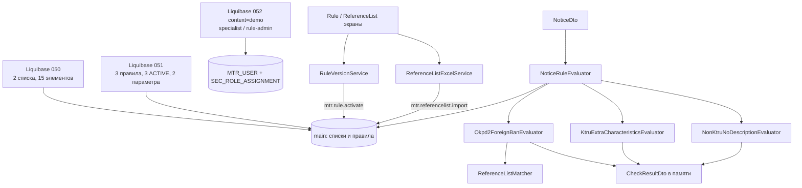

# Урок 6. Справочники, правила и роли

> Курс multi-reestr, Jmix 3.0.3. План уроков: [../LESSONS.md](../LESSONS.md). Экраны: [../UI.md](../UI.md). Модель: [../model/OVERVIEW.md](../model/OVERVIEW.md) §5, [README.md](../model/README.md) (таблица «Как правила используют модель», начальные данные). Сущности: [ReferenceList](../model/entities/ReferenceList.md), [ReferenceListItem](../model/entities/ReferenceListItem.md), [Rule](../model/entities/Rule.md), [RuleVersion](../model/entities/RuleVersion.md), [RuleParameter](../model/entities/RuleParameter.md), [CheckResultDto](../model/entities/CheckResultDto.md). Перечисления: [RuleTemplateType](../model/enums/RuleTemplateType.md), [RuleVersionStatus](../model/enums/RuleVersionStatus.md), [ParameterType](../model/enums/ParameterType.md), [ReferenceListKind](../model/enums/ReferenceListKind.md), [Severity](../model/enums/Severity.md), [RuleObjectType](../model/enums/RuleObjectType.md). Срок на карточке версии: [DeadlineSpec](../model/entities/DeadlineSpec.md), урок [lesson-05-deadlines.md](lesson-05-deadlines.md).
> Предыдущий урок: [lesson-05-deadlines.md](lesson-05-deadlines.md). Тег в конце урока: `lesson-06`.

## Зачем этот урок

**Где мы.** После урока 5 приложение умеет считать срок по ст. 191–193 ГК. Сами проверки ещё не из чего запускать: нет списков ОКПД2, нет экземпляров правил, нет ролей специалиста и администратора.

**Задача пользователя.** Администратор правил хочет завести перечень ПП 1875, три первых проверки извещения и менять параметры версии без правки Java. Специалист хочет читать правила и списки, но не активировать версии и не затирать Excel-ом чужой перечень. На Windows в продуктиве не должно появиться известных паролей `specialist` / `rule-admin`.

**В чём подвох.** Шаблон, правило и версия — три разных слоя. Логика живёт в Java-бине шаблона, экземпляр — в `Rule`, а перечень кодов и флаги — в `RuleVersion` + `RuleParameter`. Если смешать их, историческую проверку «по нормам на дату размещения» не сделать. Второй подвох — matching ОКПД2: префикс `26.80` ловит и исключение `26.80.12.000`. Третий — Liquibase: пустой UUID в CSV и суффикс `Z` у `APPROVED_AT` ломают HSQL.

**Что получится в конце.** Справочные списки с Excel (Apache POI), matcher, три evaluator'а замечаний 3 / 5 / 7, диспетчер `NoticeRuleEvaluator` (в память, без `CheckRun` / `Violation`), редактор правил с «Новая версия» / «Активировать» / «В архив», `@ResourceRole` специалиста и администратора правил. Обязательные данные — ченджсеты **050** и **051**. Демо-пользователи — только **052** с `context="demo"`. Кнопка «Проверить» и реестр нарушений — урок 7.

**Как проверяем.** Юнит-тесты matcher / Excel / evaluator'ов на DTO. Spring-тесты: счётчики Liquibase (2 списка, 15 элементов, 3 правила, 3 ACTIVE-версии, 2 параметра), копирование версии и отказ активировать пересекающийся период, диспетчер по seed-перечню. Docker нужен остальным тестам проекта; на зелёной ветке пропущенных быть не должно.

## Содержание

1. [Цель урока](#1-цель-урока)
2. [Архитектура](#2-архитектура)
3. [Теория: шаблон, правило, версия, параметры](#3-теория-шаблон-правило-версия-параметры)
4. [Справочные списки и matching](#4-справочные-списки-и-matching)
5. [Три evaluator'а и нормы](#5-три-evaluatora-и-нормы)
6. [Роли](#6-роли)
7. [Решения A–Q](#7-решения-aq)
8. [Подготовка окружения](#8-подготовка-окружения)
9. [Шаги реализации](#9-шаги-реализации)
10. [Тесты](#10-тесты)
11. [Типичные ошибки](#11-типичные-ошибки)
12. [Контрольные вопросы и задания](#12-контрольные-вопросы-и-задания)
13. [Чеклист «урок завершён»](#13-чеклист-урок-завершён)

## 1. Цель урока

После урока приложение:

- хранит справочные списки `ReferenceList` / `ReferenceListItem` и сверяет значение через `ReferenceListMatcher` (нормализация, префикс, исключение, период);
- импортирует и экспортирует элементы Excel'ем (`ReferenceListExcelService`): сводка, подтверждение, **замена** списка одной транзакцией;
- держит **3 из 10** правил аудита как `Rule` + ACTIVE `RuleVersion`: `R03_PP1875`, `R05_KTRU_CHARS`, `R07_NO_DESCRIPTION`;
- считает срабатывания тремя бинами шаблонов и собирает их в `NoticeRuleEvaluator` в список `CheckResultDto` (fingerprint SHA-256, плейсхолдеры в пояснении);
- даёт редактор: список правил без «Удалить», «Новая версия», активация без пересечения периодов, архив, блок `DeadlineSpec` только для `DEADLINE` / `LATE_DELIVERY_PENALTY`;
- назначает роли `specialist` и `rule-administrator` (стек с `ui-minimal` и `notice-viewer`); демо-логины — только контекст `demo`.

`ReferenceList`, `Rule`, `RuleVersion`, `RuleParameter` и перечисления уже есть в модели. **Новых JPA-сущностей, перечислений и DTO не создаём.** `CheckResultDto` уже в коде (карточка урока 7): evaluator его заполняет, в реестр ничего не пишет.

## 2. Архитектура



| Класс / файл | Пакет / место | Роль |
|---|---|---|
| `ReferenceList`, `ReferenceListItem` | `entity` | Список и элемент: `value`, `prefixMatch`, `excluded`, период |
| `Rule`, `RuleVersion`, `RuleParameter` | `entity` | Экземпляр шаблона, версия, параметр (`LIST` → список) |
| `RuleTemplateType` | `entity` | Enum шаблона; Java-бин — отдельно |
| `ReferenceListMatcher` | `rules` | Входит ли кандидат в список на дату |
| `ReferenceListExcelService` | `rules` | Разбор `.xlsx`, замена элементов, экспорт |
| `RuleTemplateEvaluator` | `rules` | Интерфейс: `evaluate(notice, rule, version, params)` |
| `Okpd2ForeignBanEvaluator` и др. | `rules` | Три шаблона этого урока |
| `NoticeRuleEvaluator` | `rules` | ENABLED-правила, ACTIVE-версия на дату, диспетчер |
| `RuleVersionService` | `rules` | Копия в DRAFT, активация, архив |
| `CheckResults` | `rules` | Пояснение и `fingerprint` |
| `SpecialistRole`, `RuleAdministratorRole` | `security` | `@ResourceRole`; определения в коде, не в Liquibase |
| `MultiReestrSpecifics` | `security` | `mtr.rule.activate`, `mtr.referencelist.import` |
| `050-reference-lists.xml`, `051-rules.xml` | `liquibase/changelog` | Обязательные данные, **без** `context` |
| `052-users-roles.xml` | `liquibase/changelog` | Демо-пользователи, `context="demo"` |

Кнопка «Проверить» на карточке извещения в этом уроке не появляется: диспетчер вызывается из тестов. Запись `Violation` / `CheckRun` — урок 7.

## 3. Теория: шаблон, правило, версия, параметры

Четыре слоя, которые нельзя склеить в одну таблицу.

**Шаблон (`RuleTemplateType` + Java-бин).** Это не сущность. Enum говорит, *какая* проверка, бин — *как* она смотрит DTO. Пользователь шаблон не пишет. Восемь значений enum уже в модели; в этом уроке бины есть только у трёх. Остальные шаблоны без бина диспетчер молча пропускает (пустой вклад в результат).

**Правило (`Rule`).** Экземпляр шаблона: `code` (`R03_PP1875`), `name`, `objectType` (здесь `NOTICE`), `severity`, `legalRef`, `explanationTemplate` с `{плейсхолдерами}`, флаг `enabled`. Soft delete нет: правило с историей нарушений не удаляют, его выключают. `templateType` после создания не меняют — иначе старые версии начнут значить другое.

**Версия (`RuleVersion`).** Параметры и (для сроков) `DeadlineSpec` на период `validFrom`–`validTo`. Статусы — Integer-enum: DRAFT=10, ACTIVE=20, ARCHIVED=30. В проверке участвует только ACTIVE, у которой дата объекта попадает в период (`validTo == null` — бессрочно). Несколько ACTIVE одного правила не должны пересекаться по датам: это проверяет сервис, не уникальный индекс БД. `approvedBy` / `approvedAt` заполняет только «Активировать».

**Параметр (`RuleParameter`).** Пара «код — значение» у версии. Тип `ParameterType`: для `LIST` заполнен `referenceList`, для остальных — строка `value` (у `BOOLEAN` это `true`/`false`, у `DATE` — ISO-дата). Пример: у R03 параметр `okpdList` указывает на список `PP1875_ANNEX1`.

Зачем версии. Норма меняется, старые извещения надо проверять **по норме на дату размещения**. Новая редакция перечня — новая версия с другим `validFrom`, предыдущая уходит в архив, пересечения нет.

## 4. Справочные списки и matching

Список — заголовок (`code`, `name`, `kind`, `legalRef`). Элементы — composition: `value`, `prefixMatch`, `excluded`, `groupCode` (пункт перечня, «3.00»), `caption`, `validFrom` / `validTo`.

`ReferenceListMatcher.normalize` убирает пробелы. Пустой кандидат — не совпадение.

Порядок проверки элемента:

1. Период. Если дата объекта `null`, подходят только элементы **без** обеих границ. Иначе `validFrom ≤ date ≤ validTo` (правая граница включительно, `validTo == null` — открыто).
2. Точное равенство нормализованных строк или `startsWith`, если `prefixMatch`.
3. Совпавший элемент с `excluded = true` **сразу** даёт «не входит» — даже если другой префикс уже подошёл.

Так `26.80` (префикс) + исключение `26.80.12.000` пропускает оптические диски и оставляет `26.80.11.000`.

Импорт Excel — тот же приём, что «Загрузить год» календаря: файл → сводка → подтверждение → JPQL `delete` элементов списка + `flush` + вставка. Append нет: иначе старые коды останутся и matcher начнёт врать. В ячейке `value` несколько кодов через запятую — отдельные элементы (как в legacy `okpd2_1875_zap`). Заголовки принимают и английские имена полей, и русские («значение», «префикс», «исключение», «пункт», «наименование»/«примечание», «с», «по»). Даты — ISO или `дд.мм.гггг`. Право на запись — `SpecificPolicy` `mtr.referencelist.import`.

Кнопки загрузки из legacy `okpd2_1875_zap` в этом уроке нет: в репозитории лежит компактный тестовый набор (данных), полный перечень администратор догрузит Excel'ем.

## 5. Три evaluator'а и нормы

Все три смотрят `NoticeDto.items` (`SpecPositionDto`) и возвращают `List<CheckResultDto>`. Дата для списка и версии — `publishedAt.toLocalDate()`. Если `publishedAt` нет, диспетчер извещение пропускает.

| Код | Шаблон | Норма | Когда срабатывает | Серьёзность seed |
|---|---|---|---|---|
| `R03_PP1875` | `OKPD2_FOREIGN_BAN` | ПП РФ от 23.12.2024 № 1875, приложение 1 | ОКПД2 позиции входит в `okpdList`, нет `foreignBan` и нет пары «невозможность + непустой `banImpossibleReason`» | ERROR |
| `R05_KTRU_CHARS` | `KTRU_EXTRA_CHARACTERISTICS` | ПП РФ от 08.02.2017 № 145 | У позиции есть КТРУ, у характеристики `fromEis` не `true` (добавлена заказчиком, не из справочника ЕИС) | ERROR |
| `R07_NO_DESCRIPTION` | `NON_KTRU_NO_DESCRIPTION` | ст. 33 44-ФЗ | Нет КТРУ и нет ни одной структурированной характеристики | WARNING |

**Замечание 3.** Нацрежим: код из перечня — в извещении должен стоять запрет ст. 14 либо обоснованная невозможность установить запрет. Одного флажка `banImpossible` мало.

**Замечание 5.** К позиции с КТРУ нельзя дописывать характеристики, которых нет в ЕИС (`noticektruharacts.isfromoos`). Параметр `allowedIfKtruPermits` в seed есть (`BOOLEAN`, `false`), evaluator его **не читает**: в DTO нет признака «КТРУ это разрешает». Строгое `fromEis`.

**Замечание 7.** Без КТРУ описание всё равно должно быть структурированным (список характеристик), а не только текстом. Позиция с КТРУ сюда не входит — её смотрит замечание 5.

`detail` для отпечатка: `pos={n};id={specId}`, для лишней характеристики ещё `;char={charId}`. `fingerprint = SHA-256(ruleCode|objectKey|detail)` в hex, 64 символа. Пояснение подставляет `{pos}`, `{name}`, `{okpd2}`, `{ktru}`, `{detail}`, `{number}`.

Остальные семь замечаний (1, 2, 4, 6, 8, 9, 10) — следующие уроки: сроки, файлы ТЗ, обязательность КТРУ, вид договора, неустойка.

## 6. Роли

Две ресурсные роли в коде (`@ResourceRole`). В Liquibase их не вставляют: Jmix подхватывает интерфейсы при старте.

| Роль | `code` | Что умеет |
|---|---|---|
| Специалист | `specialist` | Чтение правил, версий, параметров, списков, календаря, `Violation`, `CheckRun`. Полный CRUD `ContractTerm` и `PlanScheduleEvent` (экраны урока 8 уже в меню). Меню: Правила, Контроль, Справочники |
| Администратор правил | `rule-administrator` | CRUD правил, версий, параметров, списков, календаря. Экраны диалогов «Загрузить год» и импорта Excel. `SpecificPolicy`: `mtr.rule.activate`, `mtr.referencelist.import` |

На пользователя роли **накладывают стопкой**, политики извещений не копируют:

- специалист: `ui-minimal` + `notice-viewer` + `specialist`;
- администратор правил: то же плюс `rule-administrator`.

`notice-viewer` уже была в курсе (поиск и карточка). Пункты «Реестр нарушений» и «Журнал проверок» до урока 7 пустые, но без READ специалист ловил бы 403 — поэтому чтение выдано сейчас. Кнопка «Загрузить год» на календаре видна только если есть UPDATE у `CalendarDay` (у специалиста скрыта).

Пользователи `specialist` / `rule-admin` с паролями `{noop}specialist` и `{noop}rule-admin` — **только** ченджсет 052 с `context="demo"`. На Windows в `config/application.properties` стоит `main.liquibase.contexts=!demo` (файл-пример `dev/deploy/application-windows.properties.example`), чтобы известные пароли не попали в продуктив. Admin с полным доступом по-прежнему из шаблона проекта.

## 7. Решения A–Q

Документация оставляла развилки. Ниже — зафиксированные решения, как в коде, с правками после плана.

| | Тема | Решение |
|---|---|---|
| **A** | 3 правила или все 10 замечаний | **3 правила** сейчас. Остальные семь — вместе с их evaluator'ами в следующих уроках. |
| **B** | Полное прил. 1 ПП 1875 или компактный CSV | **Компактный тестовый набор (данных)**: префиксы, которые встречаются в эталонных извещениях, плюс исключение `26.80.12.000` и служебные коды для Excel. Полный перечень — импорт из Excel. |
| **C** | Пользователи обязательные или `demo` | **Исправление плана.** Логины `specialist` / `rule-admin` с `{noop}` — **только** `context="demo"`. Определения ролей — код, seed ролей не нужен. |
| **D** | Свой тип hit или `CheckResultDto` | **`CheckResultDto`**. Новый DTO не добавляем. |
| **E** | Excel: дописать или заменить | **Замена после подтверждения**, как год календаря. |
| **F** | `banImpossible` без причины | **Недостаточно.** Нужен непустой `banImpossibleReason`. |
| **G** | `allowedIfKtruPermits` | Параметр в seed **сохраняем**, evaluator **игнорирует**. Строгое `fromEis`. |
| **H** | Состав ролей | **Стек** `ui-minimal` + `notice-viewer` + `specialist` [+ `rule-administrator`]. Политики извещений в новые интерфейсы не копировать. |
| **I** | Удаление правила | **Кнопки «Удалить» на списке нет.** Отключение — `enabled`. |
| **J** | Кнопка загрузки из `okpd2_1875_zap` | **Не делаем** (предложение UI.md). |
| **K** | Форма параметров | **Лёгкая:** текст / флажок / дата / выбор списка по `paramType`, не движок схем. |
| **L** | Заглушки остальных шаблонов | **Без бинов.** Нет бина — диспетчер ничего не добавляет. |
| **M** | `detail` в fingerprint | `pos={pos};id={specId}`; для замечания 5 ещё `;char={id}`. |
| **N** | Дата действия | `publishedAt.toLocalDate()`. Нет даты — извещение не проверяем. |
| **O** | Код замечания 5 | **`R05_KTRU_CHARS`** (не `R06`). |
| **P** | Меню «Контроль» до урока 7 | **Чтение** `Violation` и `CheckRun`, чтобы пустые экраны не давали 403. |
| **Q** | Голден-интеграция на извещение | **Сначала юнит на DTO.** Seed-диспетчер проверяется синтетическим извещением со стабильным номером из тестового набора (данных), без зависимости от счётчика позиций в legacy. |

Номера ченджсетов: **040 уже занят** (`040-legacy-connection-settings.xml`, урок 1). Списки и правила — **050**, **051**, демо-пользователи — **052**. `includeAll` подхватывает их по имени файла.

## 8. Подготовка окружения

Модель урока 6 уже создана в визарде в начале курса. Календарь 2024–2027 и `DeadlineCalculator` уже в основной БД (уроки 4–5). Новых сущностей нет.

Для юнит-тестов matcher / Excel / evaluator'ов Docker не нужен.

Для `RulesLiquibaseCoverageTest` и `RuleVersionServiceTest` нужна тестовая main-БД после Liquibase (профиль `test`). Контекст `demo` в тестах не отфильтрован — демо-пользователи в тестовой базе есть; в продуктиве Windows их отсекает `main.liquibase.contexts=!demo`.

Полный `./gradlew test` по-прежнему требует **Docker** (Testcontainers `postgres:9.6` для legacy). Без Docker часть классов пропускается; на зелёной ветке урока пропущенных быть не должно.

Кнопки «Проверить» нет. Блок `DeadlineSpec` на версии виден, но шаблонов DEADLINE в seed ещё нет — поля понадобятся урокам 8–9.

## 9. Шаги реализации

### 9.1. Не трогать модель

Сущности и перечисления свернуть с карточками в `docs/model`. Расхождений в этом уроке нет: evaluator пишет в уже существующий `CheckResultDto`.

### 9.2. Matcher и Excel

Пакет `com.digitilius.multireestr.rules`. `ReferenceListMatcher` — утилита без Spring. `ReferenceListExcelService` — `@Service`: `preview`, `replaceItems` (транзакция + право импорта), `export`, `parse`.

Замена элементов:

```java
entityManager.createQuery("delete from mtr_ReferenceListItem e where e.list = :list")
        .setParameter("list", list)
        .executeUpdate();
entityManager.flush();
// затем SaveContext со новыми ReferenceListItem
```

Тот же приём, что `replaceYear` календаря: EclipseLink иначе вставит раньше удаления.

### 9.3. Evaluator'ы и диспетчер

Интерфейс `RuleTemplateEvaluator` + три `@Component`. Диспетчер собирает `List<RuleTemplateEvaluator>` в карту по `templateType`.

```java
for (Rule rule : loadEnabledRules()) {
    RuleVersion version = activeVersionOn(rule, date);
    RuleTemplateEvaluator evaluator = evaluators.get(rule.getTemplateType());
    if (version == null || evaluator == null) {
        continue;
    }
    results.addAll(evaluator.evaluate(notice, rule, version, new RuleEvalParams(version.getParameters())));
}
```

Fetch-plan правила тянет версии, параметры, список и его элементы — иначе matcher увидит пустой `items`.

`CheckResults.hit` заполняет код, имя, серьёзность, `objectKey = notice.number`, норму, сообщение, fingerprint.

### 9.4. `RuleVersionService`

- `copyToDraft` — следующий `versionNumber`, статус DRAFT, копия параметров и `DeadlineSpec`.
- `activate` — только DRAFT, есть `validFrom`, нет пересечения с другими ACTIVE, `approvedBy` = текущий username, `approvedAt` = сейчас. Право `mtr.rule.activate`.
- `archive` — только ACTIVE → ARCHIVED, то же право.

Пересечение закрытых и открытых интервалов: пустой `validTo` считается плюс бесконечностью.

### 9.5. Экраны

Список правил (`rules`): колонки `code`, `name`, `templateType`, `objectType`, `severity`, `enabled`; `genericFilter` по этим полям кроме имени и кода; **без** `list_remove`.

Карточка правила (`rules/:id`): вкладки «Основное» и «Версии»; `templateType` read-only, если сущность не новая; кнопка **«Новая версия»** копирует выделенную или последнюю по номеру.

Версия (диалог, маршрут `rule-versions/:id`): статус, `approvedBy` / `approvedAt` только чтение; блок срока скрыт, пока шаблон не `DEADLINE` и не `LATE_DELIVERY_PENALTY`; ACTIVE/ARCHIVED — весь экран read-only; «Активировать» / «В архив».

Параметр: при `BOOLEAN` — флажок, при `DATE` — дата, при `LIST` — `EntityComboBox` списка, иначе текстовое `value`.

Списки (`reference-lists` / `reference-lists/:id`): CRUD элементов; **«Импорт из Excel»** (сводка и подтверждение «Заменить элементы списка?») и **«Экспорт»**.

Календарь: `loadYearButton.setVisible(context.isUpdatePermitted())`.

### 9.6. Liquibase 050–052

Подключение — уже существующий `includeAll` в `changelog.xml`, отдельные `include` не нужны. Порядок по имени файла: 050, 051, 052.

| Файл | Context | Содержимое |
|---|---|---|
| `050-reference-lists.xml` | нет | `PP1875_ANNEX1` (12 элементов, в т.ч. префиксы 27.20, 26.80, 17.12, … и исключение 26.80.12.000), `KTRU_SAMPLE` (3 кода) |
| `051-rules.xml` | нет | 3 правила, 3 версии STATUS=20 с `validFrom=2024-01-01`, параметры `okpdList` и `allowedIfKtruPermits` **insert'ами**, не CSV |
| `052-users-roles.xml` | `demo` | пользователи и `SEC_ROLE_ASSIGNMENT` |

Параметры не кладут в CSV: пустой `REFERENCE_LIST_ID` HSQL читает как UUID и падает; UUID с девятью hex в группе (`eaaaaaaaa-…`) тоже невалиден. `APPROVED_AT` в CSV версий — `2026-01-01T00:00:00` **без** `Z`.

### 9.7. Что сознательно не делаем

- Кнопка «Проверить», запись `Violation` / `CheckRun`.
- Evaluator'ы замечаний 1, 2, 4, 6, 8, 9, 10 и dry-run.
- Загрузка полного ПП 1875 из legacy.
- Seed ролей и прод-пользователей с известным паролем.

## 10. Тесты

Запуск: `./gradlew test` при запущенном Docker. Результат прогона после этого урока: **168 passed, 0 skipped, 0 failed** (из них 5 классов этого урока: 4 + 2 + 3 + 1 + 4 метода).

| Тест | Что проверяет |
|---|---|
| `prefixIncludesLongerCode` | `27.20` + prefix → `27.20.23.130`; чужой код — нет |
| `excludedWinsOverPrefix` | `26.80.12.000` исключён, `26.80.11.000` входит |
| `validityWindow` | `14.1` действует в 2024 и не действует 01.01.2025 |
| `blankCandidateDoesNotMatch` | пробелы и `null` |
| `parseSplitsCommaAndReadsFlags` | «99.00, 99.01» → два элемента; дата `01.01.2024` |
| `exportRoundTrip` | экспорт → разбор, префикс сохранился |
| `okpd2RequiresBanOrReason` | срабатывает только позиция без запрета и без причины; fingerprint 64 символа |
| `extraCharacteristicsOnlyWhenKtruPresent` | лишняя характеристика при КТРУ; без КТРУ правило молчит |
| `noDescriptionWhenNoKtruAndNoCharacteristics` | пустое описание без КТРУ; с характеристиками или с КТРУ — нет |
| `copyToDraftAndRejectOverlappingActivate` | DRAFT с номером +1; активация на том же периоде — «пересекается» |
| `seedCounts` | 2 / 15 / 3 / 3 / 2 |
| `demoUsersLoadedWhenContextUnfiltered` | в тестах оба логина есть |
| `demoUsersChangesetHasDemoContext` | в XML 052 есть `context="demo"`, у первого changeSet он не забыт |
| `noticeEvaluatorUsesSeededOkpdList` | синтетическое извещение с ОКПД2 `27.20.23.130` ловит R03 и R07, не R05 |

Номер `0173100017026000008` в последнем тесте — открытый идентификатор закупки из тестового набора (данных), персональных данных нет. Позиции в этом тесте **не** читаются из legacy: собирается DTO в памяти, чтобы счётчик не прыгал.

## 11. Типичные ошибки

| Симптом | Причина | Что делать |
|---|---|---|
| `26.80.12.000` срабатывает как запрет | Matcher не смотрит `excluded` или исключение без точного кода | Сначала excluded, потом «входит» |
| Срок/перечень «не той редакции» | Взяли последнюю ACTIVE, а не версию на `publishedAt` | `activeVersionOn(rule, date)` |
| `banImpossible` без текста проходит замечание 3 | Проверили только булево поле | Нужен непустой `banImpossibleReason` |
| Замечание 5 на позиции без КТРУ | Не отфильтровали пустой `ktru` | Сначала наличие КТРУ |
| `allowedIfKtruPermits=true` ничего не меняет | Параметр намеренно игнорируется | Ждать признак в каталоге; пока `fromEis` |
| HSQL: unexpected token / DATE | `APPROVED_AT` с суффиксом `Z` | Дата-время без `Z` |
| HSQL: invalid UUID | Пустой FK в CSV или 9 hex в группе UUID | XML `insert`, валидный UUID |
| На проде появились `specialist` / `rule-admin` | Забыли `main.liquibase.contexts=!demo` | Пример Windows-конфига |
| 403 на «Контроль» у специалиста | Нет READ на `Violation` / `CheckRun` | Решение P |
| «Загрузить год» видна специалисту | Не спрятали по UPDATE | `CrudEntityContext.isUpdatePermitted()` |
| Импорт Excel оставил старые коды | Append вместо delete | Как календарь: delete + flush + insert |
| Кнопка «Удалить» на списке правил | Studio сгенерировала `list_remove` | Убрать, отключать `enabled` |

## 12. Контрольные вопросы и задания

1. Чем шаблон отличается от `Rule` и зачем ещё `RuleVersion`?
2. Почему периоды ACTIVE не защищают уникальным индексом в БД?
3. Как matcher решает спор «префикс входит, точный код исключён»?
4. Почему `banImpossible` без причины не закрывает замечание 3?
5. Почему evaluator замечания 5 не читает `allowedIfKtruPermits`?
6. Что попадёт в `fingerprint`, если сработала лишняя характеристика?
7. Зачем роли кладут стопкой, а не копируют политики `notice-viewer` в `SpecialistRole`?
8. Почему 052 с `context="demo"`, а 050/051 — без контекста? Что делает `main.liquibase.contexts=!demo` на Windows?
9. **Задание.** Добавьте в matcher элемент `27.20.23.130` с `excluded=true` и префикс `27.20`. Какой ответ на код `27.20.23.130` и почему?
10. **Задание.** Создайте DRAFT-копию R03 и задайте `validFrom` на день после `validTo` действующей (сначала закройте действующую архивом или ограничьте `validTo`). Когда активация пройдёт и когда сервис скажет «пересекается»?
11. **Задание.** Выгрузите `PP1875_ANNEX1` в Excel, добавьте строку `99.00, 99.01` и импортируйте обратно. Сколько элементов станет и какой тест уже проверяет разбиение по запятой?

## 13. Чеклист «урок завершён»

- [ ] Модель не менялась, сверка с `docs/model`.
- [ ] Matcher: нормализация, префикс, excluded, период.
- [ ] Excel: сводка, подтверждение, замена, разбиение по запятой, право `mtr.referencelist.import`.
- [ ] Три evaluator'а + диспетчер, `CheckResultDto` без записи в реестр.
- [ ] `RuleVersionService`: копия, активация без пересечения, архив, `mtr.rule.activate`.
- [ ] UI: нет удаления правила, «Новая версия», срок только у DEADLINE-шаблонов, редакторы параметров, импорт/экспорт списка, «Загрузить год» скрыта без UPDATE.
- [ ] Роли в коде; стек с `ui-minimal` и `notice-viewer`; READ на `Violation` / `CheckRun`.
- [ ] Liquibase 050/051 без context, 052 с `demo`; Windows `main.liquibase.contexts=!demo`.
- [ ] 3 из 10 правил: R03, R05, R07. Кнопки «Проверить» нет.
- [ ] В текстах — «тестовый набор (данных)». Персональных данных нет.
- [ ] Docker запущен, `./gradlew test` зелёный без пропущенных.
- [ ] Коммит и тег:

```bash
git add <файлы урока> && git commit -m "Lesson 06: reference lists, rules, roles"
git tag lesson-06
```
