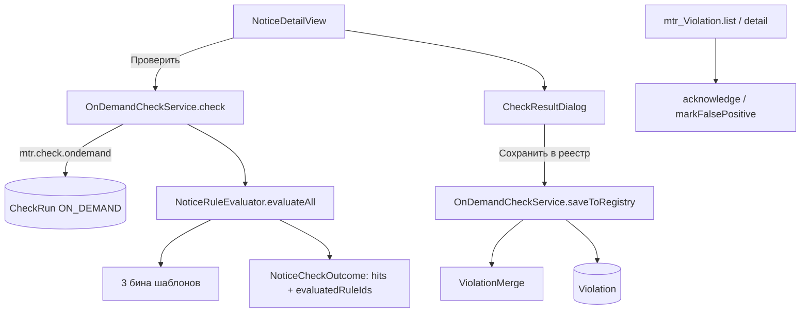

# Урок 7. Проверка по запросу и реестр нарушений

> Курс multi-reestr-helper, Jmix 3.0.3. План уроков: [../LESSONS.md](../LESSONS.md). Экраны: [../UI.md](../UI.md). Модель: [../model/OVERVIEW.md](../model/OVERVIEW.md) §5, карточки [CheckResultDto](../model/entities/CheckResultDto.md), [CheckRun](../model/entities/CheckRun.md), [Violation](../model/entities/Violation.md); перечисления [CheckRunMode](../model/enums/CheckRunMode.md), [CheckRunStatus](../model/enums/CheckRunStatus.md), [ViolationStatus](../model/enums/ViolationStatus.md).
> Предыдущий урок: [lesson-06-rules.md](lesson-06-rules.md). Тег в конце урока: `lesson-07`.

## Зачем этот урок

**Где мы.** После урока 6 диспетчер `NoticeRuleEvaluator` считает срабатывания трёх правил в память (`CheckResultDto`). На карточке извещения кнопки «Проверить» нет, журнал `CheckRun` и реестр `Violation` пустые (экраны уже в меню, чтобы не ловить 403).

**Задача пользователя.** Специалист открыл извещение, нажал «Проверить», увидел срабатывания с нормой и пояснением, сохранил их в реестр. Повторная проверка того же извещения не плодит дубли. То, что правило больше не ловит, помечается «устранено». Ложное срабатывание требует комментария.

**В чём подвох.** `CheckResultDto` не хранит `rule` / `ruleVersion`. Fingerprint общий для запусков, но `FIXED` нельзя ставить всему объекту: выключенное правило и шаблон без бина в этом прогоне не участвовали. Счётчик NEW в меню — урок 9, не этот.

**Что получится в конце.** Кнопка «Проверить», диалог `mtr_CheckResultDialog`, `OnDemandCheckService` (журнал + реестр), действия «принято к сведению» / «ложное срабатывание», фильтр реестра по извещению. Новых JPA-сущностей, перечислений и DTO нет. Liquibase 060 не нужен: `Violation` и `CheckRun` не сидируются.

**Как проверяем.** Юнит-тесты `ViolationMerge` (дедуп, статусы, «неоценённое правило не FIXED»). Spring-тест сервиса. Голден на 10 номерах тестового набора (данных): уникальные коды правил, без счётчика позиций. Docker + `./gradlew test`: **198 passed, 0 skipped, 0 failed**.

## Содержание

1. [Цель урока](#1-цель-урока)
2. [Архитектура](#2-архитектура)
3. [Проверка по запросу](#3-проверка-по-запросу)
4. [Реестр: fingerprint, статусы, FIXED](#4-реестр-fingerprint-статусы-fixed)
5. [Экраны](#5-экраны)
6. [Роли](#6-роли)
7. [Решения A–P](#7-решения-ap)
8. [Подготовка окружения](#8-подготовка-окружения)
9. [Шаги реализации](#9-шаги-реализации)
10. [Тесты](#10-тесты)
11. [Типичные ошибки](#11-типичные-ошибки)
12. [Контрольные вопросы и задания](#12-контрольные-вопросы-и-задания)
13. [Чеклист «урок завершён»](#13-чеклист-урок-завершён)

## 1. Цель урока

После урока приложение:

- на загруженной карточке показывает «Проверить» (право `mtr.check.ondemand`) и «Нарушения по извещению»;
- пишет `CheckRun` `ON_DEMAND` в момент кнопки (RUNNING → SUCCESS или FAILED);
- показывает `CheckResultDto` в диалоге; «Сохранить в реестр» делает upsert `Violation` по `fingerprint`;
- квитирует NEW → ACKNOWLEDGED и помечает FALSE_POSITIVE при непустом `comment`;
- при повторном прогоне обновляет `lastDetectedAt` / `lastCheckRun` и ставит `FIXED` только правилам, которые в этом запуске реально считались.

Модель урока 7 уже создана в визарде в начале курса. **Новых JPA-сущностей, перечислений и DTO не создаём.**

## 2. Архитектура



| Класс / файл | Пакет / место | Роль |
|---|---|---|
| `NoticeRuleEvaluator.evaluateAll` | `rules` | Hits + id правил, у которых была ACTIVE-версия и бин |
| `NoticeCheckOutcome` | `rules` | Hits, `evaluatedRuleIds`, привязка fingerprint → Rule/RuleVersion |
| `OnDemandCheckService` | `rules` | Журнал, запись в реестр, квитирование |
| `ViolationMerge` | `rules` | Дедуп, reopen FIXED, условие `shouldMarkFixed` |
| `CheckResultDialog` | `view.checkresult` | Таблица hits, «Сохранить в реестр» |
| `SpecialistRole` / `RuleAdministratorRole` | `security` | Violation у специалиста только READ; квитирование — `mtr.violation.triage`; CREATE/UPDATE CheckRun; `mtr.check.ondemand` у С и А |

Новых ченджсетов нет. Номера **050–052 заняты**, следующий свободный — **060+**, если понадобится демо.

## 3. Проверка по запросу

Кнопка на `NoticeDetailView` (карточка загружена). Без права `mtr.check.ondemand` кнопка скрыта (как «Загрузить год» без UPDATE).

`OnDemandCheckService.check(notice)`:

1. Право.
2. `CheckRun`: `mode=ON_DEMAND`, `status=RUNNING`, `objectType=NOTICE`, `objectKey=номер`. `ruleVersion` пустой (это поле dry-run, урок 10).
3. `NoticeRuleEvaluator.evaluateAll`. Нет `publishedAt` — пустой исход, журнал всё равно SUCCESS, `violationsFound=0`.
4. SUCCESS, `objectsChecked=1`, `violationsFound=hits.size()`. Исключение — FAILED и `errorMessage`, затем проброс. `PARTIAL` на одном объекте не используем.

Диалог показывает `severity`, `ruleCode`, `ruleName`, `detail`, `message`, `legalRef`. «Закрыть» оставляет журнал без `Violation`. «Сохранить в реестр» пишет нарушения, привязанные к этому `CheckRun`. Кнопка блокируется на время сохранения и после успеха.

## 4. Реестр: fingerprint, статусы, FIXED

`fingerprint = SHA-256(ruleCode|objectKey|detail)` (hex, 64), уже в `CheckResults`. UNIQUE в БД.

Новая запись: `NEW`, `firstDetectedAt=lastDetectedAt=now`, `legacyId=notice.id`, `objectCaption=номер — предмет`, копия `message` / `legalRef` / `severity`. Сроки (`dueDate` / `factDate`) у текущих трёх правил пустые.

Повтор с тем же fingerprint: обновить `lastDetectedAt`, `lastCheckRun`, `ruleVersion`, текст; **не** сбрасывать ACKNOWLEDGED и FALSE_POSITIVE. Если было FIXED — снова NEW, очистить `resolvedAt` и квитирование.

`FIXED`, если fingerprint пропал **и** `rule.id` входит в `evaluatedRuleIds` этого запуска **и** статус не `FALSE_POSITIVE`. ACKNOWLEDGED при исчезнувшем hit становится FIXED. Ложное срабатывание остаётся FP. В `evaluatedRuleIds` попадает правило, у которого `enabled`, есть ACTIVE-версия на дату извещения и есть бин шаблона. Выключенное правило, версия вне периода, шаблон без бина — запись не трогаем.

Hits одного запуска перед записью схлопываются по `fingerprint` (первый оставляем): повтор в том же `CheckRun` не должен упираться в UNIQUE.

Статусы Integer-enum: NEW=10, ACKNOWLEDGED=20, FALSE_POSITIVE=30, FIXED=40. «Принять к сведению» только из NEW. «Ложное срабатывание» нельзя из FIXED; комментарий обязателен (берётся с формы, пишется сервисом).

## 5. Экраны

- Карточка: «Проверить», «Нарушения по извещению» (`violations?objectKey=`). «Условия контракта» — по-прежнему предложение урока 8.
- `mtr_CheckResultDialog` — свой диалог, без маршрута.
- Реестр: нет Создать/Удалить; колонки как в UI.md; фильтр по умолчанию NEW+ACKNOWLEDGED (`propertyFilter` `status` **`IN_LIST`**, `defaultValue="10,20"` на атрибуте — для Integer-enum операция `IN` и вложенный `<defaultValue>` не работают); с query `objectKey` — все статусы этого извещения. Экспорт **не делаем** (нет gridexport). Счётчик NEW в меню — урок 9.
- Карточка нарушения: поля проверки read-only; `comment` редактируется; действия вместо combo статуса. «Открыть объект» — `notices/:number` для NOTICE.
- Журнал: только чтение; колонки включая `createdBy`, периоды. Вложенный список нарушений с `lastCheckRun` **не делаем**.

## 6. Роли

Стек как в уроке 6. Дополнительно:

| Роль | Что добавили |
|---|---|
| Специалист | READ `Violation` (атрибуты VIEW, `comment` — MODIFY на форме); CREATE+UPDATE (без DELETE) `CheckRun`; READ `CheckResultDto`; экран диалога; `SpecificPolicy` `mtr.check.ondemand` и `mtr.violation.triage` |
| Администратор правил | тот же specific и диалог, чтобы А мог нажать «Проверить» в стеке; запись в БД — политики специалиста |

`createdBy` журнала — текущий пользователь, `SystemAuthenticator` не используем.

## 7. Решения A–P

| | Тема | Решение |
|---|---|---|
| **A** | Когда писать `CheckRun` | **На «Проверить»**, не на «Сохранить». Save только `Violation`. |
| **B** | `PARTIAL` | На одном извещении не используем. |
| **C** | Счётчик NEW | **Урок 9.** |
| **D** | FIXED vs FALSE_POSITIVE, если hit исчез | ACKNOWLEDGED → **FIXED**. FALSE_POSITIVE **не трогаем**. |
| **E** | Повтор hit на ACK/FP | Статус не менять, обновить метаданные обнаружения. |
| **F** | Повтор hit на FIXED | **NEW**, сбросить `resolvedAt` и квитирование. |
| **G** | Нет `ruleVersion` в DTO | `NoticeCheckOutcome.bindings`, DTO не меняем. |
| **H** | Кто жмёт «Проверить» | С и А; specific на обеих ролях; CREATE/UPDATE — на специалисте. |
| **I** | Отдельный specific на квитирование | **`mtr.violation.triage`** у специалиста. Сервис проверяет право; стандартного save карточки нет. |
| **J** | «Нарушения по извещению» | **Делаем**, query `objectKey`. |
| **K** | Нарушения на карточке `CheckRun` | **Не делаем.** |
| **L** | Экспорт реестра | **Не делаем.** |
| **M** | Ченджсет 060 | **Нет.** |
| **N** | `SystemAuthenticator` | **Нет.** |
| **O** | Нет `publishedAt` | Пустой список hits, журнал SUCCESS/0. |
| **P** | Правило без бина | Не в `evaluatedRuleIds`, `FIXED` не ставить. |

## 8. Подготовка окружения

Модель CheckRun / Violation / CheckResultDto уже в коде. Seed правил — 050/051. Демо-пользователи — 052 `demo`.

Юнит `ViolationMerge` Docker не нужен. Голден и карточка — Testcontainers `postgres:9.6` и тестовый набор (данных). Персональных данных в эталоне нет.

## 9. Шаги реализации

### 9.1. Не трогать модель

Сверить сущности с карточками. Расхождений, требующих правки JPA/enum/DTO, нет.

### 9.2. Исход диспетчера

`evaluateAll`: для каждого enabled-правила с ACTIVE на дату и бином добавить `rule.id` в `evaluatedRuleIds`, даже если hits пустые.

### 9.3. Сервис

`check` без общей транзакции на FAILED (журнал должен сохраниться). `saveToRegistry` — `@Transactional`. Upsert только по fingerprint текущего объекта.

### 9.4. UI и роли

Кнопки на карточке, диалог, действия реестра, колонки журнала. Роли как в §6.

### 9.5. Тесты

`ViolationMergeTest`, `OnDemandCheckServiceTest` (синтетический номер `0173100017099000001` из того же формата, не из эталона выбора оригинала), `NoticeOnDemandGoldenTest` по CSV уникальных кодов.

## 10. Тесты

Запуск: `./gradlew test` при запущенном Docker. После этого урока: **198 passed, 0 skipped, 0 failed** (урок 6: 175).

| Тест | Что проверяет |
|---|---|
| `newHitStartsAsNew` | NEW, caption, legalRef |
| `sameFingerprintUpdatesLastDetectedAndKeepsAcknowledged` | ACK живёт |
| `falsePositiveSurvivesRehit` | FP живёт |
| `fixedRehitReopensAsNew` | reopen |
| `missingFingerprintOfEvaluatedRuleIsFixed` | ACK → FIXED |
| `falsePositiveIsNotMarkedFixedWhenHitGone` | FP не становится FIXED |
| `doesNotFixWhenRuleWasNotEvaluated` | выключенное / без бина |
| `checkWritesJournalAndSaveDedupesAndFixesOnlyEvaluatedRules` | журнал, дедуп, FIXED только у оценённого, FP после ACK |
| `duplicateHitsInOneRunAreDedupedBeforeSave` | повтор fingerprint в одном запуске |
| `specialistCanTriageAndViewerCannot` | `mtr.violation.triage` |
| `evaluateGoldenNoticeRuleCodes` | 10 номеров тестового набора (данных), уникальные коды; пустой список валиден (`-`) |

Голден (уникальные коды, не число позиций): `0173100017025000006` и `0173100017024000008` — пусто; `0173100017026000008` — R03; `0173100017026000015` — R05; `0173100017026000001` — R03+R07. Номера открытые, ПДн нет.

## 11. Типичные ошибки

| Симптом | Причина | Что делать |
|---|---|---|
| Дубли в реестре | Не тот fingerprint или не UNIQUE | SHA-256 как в `CheckResults` |
| Выключенное правило стало FIXED | В `evaluatedRuleIds` попали все enabled | Только ACTIVE + бин |
| 403 на «Сохранить» / квитирование | Entity UPDATE на Violation нет | Запись в реестр — `mtr.check.ondemand` + unconstrained; квитирование — `mtr.violation.triage` |
| «Проверить» у rule-admin без стека | Specific только у specialist | Specific на обеих ролях |
| Комментарий FP пропал | Reload из БД до копирования поля | Брать `comment` с формы |
| Журнал пустой после ошибки | FAILED в той же транзакции, что и throw | Сохранить FAILED отдельно |
| Голден скачет по числу hits | Завязались на pos | Только distinct `ruleCode` |

## 12. Контрольные вопросы и задания

1. Почему `CheckRun` пишется до «Сохранить в реестр»?
2. Что входит в `evaluatedRuleIds` и зачем это для FIXED?
3. Почему ACKNOWLEDGED не сбрасывается при повторном hit?
4. Зачем `CheckResultDto` без `ruleVersion`, если Violation его требует?
5. Чем `mtr.check.ondemand` отличается от CREATE на `CheckRun`?
6. Почему счётчик NEW не в этом уроке?
7. **Задание.** Пометьте нарушение FALSE_POSITIVE, исправьте позицию в DTO так, чтобы hit исчез. Какой статус, если правило всё ещё оценивалось?
8. **Задание.** Выключите R03 и повторите проверку извещения с R03. Должна ли старая запись стать FIXED?
9. **Задание.** Нажмите «Проверить» и закройте диалог. Что видно в журнале и в реестре?

## 13. Чеклист «урок завершён»

- [ ] Модель не менялась.
- [ ] «Проверить» пишет `CheckRun` ON_DEMAND и открывает диалог.
- [ ] «Сохранить в реестр» — дедуп по fingerprint.
- [ ] FIXED только для оценённых в этом запуске правил.
- [ ] Квитирование и ложное срабатывание с комментарием.
- [ ] «Нарушения по извещению»; счётчика NEW нет.
- [ ] Роли: `mtr.check.ondemand`, `mtr.violation.triage`, Violation у специалиста только READ.
- [ ] Нет Liquibase 060. Тексты — «тестовый набор (данных)», без ПДн.
- [ ] Docker, `./gradlew test`: 198 / 0 / 0.
- [ ] Коммит и тег:

```bash
git add <файлы урока> && git commit -m "Lesson 07: on-demand check and violation registry"
git tag lesson-07
```
