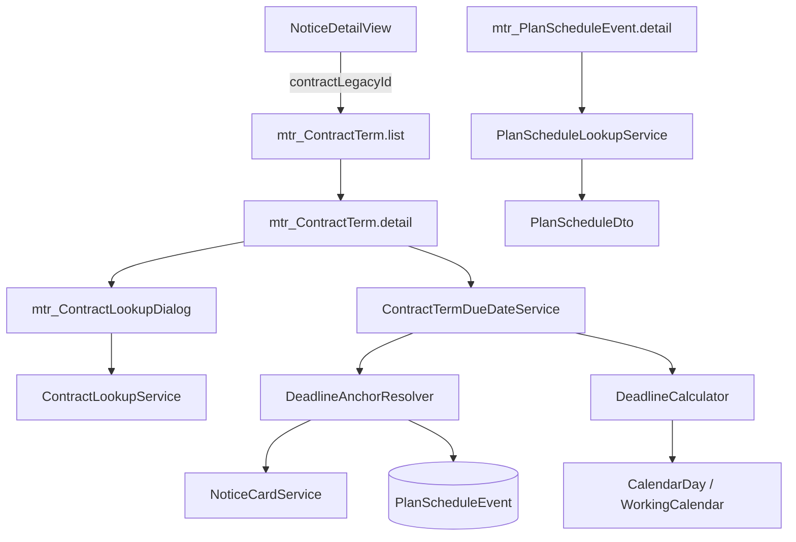

# Урок 8. Ручные данные: условия контрактов, даты ЛБО/ПГ

> Курс multi-reestr, Jmix 3.0.3. План уроков: [../LESSONS.md](../LESSONS.md). Экраны: [../UI.md](../UI.md). Модель: [ContractTerm](../model/entities/ContractTerm.md), [PlanScheduleEvent](../model/entities/PlanScheduleEvent.md), [PlanScheduleDto](../model/entities/PlanScheduleDto.md), [ContractDto](../model/entities/ContractDto.md), [ContractItemDto](../model/entities/ContractItemDto.md), [DeadlineSpec](../model/entities/DeadlineSpec.md), [ContractTermType](../model/enums/ContractTermType.md).
> Предыдущий урок: [lesson-07-checks.md](lesson-07-checks.md). Тег в конце урока: `lesson-08`.

## Зачем этот урок

**Где мы.** После урока 7 специалист проверяет извещение по запросу. Сроки поставки, приёмки, оплаты и даты ЛБО в legacy нет: `contractdateend` — это окончание действия, не срок поставки; `planzakuppackets.approvedate` пуст.

**Задача пользователя.** Ввести условие контракта формулой `DeadlineSpec` или конкретной датой, увидеть итоговую дату по календарю, привязать запись к контракту из MultiReestr. Задать даты ЛБО и утверждения ПГ, подставив год и версию из подсказки `PlanScheduleDto`.

**В чём подвох.** JPA не ссылается на legacy FK. `DeadlineCalculator` считает только от уже известной даты якоря. Тестовый набор (данных) не содержит таблицу `planzakuppackets`. UNIQUE `(FIN_YEAR, PLAN_VERSION)` допускает несколько `NULL` в `PLAN_VERSION` (PostgreSQL).

**Что получится в конце.** CRUD «Условия контрактов» и «Даты ЛБО и плана-графика», поиск контракта, итоговая дата на карточке `ContractTerm`, кнопка с карточки извещения, демо-строки `060` с `context="demo"`. Сущности и DTO не менялись.

**Как проверяем.** Testcontainers: извещения `notices.id` 3, 17, 38, 40; расчёт через `CalendarDay`; маппинг `PlanScheduleDto` на временной таблице в контейнере. `./gradlew test` с Docker.

## Содержание

1. [Цель урока](#1-цель-урока)
2. [Архитектура](#2-архитектура)
3. [Условие контракта](#3-условие-контракта)
4. [Даты ЛБО и ПГ](#4-даты-лбо-и-пг)
5. [Роли](#5-роли)
6. [Решения A–I](#6-решения-ai)
7. [Расхождения с docs](#7-расхождения-с-docs)
8. [Подготовка окружения](#8-подготовка-окружения)
9. [Шаги реализации](#9-шаги-реализации)
10. [Тесты](#10-тесты)
11. [Типичные ошибки](#11-типичные-ошибки)
12. [Контрольные вопросы и задания](#12-контрольные-вопросы-и-задания)
13. [Чеклист «урок завершён»](#13-чеклист-урок-завершён)

## 1. Цель урока

После урока приложение:

- хранит `ContractTerm` (формула или `fixedDate`, не оба сразу) и показывает итоговую дату на карточке;
- ищет контракт в legacy (`ContractDto`) и подставляет `contractLegacyId`, номер контракта, номер извещения;
- с карточки извещения открывает список условий с query `contractLegacyId`;
- хранит `PlanScheduleEvent`; combo подставляет `legacyPlanId`, `finYear`, `planVersion` из `PlanScheduleDto` (`oosversion` → `version`);
- если `planzakuppackets` нет — пустой список подсказок, без исключения.

Модель уже создана в визарде. **JPA-сущности, перечисления и DTO не создаём и не меняем.**

## 2. Архитектура



| Класс / файл | Пакет / место | Роль |
|---|---|---|
| `DeadlineAnchorResolver` | `deadline` | Дата якоря из извещения, контракта, `PlanScheduleEvent` |
| `ContractTermDueDateService` | `manual` | `fixedDate` или `deadline(якорь, spec)` |
| `ContractLookupService` | `legacy.contract` | Поиск `reestr` по id / номеру |
| `PlanScheduleLookupService` | `legacy.planschedule` | `planzakuppackets`; пусто, если таблицы нет |
| `060-manual-data.xml` | Liquibase `demo` | Пример ЛБО и DELIVERY для `reestr.id` 18 |

## 3. Условие контракта

Список по [UI.md](../UI.md): `contractNumber`, `purchaseNumber`, `contractLegacyId`, `termType`, `fixedDate`, `sourceClause`.

Карточка: поиск `ContractDto` (диалог), блок `DeadlineSpec`, `fixedDate`, read-only «Итоговая дата». XOR: формула (`anchor` + `offsetValue` + `unit`) **или** `fixedDate`.

Пример из карточки сущности: `reestr.id` 18, DELIVERY, `CONTRACT_SIGNED` + 30 календарных, `startNextDay`, `NEXT_WORKDAY` → 22.01.2026. Для правил не брать `contract.endDate` (21.01.2026).

## 4. Даты ЛБО и ПГ

Список: `finYear`, `planVersion`, `lboDate`, `approvalDate`, `basisDocument`. `legacyPlanId` — только на карточке.

Подсказка — combo `PlanScheduleDto`. `approveDate` в данных пуст, в `approvalDate` не копируется. Подсказку «ЛБО + 10 р.д.» на этом экране не показываем.

В тестовом наборе (данных) `planzakuppackets` нет. SQL и GRANT (если таблица есть) готовы; маппинг проверяет тест, который создаёт таблицу в контейнере на время метода.

## 5. Роли

`SpecialistRole`: ALL на `ContractTerm` / `PlanScheduleEvent` (уже с урока 6), READ `PlanScheduleDto`, экран `mtr_ContractLookupDialog`. `ContractDto` — в `notice-viewer`.

`RuleAdministratorRole` не дублирует политики: администратор правил получает их стеком `specialist` + `rule-administrator`.

Демо-логины по-прежнему только `052` с `context="demo"`.

## 6. Решения A–I

| | Тема | Решение |
|---|---|---|
| **A** | Формула и дата | XOR. Итоговая дата: `fixedDate`, иначе расчёт. |
| **B** | Якорь | `DeadlineAnchorResolver`. Нет даты — пустая итоговая дата. |
| **C** | Контракт | Диалог поиска, не entity picker. С карточки извещения — query `contractLegacyId`. |
| **D** | ПГ | Combo из `PlanScheduleLookupService`. |
| **E** | Дамп | Не расширяем. Тест сам создаёт `planzakuppackets` на время метода. |
| **F** | Seed | `060` только `demo`. Тесты пишут свои строки. |
| **G** | Роли | READ `PlanScheduleDto` у специалиста. |
| **H** | +10 р.д. | Не показываем. Итоговая дата только на карточке `ContractTerm`. |
| **I** | Пункт контракта | `sourceClause` / `note`, без ПДн. |

## 7. Расхождения с docs

Сущности и DTO совпадают с карточками. Экраны списка приведены к [UI.md](../UI.md) (порядок колонок `ContractTerm`; без `legacyPlanId` в списке ПГ).

UNIQUE `(FIN_YEAR, PLAN_VERSION)`: `PLAN_VERSION` необязателен. В PostgreSQL несколько строк с `PLAN_VERSION IS NULL` уникальность не нарушают (`NULL` не равен `NULL`). Имеет смысл всегда задавать версию, если она известна из подсказки.

`PlanScheduleDto.version` и `PlanScheduleEvent.planVersion` — разные имена; маппинг явный (`oosversion` → `version` → `planVersion`).

## 8. Подготовка окружения

Тег `lesson-07`. Docker для Testcontainers `postgres:9.6`. Main-БД тестов — после Liquibase, контекст `demo` не отфильтрован.

Следующий свободный номер ченджсета после 052 — **060**.

## 9. Шаги реализации

1. Не менять JPA/DTO.
2. `DeadlineAnchorResolver`, `ContractTermDueDateService`, lookup-сервисы и SQL.
3. `grant-readonly.sql`: GRANT на `planzakuppackets` только если таблица есть (`DO $$ … $$`), чтобы тестовый набор (данных) не падал.
4. Доработать CRUD, диалог поиска, кнопку на карточке извещения.
5. `060-manual-data.xml` с `context="demo"`.
6. Тесты и документ урока.

## 10. Тесты

Запуск: `./gradlew test` при Docker. Legacy-классы — `@EnabledIf dockerAvailable`.

Золотые `notices.id`: **3** (контракт 30), **17** (19), **38** (контракта нет), **40** (контракт 3).

| Тест | Что проверяет |
|---|---|
| `DeadlineAnchorResolverTest` | Якоря из DTO и `PlanScheduleEvent`, пустые источники |
| `ContractTermDueDateLegacyTest` | 3 / 17 — формула от `CONTRACT_SIGNED` и `CalendarDay`; 38 — пусто; 40 — замечание 1 (ЛБО 26.03.2025 + 10 рабочих → 09.04.2025); `fixedDate` |
| `ContractLookupServiceTest` | Контракты 30, 19, 3; номер извещения 38 пуст |
| `PlanScheduleLookupServiceTest` | Нет таблицы → пусто; две строки → `version`/`finYear`/`publishDate` |
| `ContractTermUniqueTest` | UNIQUE `(contractLegacyId, termType)` |
| `NoticeDetailViewTest` | Кнопка «Условия контракта» при контракте (3) и без (38) |

## 11. Типичные ошибки

| Симптом | Причина | Что делать |
|---|---|---|
| Итоговая дата пустая | Нет якоря или XOR сбился | Контракт найден, формула полная, не оба варианта |
| Срок как `endDate` | Взяли окончание действия | Формула / `fixedDate` |
| 403 на combo ПГ | Нет READ `PlanScheduleDto` | Политика у специалиста |
| GRANT падает в тестах | Таблицы нет в дампе | Условный `DO` в `grant-readonly.sql` |
| Дубль DELIVERY | UNIQUE пары | Один тип на контракт |

## 12. Контрольные вопросы и задания

1. Почему итоговую дату не хранят в колонке?
2. Чем `PlanScheduleDto.version` отличается от `PlanScheduleEvent.planVersion`?
3. Почему `approvedate` из legacy не копируют в `approvalDate`?
4. Что будет при двух `PlanScheduleEvent` с пустым `planVersion` в PostgreSQL?
5. **Задание.** Откройте извещение 0173100017025000020 и введите DELIVERY по формуле из карточки `ContractTerm`. Какая итоговая дата и почему не 21.01.2026?
6. **Задание.** Введите ЛБО 26.03.2025 и утверждение 10.04.2025. Сколько рабочих дней просрочки по замечанию 1?

## 13. Чеклист «урок завершён»

- [ ] Сущности и DTO не менялись.
- [ ] XOR формулы и `fixedDate`; итоговая дата на карточке `ContractTerm`.
- [ ] Поиск контракта; кнопка с карточки извещения.
- [ ] Подсказка ПГ; нет таблицы — пусто.
- [ ] Роли: `PlanScheduleDto` у специалиста.
- [ ] `060` только `context="demo"`. Тексты — «тестовый набор (данных)», без ПДн.
- [ ] Docker, `./gradlew test`.
- [ ] Коммит:

```bash
git add <файлы урока> && git commit -m "Lesson 08: contract terms and plan-schedule dates"
git tag lesson-08
```
