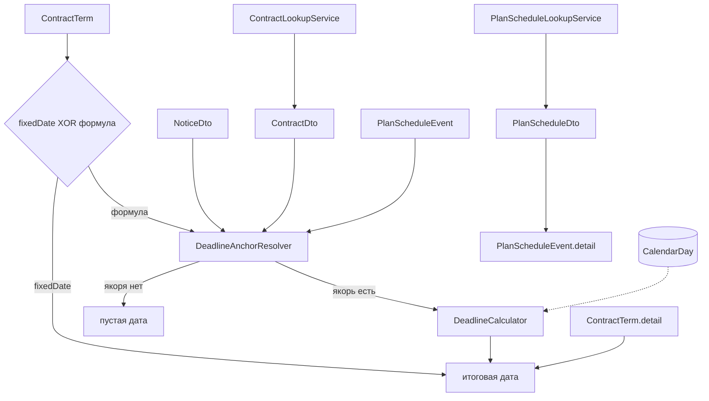

# Урок 8. Ручные данные: условия контрактов, даты ЛБО/ПГ

> Курс multi-reestr, Jmix 3.0.3. План уроков: [../LESSONS.md](../LESSONS.md). Экраны: [../UI.md](../UI.md). Модель: [../model/OVERVIEW.md](../model/OVERVIEW.md), карточки [ContractTerm](../model/entities/ContractTerm.md), [PlanScheduleEvent](../model/entities/PlanScheduleEvent.md), [PlanScheduleDto](../model/entities/PlanScheduleDto.md), [DeadlineSpec](../model/entities/DeadlineSpec.md); перечисления [ContractTermType](../model/enums/ContractTermType.md), [DeadlineAnchor](../model/enums/DeadlineAnchor.md). Движок срока: [lesson-05-deadlines.md](lesson-05-deadlines.md).
> Предыдущий урок: [lesson-07-checks.md](lesson-07-checks.md). Тег в конце урока: `lesson-08`.

## Зачем этот урок

**Где мы.** После урока 7 специалист умеет проверить извещение и вести реестр. Сроки поставки, приёмки и оплаты в legacy нет. Дат доведения ЛБО и утверждения плана-графика тоже нет: `planzakuppackets.approvedate` пуст, ЛБО не хранится.

**Задача пользователя.** Завести условие контракта формулой (`DeadlineSpec`) или конкретной датой, увидеть итоговую дату на карточке. Для замечания 1 ввести ЛБО и утверждение ПГ, подставив год и версию из подсказки `PlanScheduleDto`. С карточки извещения перейти к условиям этого контракта.

**В чём подвох.** Формула и `fixedDate` вместе дают две разные даты — на сохранении это ошибка, при расчёте `fixedDate` побеждает. Нет якоря — пустая дата, без исключения. Нет года в календаре — исключение `DbWorkingCalendar` («год не загружен в производственный календарь») показываем сообщением. Таблицы `planzakuppackets` в тестовом дампе нет: lookup не падает, отдаёт пустой список, ручной ввод работает. UNIQUE `(FIN_YEAR, PLAN_VERSION)` в PostgreSQL допускает несколько строк с `PLAN_VERSION IS NULL`.

**Что получится в конце.** Поиск контракта, `ContractTermDueDateService`, combo плана-графика, кнопка «Условия контракта» на карточке извещения, демо-ченджсет 060 (`context="demo"`). Новых JPA-сущностей, перечислений и DTO нет.

**Как проверяем.** Testcontainers `postgres:9.6` и тестовый набор (данных): извещения id 3, 17, 38, 40; контракты `reestr.id` 30, 19, 3; у 38 контракта нет. Docker + `./gradlew test`. Персональных данных в эталоне нет.

## Содержание

1. [Цель урока](#1-цель-урока)
2. [Архитектура](#2-архитектура)
3. [Условие контракта](#3-условие-контракта)
4. [Якорь и итоговая дата](#4-якорь-и-итоговая-дата)
5. [Поиск контракта и план-график](#5-поиск-контракта-и-план-график)
6. [Экраны](#6-экраны)
7. [Роли](#7-роли)
8. [Решения A–H](#8-решения-ah)
9. [Подготовка окружения](#9-подготовка-окружения)
10. [Шаги реализации](#10-шаги-реализации)
11. [Тесты](#11-тесты)
12. [Типичные ошибки](#12-типичные-ошибки)
13. [Контрольные вопросы и задания](#13-контрольные-вопросы-и-задания)
14. [Чеклист «урок завершён»](#14-чеклист-урок-завершён)

## 1. Цель урока

После урока приложение:

- сохраняет `ContractTerm` только если задан `fixedDate` **или** заполнена формула (`anchor` + `offsetValue` + `unit`);
- считает итоговую дату: `fixedDate`, иначе якорь + `DeadlineCalculator`; нет якоря — пусто;
- ищет контракт в legacy по номеру контракта / извещения / id и подставляет поля на карточке;
- с извещения открывает список условий с фильтром `contractLegacyId` (кнопка активна только при наличии контракта);
- подставляет `legacyPlanId` / `planVersion` / `finYear` из `PlanScheduleDto` и **не** копирует `approveDate` в `approvalDate`;
- при отсутствии `planzakuppackets` или ошибке SQL показывает пустой combo, ручные поля работают.

Модель урока 8 уже создана в визарде в начале курса. **Новых JPA-сущностей, перечислений и DTO не создаём.**

## 2. Архитектура



| Класс / файл | Пакет / место | Роль |
|---|---|---|
| `DeadlineAnchorResolver` | `deadline` | Дата якоря из извещения / контракта / ЛБО-события |
| `ContractTermDueDateService` | `manual` | `fixedDate` или калькулятор |
| `ContractTermRules` | `manual` | XOR на сохранении и на карточке |
| `ContractLookupService` | `legacy.contract` | `legacyJdbc`, SQL `sql/legacy/contract-lookup.sql` |
| `PlanScheduleLookupService` | `legacy.planschedule` | `planzakuppackets`; ошибка → пустой список |
| `ContractLookupDialog` | `view.contractlookup` | Свой `StandardView` |
| Liquibase `060-manual-data.xml` | `context="demo"` | ЛБО 26.03.2025 / утверждение 10.04.2025 и DELIVERY для `reestr.id` 18 |

## 3. Условие контракта

XOR: либо `fixedDate`, либо заполненная формула. Оба сразу — ошибка валидации (`ContractTermRules` + `EntitySavingEvent`). Ни того ни другого — тоже ошибка. UNIQUE `(CONTRACT_LEGACY_ID, TERM_TYPE)`.

Итоговая дата — **только на карточке**, не колонка БД и не колонка списка. Подсказок вида «ЛБО + 10 р.д.» нет.

## 4. Якорь и итоговая дата

`DeadlineAnchorResolver` читает:

| Якорь | Откуда |
|---|---|
| `LBO_DATE` | `PlanScheduleEvent.lboDate` |
| `PLAN_APPROVAL_DATE` | `PlanScheduleEvent.approvalDate` |
| `NOTICE_PUBLISHED` | `NoticeDto.applicationsFrom` |
| `NOTICE_CHANGE_PUBLISHED` | `publishedAt`, только если `modifVersion > 1` |
| `APPLICATIONS_END` | `applicationsTo` |
| `CONTRACT_SIGNED` | `ContractDto.date` |
| `DELIVERY_DOCUMENT` / `ACCEPTANCE` / `PAYMENT` / `STAGE_END` | исполнения контракта |

Нет источника — `Optional.empty()`, без исключения. Расчёт рабочих дней идёт через календарь; если год не загружен, `DbWorkingCalendar` бросает `IllegalStateException` с текстом «не загружен в производственный календарь» — карточка показывает это сообщение.

## 5. Поиск контракта и план-график

`ContractLookupService.search`: id (если строка — короткое число), `contractnumber` и `tendernumber` через `ILIKE`. Карточка подставляет `contractLegacyId` / `contractNumber` / `purchaseNumber`.

`PlanScheduleLookupService.listAll` читает `planzakuppackets` (`version` DTO ← `oosversion`). Нет таблицы или ошибка SQL — пустой список. В `dev/legacy/grant-readonly.sql` таблица в общем GRANT SELECT. Тестовый дамп её не содержит и **не расширяется**: Testcontainers перед GRANT создаёт пустую оболочку колонок, тест «таблицы нет» её снимает, тест маппинга вставляет две строки и удаляет таблицу.

Combo на карточке `PlanScheduleEvent` подставляет `legacyPlanId`, `planVersion` (из `version`), `finYear`. `approveDate` в `approvalDate` не копируем: в данных поле пустое, дату утверждения специалист вводит сам.

UNIQUE `(FIN_YEAR, PLAN_VERSION)` в PostgreSQL допускает несколько `NULL` в `PLAN_VERSION` (несколько событий «только год, без версии»). HSQL в тестах ведёт себя строже — на это не завязываемся.

## 6. Экраны

- Список `ContractTerm`: колонки `contractNumber`, `purchaseNumber`, `contractLegacyId`, `termType`, `fixedDate`, `sourceClause`. Query `contractLegacyId` фильтрует список.
- Карточка: поиск контракта, блок формулы, `fixedDate`, read-only итоговая дата.
- Список `PlanScheduleEvent`: `finYear`, `planVersion`, `lboDate`, `approvalDate`, `basisDocument`.
- Карточка извещения: «Условия контракта» — активна только если контракт загружен (id 3 — да, id 38 — нет).

## 7. Роли

Стек как в уроках 6–7. Дополнительно у специалиста: READ/VIEW `PlanScheduleDto` и `ViewPolicy` на `mtr_ContractLookupDialog`. `RuleAdministratorRole` не дублируем: поиск контракта и даты ЛБО — работа специалиста.

## 8. Решения A–H

| | Тема | Решение |
|---|---|---|
| **A** | Формула и дата | XOR на сохранении; расчёт: `fixedDate`, иначе формула |
| **B** | Нет якоря / нет года | Пустая дата / сообщение из `DbWorkingCalendar` |
| **C** | Поиск контракта | Свой диалог; кнопка с извещения с query `contractLegacyId` |
| **D** | План-график | Combo; `approveDate` не копировать; SQL-ошибка → пусто |
| **E** | Дамп | Не расширять; таблицу в тесте создать и убрать |
| **F** | 060 | Только `demo`; тесты не зависят от этих строк |
| **G** | Роли | PlanScheduleDto и диалог — у специалиста |
| **H** | Итоговая дата | Только карточка, не БД, не список |

## 9. Подготовка окружения

Модель `ContractTerm` / `PlanScheduleEvent` / `PlanScheduleDto` уже в коде. Календарь 2024–2027 — seed урока 4. Демо ЛБО и DELIVERY для `reestr.id` 18 — 060 `demo`.

Тестовый набор (данных) не меняем. Номера извещений и `reestr.id` — открытые идентификаторы закупки, персональных данных нет.

## 10. Шаги реализации

### 10.1. Не трогать модель

Сверить сущности с карточками. Расхождений, требующих правки JPA/enum/DTO, нет.

### 10.2. Якорь и срок

`DeadlineAnchorResolver`, `ContractTermDueDateService`, XOR в `ContractTermRules`.

### 10.3. Legacy

SQL в `resources/sql/legacy`. `planzakuppackets` в `grant-readonly.sql` (GRANT, если таблица есть).

### 10.4. UI и роли

Диалог поиска, колонки по UI.md, кнопка на карточке извещения, combo ПГ, итоговая дата read-only. Роли как в §7.

### 10.5. Демо и тесты

060 `demo`. Тесты на голден-id и на отсутствие таблицы плана-графика.

## 11. Тесты

Запуск: `./gradlew test` при запущенном Docker. Без Docker тесты, которым нужен legacy, падают — это ожидаемо (`RequireDocker`, без `-PallowNoDocker`).

| Тест | Что проверяет |
|---|---|
| `ContractTermRulesTest` | XOR: оба сразу и пусто — ошибка |
| `contractSignedUsesCalendarDayForGoldenNotice3` | `CONTRACT_SIGNED` извещения id 3 → 27.05.2026 |
| `notice38WithoutContractHasEmptyDueDate` | id 38, якоря нет → пусто |
| `fixedDateWinsOverFormula` | id 17, `fixedDate` побеждает |
| `lboPlusTenWorkingDaysIsNinthOfApril` | 26.03.2025 + 10 раб. = 09.04.2025 |
| `uniqueContractLegacyIdAndTermType` | UNIQUE пары |
| `ContractLookupServiceTest` | id 30/19/3, поиск по номеру; 38 пусто |
| `missingTableReturnsEmptyList` | нет `planzakuppackets` → пустой список |
| `mapsVersionToPlanVersionAndKeepsPublishDate` | две строки только в тесте, `oosversion` → `version` |
| `NoticeDetailViewTest` | кнопка: 0173100017026000015 активна, 0173100017024000010 нет |

## 12. Типичные ошибки

| Симптом | Причина | Что делать |
|---|---|---|
| Итоговая дата пустая при формуле | Нет якоря (нет контракта, нет ЛБО) | Это норма; не бросать исключение |
| 500 на карточке | Год не в календаре проброшен наверх | Показать сообщение `DbWorkingCalendar` |
| Combo ПГ пустой и форма сломана | SQL-ошибка не поймана | `listAll` → пустой список |
| GRANT падает на дампе | `planzakuppackets` нет | На живой БД таблица есть; в тестах — пустая оболочка до GRANT |
| Два события на один год без версии | В PG несколько NULL допустимы | Не чинить UNIQUE; описать в уроке |
| Тест уникальности задел demo | Пара 18+DELIVERY из 060 | Тесты не зависят от demo, берут свой id |

## 13. Контрольные вопросы и задания

1. Почему `fixedDate` побеждает в расчёте, но оба поля нельзя сохранить?
2. Чем отсутствие якоря отличается от «год не загружен в календарь»?
3. Почему `approveDate` из DTO не копируется в `approvalDate`?
4. Зачем UNIQUE `(FIN_YEAR, PLAN_VERSION)` допускает несколько NULL?
5. Почему тестовый дамп не пополняют `planzakuppackets`?
6. **Задание.** Откройте извещение без контракта и с контрактом. Когда жива кнопка «Условия контракта»?
7. **Задание.** Введите ЛБО 26.03.2025 и формулу +10 рабочих. Какая итоговая дата?
8. **Задание.** Сохраните два `ContractTerm` с одним `reestr.id` и одним `termType`. Что скажет БД?

## 14. Чеклист «урок завершён»

- [ ] Модель не менялась.
- [ ] XOR формулы и `fixedDate`; итоговая дата только на карточке.
- [ ] Нет якоря — пусто; нет года календаря — сообщение.
- [ ] Поиск контракта; кнопка на извещении с фильтром.
- [ ] Combo ПГ без копирования `approveDate`; нет таблицы — пустой список.
- [ ] 060 только `demo`. Дамп не расширен.
- [ ] Роли: `PlanScheduleDto` и диалог у специалиста.
- [ ] Тексты — «тестовый набор (данных)», без ПДн.
- [ ] Docker, `./gradlew test`.
- [ ] Коммит и тег:

```bash
git add <файлы урока> && git commit -m "Lesson 08: contract terms and plan-schedule dates"
git tag lesson-08
```
