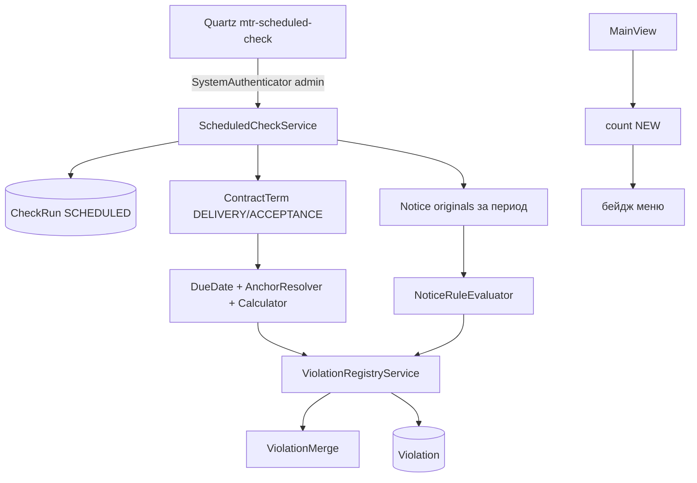

# Урок 9. Плановое сканирование (Quartz) и оповещение в приложении

> Курс multi-reestr, Jmix 3.0.3. План уроков: [../LESSONS.md](../LESSONS.md). Экраны: [../UI.md](../UI.md). Модель: [../model/OVERVIEW.md](../model/OVERVIEW.md) §5, карточки [CheckRun](../model/entities/CheckRun.md), [Violation](../model/entities/Violation.md), [ContractTerm](../model/entities/ContractTerm.md), [DeadlineSpec](../model/entities/DeadlineSpec.md); перечисления [CheckRunMode](../model/enums/CheckRunMode.md), [CheckRunStatus](../model/enums/CheckRunStatus.md), [ViolationStatus](../model/enums/ViolationStatus.md). Сроки: [lesson-08-manual-data.md](lesson-08-manual-data.md), [lesson-05-deadlines.md](lesson-05-deadlines.md). Реестр: [lesson-07-checks.md](lesson-07-checks.md).
> Предыдущий урок: [lesson-08-manual-data.md](lesson-08-manual-data.md). Тег в конце урока: `lesson-09`.

## Зачем этот урок

**Где мы.** После урока 8 специалист заводит сроки поставки и приёмки вручную, а проверка извещения — только по кнопке. Реестр есть, счётчика NEW в меню нет. Почты нет.

**Задача пользователя.** Ночью (или по cron с экрана Quartz) система сама проходит сроки DELIVERY/ACCEPTANCE и извещения за выбранный период, пишет тот же реестр, что кнопка «Проверить». В меню видно, сколько записей ещё NEW.

**В чём подвох.** `FIXED` нельзя ставить всему реестру: в прогоне участвует только окно извещений и те условия, по которым посчиталась дата. Нет года в календаре или нет таблицы в legacy — это ошибка объекта, а не падение задачи. Параллельный запуск той же джобы портит merge. Cron, который админ поменял в UI, регистрация при старте не должна вернуть «заводской».

**Что получится в конце.** Аддон Jmix Quartz, джоба `mtr-scheduled-check` (`@DisallowConcurrentExecution`), `ScheduledCheckService`, общий `ViolationRegistryService` (ON_DEMAND и SCHEDULED), бейдж NEW, правила `R09_DELIVERY` / `R10_ACCEPTANCE`. Почту (`io.jmix.email`) не подключаем. Новых JPA-сущностей, перечислений и DTO нет.

**Как проверяем.** Юнит/Spring без Docker: нет legacy → CheckRun FAILED; календарь 1999 → исключение не роняет assess-тест (его ловит джоба). Docker + тестовый набор (данных): просроченная поставка в реестре, FALSE_POSITIVE живёт. `./gradlew test` при запущенном Docker.

## Содержание

1. [Цель урока](#1-цель-урока)
2. [Архитектура](#2-архитектура)
3. [Quartz](#3-quartz)
4. [Что сканируем](#4-что-сканируем)
5. [Реестр и FIXED](#5-реестр-и-fixed)
6. [Оповещение](#6-оповещение)
7. [Ошибки, которые не роняют задачу](#7-ошибки-которые-не-роняют-задачу)
8. [Роли](#8-роли)
9. [Решения A–H](#9-решения-ah)
10. [Подготовка окружения](#10-подготовка-окружения)
11. [Шаги реализации](#11-шаги-реализации)
12. [Тесты](#12-тесты)
13. [Типичные ошибки](#13-типичные-ошибки)
14. [Контрольные вопросы и задания](#14-контрольные-вопросы-и-задания)
15. [Чеклист «урок завершён»](#15-чеклист-урок-завершён)

## 1. Цель урока

После урока приложение:

- по расписанию создаёт `CheckRun` `SCHEDULED` (RUNNING → SUCCESS / PARTIAL / FAILED);
- проверяет все `ContractTerm` `DELIVERY` и `ACCEPTANCE` через `DeadlineCalculator` / `DeadlineAnchorResolver`;
- проверяет оригиналы извещений с `publishedAt` в `[today − lookback, today]`, не больше `mtr.scan.max-notices`;
- пишет `Violation` тем же merge/fingerprint, что кнопка «Проверить»;
- показывает число NEW у пункта «Реестр нарушений»;
- не шлёт почту.

Модель не меняем. Режима `CheckRunType` нет: тип запуска — `CheckRunMode.SCHEDULED` (уже был в enum урока 7).

## 2. Архитектура



| Класс / файл | Пакет / место | Роль |
|---|---|---|
| `ScheduledCheckJob` | `scan` | Quartz `Job`, `@DisallowConcurrentExecution` |
| `ScheduledCheckJobRegistrar` | `scan` | Durable job; триггер только если его ещё нет |
| `ScheduledCheckService` | `scan` | Журнал, обход объектов, PARTIAL/FAILED |
| `ContractTermDeadlineScan` | `scan` | Просрочка и `warnBeforeDays` |
| `ViolationRegistryService` | `rules` | Общий upsert; `OnDemandCheckService.saveToRegistry` делегирует сюда |
| `NewViolationCountService` | `scan` | `count` статуса NEW |
| Liquibase `061-deadline-rules.xml` | без `demo` | `R09_DELIVERY`, `R10_ACCEPTANCE` |

Почта: аддон Email Sending (`io.jmix.email`) в этом курсе **не** подключаем. Это возможное расширение: отдельный Job читал бы NEW и вызывал `Emailer`. Notifications (платный) не используем.

## 3. Quartz

Зависимости: `jmix-quartz-starter`, `jmix-quartz-flowui-starter`. Таблицы `QRTZ_*` — ченджсеты аддона в master changelog. `spring.quartz.job-store-type=jdbc`, `jdbc.initialize-schema=never`, `overwrite-existing-jobs=false`.

Расписание по умолчанию: `0 0 6 * * ?`, зона `Europe/Moscow` (`mtr.scan.cron` / `mtr.scan.zone`). Меняют **на экране Quartz jobs** (composite menu, admin / `FullAccessRole`). Свой экран не делаем.

Регистрация при старте: `addJob(..., true)` обновляет класс джобы и **не** трогает существующий trigger. Нет trigger — создаём default cron. Повторный старт не откатывает cron из UI.

В тестах: `spring.quartz.auto-startup=false`.

Кнопки «Запустить сейчас» на журнале `CheckRun` нет: отдельного specific на план нет, `mtr.check.ondemand` смешивать с джобой не стали.

## 4. Что сканируем

**Контракты.** Все `ContractTerm` с типом `DELIVERY` и `ACCEPTANCE`. `PAYMENT` и замечания 1 / 6 / неустойка (`LATE_DELIVERY_PENALTY`) — не этот урок.

Правила (061, не `demo`): шаблон `DEADLINE`, объект `CONTRACT`, коды `R09_DELIVERY` и `R10_ACCEPTANCE`. Формула срока живёт на `ContractTerm`, не на `RuleVersion`.

Hit: нет факта → сравниваем «сегодня» с due. Просрочка — `severity` правила. Приближение: `warnBeforeDays` на `term`, due ещё не прошёл, дней до due ≤ порога — `WARNING`. Один `detail` (`term=DELIVERY` / `term=ACCEPTANCE`) → один fingerprint. `dueDate` / `factDate` / `deviationDays` пишем на `Violation` (в `CheckResultDto` этих полей нет — DTO не расширяем).

Нет due (нет якоря) — условие **не** оценено. Нет R09/R10 — в `errorMessage` пометка, реестр по срокам пустой.

**Извещения.** Оригиналы с датой публикации в окне lookback (`mtr.scan.notice-lookback-days`, по умолчанию 365), потолок `mtr.scan.max-notices` (200). `max-notices=0` — извещения не трогаем (так в тесте сроков). Период пишем в `CheckRun.periodFrom` / `periodTo`. Правила — те же три бина урока 6; R09/R10 без бина в `NoticeRuleEvaluator` не входят в `evaluatedRuleIds`.

## 5. Реестр и FIXED

`ViolationRegistryService.merge` — тот же дедуп, что урок 7: fingerprint UNIQUE, ACK/FP не сбрасываются, FIXED reopen в NEW, FP не уходит в FIXED.

Merge **по объекту**: извещение — `objectKey` номер; контракт — `reestr.id` (оба срока одного контракта в одном merge, иначе второй тип пометил бы первый FIXED).

Оценённое правило:

- извещение — как в уроке 7 (`enabled` + ACTIVE на дату + бин);
- срок — итоговая дата посчиталась. Нет якоря / нет due / нет правила — не оценено. Год календаря не загружен — объект в ошибку, не оценён.

Вне окна извещения в этот прогон не входят и не получают FIXED.

Квитирование по-прежнему `mtr.violation.triage`.

## 6. Оповещение

Только реестр и бейдж NEW на `mtr_Violation.list` в `MainView` (`AfterNavigationObserver`). Ноль — бейджа нет. Другие сессии Quartz не пушит: счётчик после навигации. Add-on Notifications нет.

## 7. Ошибки, которые не роняют задачу

Исключение джобы ловит `ScheduledCheckService`. Журнал всегда с `finishedAt`.

| Ситуация | Статус CheckRun |
|---|---|
| Legacy нет / ping не ок | `FAILED`, merge нет |
| Нет таблицы / SQL на списке извещений | ошибка в `errorMessage`, сроки всё равно идут |
| Год не в календаре на одном условии | эта запись не оценена, остальные идут, при успехах — `PARTIAL` |
| Часть объектов ок, часть нет | `PARTIAL` (id 30, уже в enum) |
| Ноль успехов и есть ошибки | `FAILED` |

`errorMessage` — сокращённый список (`контракт 18/DELIVERY: …`), обрезка 2000 символов.

`createdBy` планового журнала — `admin` (`SystemAuthenticator`). Это исключение из решения N урока 7 (там не было фоновой задачи).

## 8. Роли

Стек уроков 6–8. Экраны Quartz — `FullAccessRole` (admin). Специалисту и администратору правил Quartz не выдаём. Кнопки «Запустить сейчас» нет.

## 9. Решения A–H

| | Тема | Решение |
|---|---|---|
| **A** | Джоба и cron | Одна `ScheduledCheckJob`; UI Quartz; регистрация не затирает trigger; `@DisallowConcurrentExecution`; в тестах Quartz не стартует |
| **B** | Объём | Все DELIVERY/ACCEPTANCE; извещения — lookback + max; PAYMENT нет |
| **C** | Правила сроков | R09/R10, шаблон `DEADLINE`, объект `CONTRACT`; warn на `ContractTerm` |
| **D** | FIXED | По объекту; оценено = due посчитан / evaluator как в уроке 7 |
| **E** | Счётчик | Бейдж NEW на пункте реестра |
| **F** | Роли / authenticator | Quartz — admin; `runWithUser("admin")`; кнопки «сейчас» нет |
| **G** | Статусы | Существующие RUNNING/SUCCESS/PARTIAL/FAILED |
| **H** | 061 | Обязательный, не `demo` |

## 10. Подготовка окружения

Календарь 2024–2027 — seed урока 4. Правила извещений — 051. Демо DELIVERY `reestr.id` 18 — 060 `demo`. Docker для legacy-тестов.

Персональных данных в тестовом наборе (данных) нет.

## 11. Шаги реализации

### 11.1. Не трогать модель

Сверить enum: `CheckRunMode.SCHEDULED`, `CheckRunStatus.PARTIAL`, `RuleTemplateType.DEADLINE`, `RuleObjectType.CONTRACT` уже есть.

### 11.2. Реестр

Вынести merge из `OnDemandCheckService` в `ViolationRegistryService`. Регресс урока 7 не ломать.

### 11.3. Скан и Quartz

Аддон, registrar, job, `ScheduledCheckService`, SQL периода, 061, бейдж.

### 11.4. Тесты и документ

См. §12. Этот файл и ссылка в LESSONS.md.

## 12. Тесты

Запуск: `./gradlew test` при запущенном Docker. Без Docker тесты, которым нужен legacy, падают — это ожидаемо (`RequireDocker`, без `-PallowNoDocker`).

| Тест | Что проверяет |
|---|---|
| `OnDemandCheckServiceTest` (урок 7) | дедуп, FP не FIXED, `mtr.violation.triage` после выноса merge |
| `overdueFixedDateWithoutFactIsError` | просрочка R09 |
| `approachingDueDateIsWarning` | `warnBeforeDays` |
| `missingDueDateIsNotEvaluated` | нет якоря |
| `unloadedCalendarYearThrows` | сообщение календаря |
| `missingLegacyFinishesFailedWithoutThrowing` | нет Docker/пула → FAILED |
| `quartzDoesNotAutoStartAndJobIsRegisteredOnce` | auto-startup=false, cron не затирается |
| `scheduledScanWritesDeliveryHitAndKeepsFalsePositive` | Docker, реестр, FP |

## 13. Типичные ошибки

| Симптом | Причина | Что делать |
|---|---|---|
| R09 стал FIXED после приёмки того же контракта | два merge на один `objectKey` | один merge на `reestr.id` |
| Cron сбросился после рестарта | `overwrite-existing-jobs` или новый trigger каждый раз | trigger только если список пуст |
| Джоба упала на «год не загружен» | исключение не поймали | ловить на объекте, PARTIAL |
| Дубли после кнопки и плана | разный fingerprint | тот же SHA-256 |
| Бейдж 0 на чужой сессии после плана | нет push | обновить навигацией |

## 14. Контрольные вопросы и задания

1. Чем `CheckRunMode.SCHEDULED` отличается от несуществующего `CheckRunType`?
2. Почему merge сроков идёт по контракту, а не по каждой строке `ContractTerm`?
3. Когда срок **не** оценён и старый Violation не станет FIXED?
4. Почему `warnBeforeDays` на условии контракта, а не обязательно на версии правила?
5. Зачем `@DisallowConcurrentExecution`?
6. Почему почту только рассказываем?
7. **Задание.** Поменяйте cron на экране Quartz, перезапустите приложение. Cron должен остаться.
8. **Задание.** Выключите R09 и прогоните план. Старая поставка не должна стать FIXED.
9. **Задание.** Пометьте поставку FALSE_POSITIVE и повторите план. Статус?

## 15. Чеклист «урок завершён»

- [ ] Модель не менялась. Quartz-таблицы — аддон.
- [ ] ON_DEMAND и SCHEDULED пишут реестр через `ViolationRegistryService`.
- [ ] DELIVERY/ACCEPTANCE + извещения за окно; PAYMENT нет.
- [ ] Ошибки legacy/календаря → CheckRun, не stacktrace наружу из джобы.
- [ ] Бейдж NEW. Почты нет.
- [ ] Регистрация не затирает cron UI. Quartz в тестах не стартует.
- [ ] 061 не `demo`. Тексты — «тестовый набор (данных)», без ПДн.
- [ ] Docker, `./gradlew test`.
- [ ] Коммит и тег:

```bash
git add <файлы урока> && git commit -m "Lesson 09: scheduled Quartz scan and NEW menu badge"
git tag lesson-09
```
