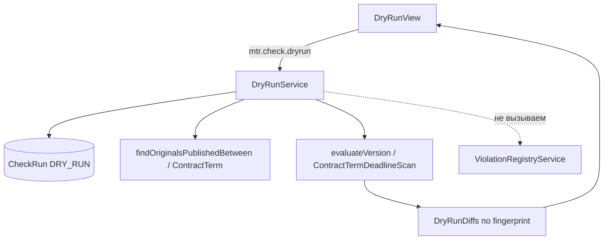

# Урок 10. Dry-run правил на исторических данных; финал

> Курс multi-reestr, Jmix 3.0.3. План уроков: [../LESSONS.md](../LESSONS.md). Экраны: [../UI.md](../UI.md). Модель: [../model/OVERVIEW.md](../model/OVERVIEW.md) §5, карточки [CheckResultDto](../model/entities/CheckResultDto.md), [CheckRun](../model/entities/CheckRun.md), [RuleVersion](../model/entities/RuleVersion.md); перечисления [CheckRunMode](../model/enums/CheckRunMode.md), [DryRunDiff](../model/enums/DryRunDiff.md), [RuleVersionStatus](../model/enums/RuleVersionStatus.md). Скан: [lesson-09-scheduled.md](lesson-09-scheduled.md). Реестр: [lesson-07-checks.md](lesson-07-checks.md). Развёртывание: [../deploy-windows.md](../deploy-windows.md).
> Предыдущий урок: [lesson-09-scheduled.md](lesson-09-scheduled.md). Тег в конце урока: `lesson-10`.

## Зачем этот урок

**Где мы.** После урока 9 правила активируют сразу. Плановый скан и кнопка «Проверить» пишут реестр. Сравнить черновик с действующей версией на старых извещениях нельзя, не замусорив `Violation`.

**Задача пользователя.** Администратор правил копирует версию в DRAFT, меняет параметры, гоняет её на периоде публикации и видит NEW / UNCHANGED / DISAPPEARED. В реестр ничего не попадает. Затем активирует версию, если картина приемлема.

**В чём подвох.** Диспетчер `evaluateAll` берёт только `enabled` + ACTIVE. Черновик туда не попадает. Скан урока 9 сразу вызывает `ViolationRegistryService`. Dry-run должен пройти тот же путь до fingerprint и остановиться. `FALSE_POSITIVE` в реестре к сравнению не относится: сравнивают hits версий, не статусы нарушений.

**Что получится в конце.** Экран `mtr_DryRunView`, `DryRunService`, `CheckRun` `DRY_RUN` (статистика, без `Violation`), сравнение `CheckResultDto.diff`, право `mtr.check.dryrun` только у администратора правил. Новых JPA-сущностей, перечислений и DTO нет: `DryRunDiff`, `CheckResultDto.diff` и `CheckRunMode.DRY_RUN` уже в модели. Liquibase после 061 не нужен. Почту не подключаем, только упоминаем как возможное расширение. Финал курса: сквозной сценарий, jar, обновление Windows.

**Как проверяем.** Юнит `DryRunDiffs`. Spring без Docker: не DRAFT, период > 365 дней, нет права у специалиста, нет legacy → журнал FAILED. Docker + тестовый набор (данных): извещения id 3, 17, 38, 40 (номера `0173100017026000015`, `…000001`, `0173100017024000010`, `…000008`), R09 на `ContractTerm`, счётчик `Violation` не растёт. `./gradlew test` при запущенном Docker.

## Содержание

1. [Цель урока](#1-цель-урока)
2. [Архитектура](#2-архитектура)
3. [Выбор набора и лимиты](#3-выбор-набора-и-лимиты)
4. [Сравнение версий](#4-сравнение-версий)
5. [Экраны](#5-экраны)
6. [Роли](#6-роли)
7. [Решения A–H](#7-решения-ah)
8. [Подготовка окружения](#8-подготовка-окружения)
9. [Шаги реализации](#9-шаги-реализации)
10. [Тесты](#10-тесты)
11. [Типичные ошибки](#11-типичные-ошибки)
12. [Контрольные вопросы и задания](#12-контрольные-вопросы-и-задания)
13. [Финал курса](#13-финал-курса)
14. [Чеклист «урок завершён»](#14-чеклист-урок-завершён)

## 1. Цель урока

После урока приложение:

- даёт пункт «Прогон на истории» и кнопки с карточки правила / DRAFT-версии;
- пишет `CheckRun` `DRY_RUN` (RUNNING → SUCCESS / PARTIAL / FAILED) с `ruleVersion`, периодом и статистикой;
- для NOTICE использует `NoticeLookupService.findOriginalsPublishedBetween` и `NoticeRuleEvaluator.evaluateVersion`;
- для CONTRACT (`R09_DELIVERY` / `R10_ACCEPTANCE`) использует `ContractTermDeadlineScan.assess`;
- **не** вызывает `ViolationRegistryService`;
- показывает `DryRunDiff` и выгрузку Excel (свой POI);
- пускает прогон при `Rule.enabled = false`.

Модель не меняем.

## 2. Архитектура



| Класс / файл | Пакет | Роль |
|---|---|---|
| `DryRunService` | `rules` | Права, журнал, цикл, запрет реестра |
| `DryRunDiffs` | `rules` | NEW / UNCHANGED / DISAPPEARED |
| `NoticeRuleEvaluator.evaluateVersion` | `rules` | Одна версия, без фильтра ACTIVE/`enabled` |
| `NoticeLookupService.findOriginalsPublishedBetween` | `legacy.notice` | Окно публикации, cap `max-notices` |
| `ContractTermDeadlineScan` | `scan` | R09/R10 |
| `DryRunView` | `view.dryrun` | Параметры, таблица, экспорт |
| `RuleAdministratorRole` | `security` | `mtr.check.dryrun`, экран и меню |

`OnDemandCheckService.check` не переиспользуем: он всегда `ON_DEMAND`.

## 3. Выбор набора и лимиты

Период `periodFrom`–`periodTo` включительно, не длиннее `mtr.scan.notice-lookback-days` (365). Число оригиналов — `mtr.scan.max-notices` (200), тот же SQL `notice-candidates-by-publish-period.sql`, что у планового скана.

NOTICE: оригиналы с датой публикации в периоде. CONTRACT: все `ContractTerm` нужного типа (как `ScheduledCheckService`), период пишется в журнал.

Legacy недоступна после создания журнала → `FAILED`. Часть карточек не загрузилась → `PARTIAL` + `errorMessage`. `violationsFound` — число hits **черновика**, без DISAPPEARED.

## 4. Сравнение версий

Только выбранное правило. Fingerprint тот же: `SHA-256(ruleCode|objectKey|detail)`.

- в DRAFT и в ACTIVE → `UNCHANGED` (текст черновика);
- только DRAFT → `NEW`;
- только ACTIVE → `DISAPPEARED`.

Нет ACTIVE — все hits DRAFT = `NEW`. Нет `publishedAt` — извещение не считается. Нет бина шаблона — ошибка объекта / FAILED. Не DRAFT — отказ до журнала.

## 5. Экраны

- Меню Правила → «Прогон на истории» (`mtr_DryRunView` / `dry-run`).
- Версия DRAFT, период, тип с правила (только чтение).
- «Запустить», «Экспорт», «К активации».
- Журнал проверок уже умеет `mode` / `ruleVersion` / период.

## 6. Роли

`mtr.check.dryrun` **только** у `rule-administrator`. Специалист экран не видит. Демо-`rule-admin` по-прежнему стек с `specialist` (CREATE `CheckRun`). `SystemAuthenticator` нет.

## 7. Решения A–H

| | Тема | Решение |
|---|---|---|
| **A** | Specific | `mtr.check.dryrun`, не `ondemand` |
| **B** | Лимиты | 365 / 200 из `ScanProperties` |
| **C** | PARTIAL | Да, плюс `errorMessage` |
| **D** | `enabled=false` | Прогон разрешён |
| **E** | Реестр | Не вызывать merge |
| **F** | Liquibase | Нет; 061 занят R09/R10 |
| **G** | Экспорт | POI, не gridexport |
| **H** | Почта | Не реализуем, абзац в §13 |

## 8. Подготовка окружения

Модель dry-run уже в коде с начала курса. Seed правил — 050/051/061. Демо-пользователи — 052 `demo`. Docker: Testcontainers `postgres:9.6`, тестовый набор (данных). Персональных данных в эталоне нет.

## 9. Шаги реализации

1. Не трогать JPA/DTO/enum.
2. `evaluateVersion`, `DryRunDiffs`, `DryRunService` (NOTICE + CONTRACT).
3. Экран, меню, кнопки на правиле/версии.
4. Роль и `MultiReestrSpecifics`.
5. Тесты. Документ урока.

## 10. Тесты

Запуск: `./gradlew test` при запущенном Docker.

| Тест | Что проверяет |
|---|---|
| `DryRunDiffsTest` | NEW / UNCHANGED / DISAPPEARED, пустой ACTIVE, дедуп fingerprint |
| `rejectsNonDraftAndTooLongPeriod` | не DRAFT; период > lookback |
| `missingLegacyWritesFailedJournal` | `DRY_RUN` FAILED, без throw наружу |
| `specialistCannotDryRun` | нет `mtr.check.dryrun` |
| `noticeDraftDoesNotWriteRegistryAndMarksDisappeared` | пустой `okpdList` → DISAPPEARED на 17 и 38; реестр не растёт |
| `enabledFalseStillRunsAndUnchangedWhenParamsSame` | выключенный R03, UNCHANGED на `0173100017026000001` |
| `contractDraftDoesNotWriteRegistry` | R09, hit UNCHANGED, реестр не растёт |

## 11. Типичные ошибки

| Симптом | Причина | Что делать |
|---|---|---|
| Появились Violation | Вызвали registry | Только diff в памяти |
| Черновик как ACTIVE | `evaluateAll` | `evaluateVersion` |
| Специалист видит меню | MenuPolicy на specialist | Только rule-administrator |
| Журнал пустой после ошибки | FAILED в той же транзакции, что throw | Как on-demand/scan: сохранить FAILED |
| Период 2024–2026 в продукте | lookback 365 | Два прогона или временно больший lookback в тесте |

## 12. Контрольные вопросы и задания

1. Чем `DRY_RUN` отличается от «Проверить» и от Quartz?
2. Почему fingerprint, а не текст пояснения?
3. Почему `enabled=false` не мешает dry-run?
4. Попадает ли FALSE_POSITIVE из реестра в таблицу сравнения?
5. **Задание.** Скопируйте R03, очистите список ОКПД2, прогоните 2026 год. Что с извещением `0173100017026000001`?
6. **Задание.** Нажмите «Запустить» и закройте экран. Что в журнале и в реестре?

## 13. Финал курса

Сквозной сценарий на тестовом наборе (данных):

1. Войти `admin` (или демо `rule-admin` при контексте `demo`).
2. Поиск извещения `0173100017026000001` → карточка → «Проверить» → по желанию «Сохранить в реестр».
3. Реестр, счётчик NEW (урок 9).
4. Правила → R03 → «Новая версия» → изменить параметр → «Прогон на истории» на периоде 2026 → таблица diff → в реестре новых строк нет.
5. «К активации», если периоды не пересекаются.
6. Плановый скан (Quartz) по-прежнему пишет реестр; dry-run — нет.

Сборка jar на Mac: `dev/deploy/build-jar.sh` (`./gradlew clean bootJar -Pvaadin.productionMode=true`).

Обновление Windows — не первая установка (она в уроке 1), а [deploy-windows.md](../deploy-windows.md) §8:

1. Собрать jar с тега `lesson-10`.
2. Остановить приложение, `pg_dump` БД `multireestr` на PostgreSQL 16 `:5435`.
3. Заменить `multi-reestr.jar`, не затирать `config\application.properties` (`main.liquibase.contexts=!demo`).
4. `.\start-app.ps1` — Liquibase (для этого урока новых ченджсетов нет). `grant-readonly.sql` не менялся.
5. Рядом: MultiReestr на PG 9.6 `:5432`, роль `reestr_ro`; main — отдельный PostgreSQL 16 `:5435`.

Почту (аддон Email Sending, `io.jmix.email`) **не подключаем**. Это возможное расширение поверх того же реестра нарушений; в курс не входит. Add-on Notifications не используем: оповещение — реестр и бейдж NEW.

## 14. Чеклист «урок завершён»

- [ ] Модель не менялась.
- [ ] Dry-run пишет `CheckRun` `DRY_RUN` и не пишет `Violation`.
- [ ] Diff NEW / UNCHANGED / DISAPPEARED; NOTICE и R09/R10.
- [ ] Лимиты 365 / 200; PARTIAL при частичных ошибках; `enabled=false` допускается.
- [ ] Роль: `mtr.check.dryrun` только у администратора правил.
- [ ] Нет Liquibase после 061. Тексты — «тестовый набор (данных)», без ПДн.
- [ ] Docker, `./gradlew test` зелёный.
- [ ] Сквозной сценарий и обновление по deploy-windows.md описаны.
- [ ] Коммит и тег:

```bash
git add <файлы урока> && git commit -m "Lesson 10: rule dry-run on historical notices"
git tag lesson-10
```
