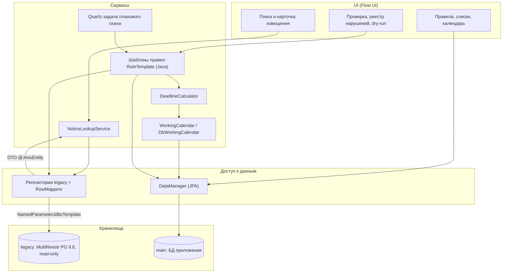
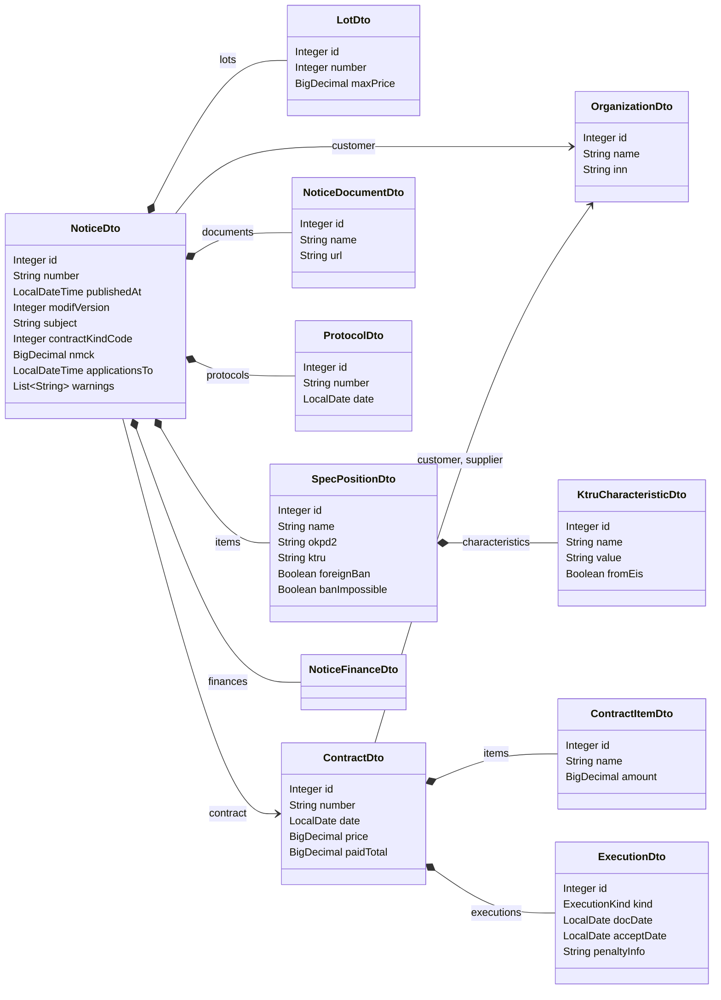
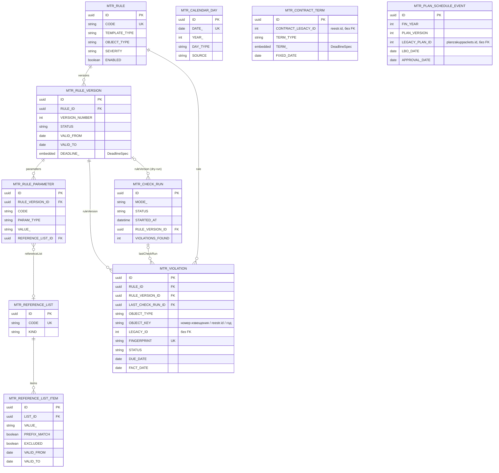
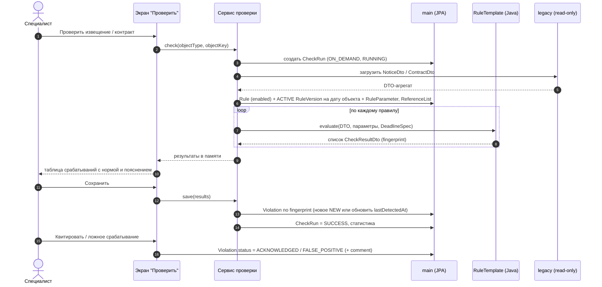
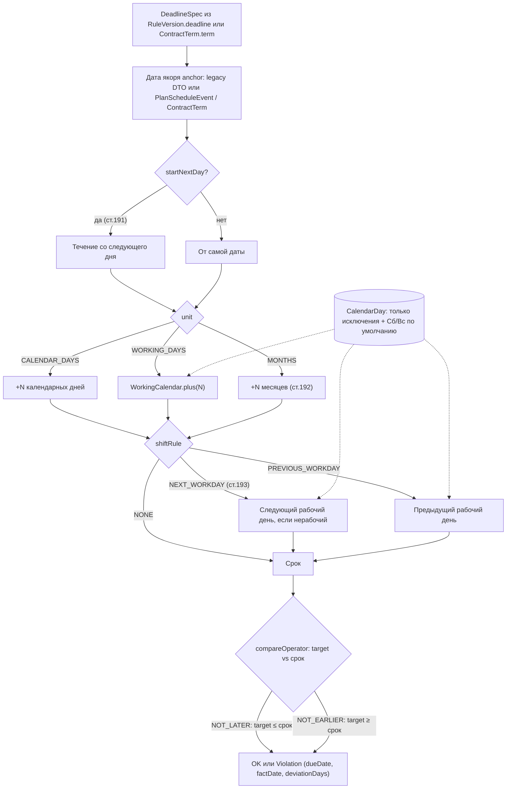
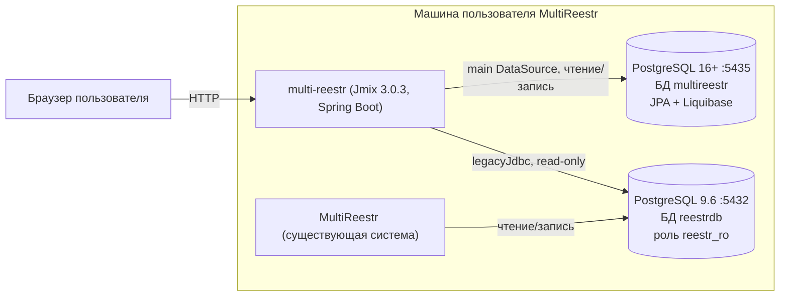

# Обзор модели данных multi-reestr

> Учебный проект на Jmix 3.0.3: пакет `com.digitilius.multireestr`, префикс сущностей `mtr_`. Документ даёт общую картину и показывает, как части модели связаны между собой. Подробности по каждому атрибуту приведены в [README.md](README.md), [entities/](entities/) и [enums/](enums/). Экраны и навигация описаны в [../UI.md](../UI.md).

## Содержание

1. [Назначение и два хранилища](#1-назначение-и-два-хранилища)
2. [Слои приложения](#2-слои-приложения)
3. [Legacy-блок: DTO в памяти](#3-legacy-блок-dto-в-памяти)
4. [Main-блок: JPA-сущности](#4-main-блок-jpa-сущности)
5. [Как работают правила: от правила до нарушения](#5-как-работают-правила-от-правила-до-нарушения)
6. [Расчёт сроков](#6-расчёт-сроков)
7. [Группы перечислений](#7-группы-перечислений)
8. [Развёртывание и базы данных](#8-развёртывание-и-базы-данных)
9. [Ключевые проектные решения](#9-ключевые-проектные-решения)
10. [Указатель сущностей и перечислений](#10-указатель-сущностей-и-перечислений)

## 1. Назначение и два хранилища

Приложение помогает специалисту по закупкам (44-ФЗ) выполнять две задачи:

- **смотреть** извещение, его лоты, позиции спецификации, протоколы, контракт и исполнение. Все эти данные берутся из унаследованной БД MultiReestr;
- **проверять** эти данные по бизнес-правилам, которые пишут сами пользователи. Найденные нарушения попадают в реестр, ими можно управлять: квитировать, помечать ложными, видеть их в приложении: сам реестр нарушений и счётчик новых нарушений в меню.

Поэтому данные хранятся в двух разных местах:

| Хранилище | Что это | Как читается/пишется | Что там лежит |
|---|---|---|---|
| **legacy** | PostgreSQL 9.6 MultiReestr (`reestrdb`, `localhost:5432`), отдельный `DataSource` `legacy` | Только чтение через `NamedParameterJdbcTemplate` (`legacyJdbc`), обычный JDBC. Это **не** data store Jmix: хранилище не добавляется в `jmix.core.additional-stores`, для него нет EntityManager и Liquibase | Извещения, лоты, спецификации, характеристики КТРУ, документы, протоколы, контракты, исполнение, планы-графики, организации |
| **main** | Основная БД приложения (Jmix data store `main`): в продуктиве — отдельный инстанс PostgreSQL 16+ (`localhost:5435/multireestr`), в разработке — HSQLDB или `postgres:16` | JPA-сущности, Liquibase, `DataManager` | Производственный календарь, справочные списки, правила с версиями и параметрами, журнал запусков проверок, реестр нарушений, данные для ручного ввода (условия контрактов, даты ЛБО/ПГ) |

Режим «только чтение» для legacy задан на трёх уровнях: параметры драйвера `readOnly=true&readOnlyMode=always`, `hikari.read-only` и `connection-init-sql` с `default_transaction_read_only`. Кроме того, у пользователя БД есть только права на чтение. Подробнее о размещении баз — в [разделе 8](#8-развёртывание-и-базы-данных).

## 2. Слои приложения

Связь между хранилищами есть только в одну сторону и только по значению. JPA-сущности хранят legacy-ключи как обычные поля (`ContractTerm.contractLegacyId`, `PlanScheduleEvent.legacyPlanId`, `Violation.objectKey` / `legacyId`), без FK и без JPA-связей.

## 3. Legacy-блок: DTO в памяти

Все legacy-объекты описаны как DTO-сущности (`@JmixEntity`, без `@Store`) в пакете `…entity.legacy`. Их id имеет тип `Integer` (`@JmixId`) и совпадает с ключом legacy-таблицы. Единственное исключение — `CheckResultDto` с UUID. Вокруг каждого DTO есть SQL из `notice_lookup_spec` и маппер: `trim`, `coalesce(x,0)=1` → `Boolean`, numeric → `BigDecimal`.

Корень агрегата — **NoticeDto** (карточка извещения). Он собирает лоты, позиции спецификации с характеристиками, документы, протоколы и контракт, если тот есть. Контракт сам содержит позиции и документы исполнения.

На диаграмме показаны только ключевые атрибуты, полный список есть в карточках сущностей.

Отдельно от агрегата существуют:

- **NoticeCandidateDto** — строка поиска: в гриде оригинал номера, `chosen` и `reason` по правилу Q2; редакции смотрят в карточке;
- **PlanScheduleDto** — версия плана-графика (`planzakuppackets`). Используется как подсказка при ручном вводе `PlanScheduleEvent`, потому что дат ЛБО в legacy нет, а `approvedate` пустой;
- **CheckResultDto** — результат проверки, который живёт только в памяти (окно «Проверить», dry-run). Подробнее в разделе 5.

Несколько особенностей legacy, которые стоит учитывать:

- `SpecPositionDto.lotId` хранит id лота как число. Позиции подчинены извещению, а не лоту;
- `ContractDto` находится по `reestr.tendernumber`. Его `endDate` может не совпадать со сроком по формуле контракта, поэтому правила берут срок из `ContractTerm`;
- у `NoticeDocumentDto` нет содержимого, только URL на filestore ЕИС.

## 4. Main-блок: JPA-сущности

У всех сущностей main id типа UUID (`@JmixGeneratedValue`), есть трейты Audit of creation и Audit of modification. Это трейты ядра Jmix (поля `createdBy`/`createdDate`/`lastModifiedBy`/`lastModifiedDate`), а не add-on Jmix Audit: entity log в проекте не используется. Трейт Versioned подключён у всех, кроме `CalendarDay` и `CheckRun`. Soft delete не используется.

Сущности main-хранилища делятся на группы:

| Группа | Сущности | Роль |
|---|---|---|
| Календарь | [CalendarDay](entities/CalendarDay.md) | Хранит только **исключения**: праздники, переносы, сокращённые дни. Если даты нет в таблице, действует правило по умолчанию (Пн–Пт рабочие, Сб–Вс выходные). Запись в таблице всегда главнее этого правила |
| Справочники | [ReferenceList](entities/ReferenceList.md) → [ReferenceListItem](entities/ReferenceListItem.md) | Списки, которые редактирует пользователь: ОКПД2 по ПП 1875 прил. 1, КТРУ, ключевые слова. Для элемента можно задать совпадение по префиксу, исключение и период действия |
| Правила | [Rule](entities/Rule.md) → [RuleVersion](entities/RuleVersion.md) → [RuleParameter](entities/RuleParameter.md), встраиваемый [DeadlineSpec](entities/DeadlineSpec.md) | Экземпляр шаблона, его версии с периодом действия и параметры версии |
| Проверки | [CheckRun](entities/CheckRun.md), [Violation](entities/Violation.md) | Журнал запусков и реестр нарушений |
| Ручной ввод | [ContractTerm](entities/ContractTerm.md), [PlanScheduleEvent](entities/PlanScheduleEvent.md) | Данные, которых нет в legacy: условия контракта (сроки поставки, приёмки, оплаты) и даты ЛБО и утверждения плана-графика |

`DeadlineSpec` — это Embeddable без собственной таблицы. Его колонки хранятся у владельца с префиксом `DEADLINE_` в `RuleVersion` и `TERM_` в `ContractTerm`.

## 5. Как работают правила: от правила до нарушения

1. **Шаблон** (`RuleTemplateType`) — это не сущность, а enum плюс Java-бин с логикой проверки, например `OKPD2_FOREIGN_BAN` или `DEADLINE`.
2. **Rule** — экземпляр шаблона, который создаёт специалист. У него есть код (`R03_PP1875`), объект проверки (`RuleObjectType`), серьёзность, норма (`legalRef`) и шаблон пояснения с `{плейсхолдерами}`. Правило отключают флагом `enabled`.
3. **RuleVersion** — набор параметров с периодом действия `validFrom`–`validTo` и статусом DRAFT, ACTIVE или ARCHIVED. В проверках участвует ACTIVE-версия, действующая на дату объекта (размещения или заключения). Так исторические данные проверяются по нормам на ту дату. Периоды ACTIVE-версий одного правила не должны пересекаться; этот инвариант проверяет сервис, а не БД.
4. **RuleParameter** — пара «ключ — значение» с типом `ParameterType`. Для типа `LIST` параметр ссылается на `ReferenceList`. Пример: R03 → `okpdList` = LIST `PP1875_ANNEX1`.
5. **CheckRun** фиксирует каждый запуск: режим (ON_DEMAND, SCHEDULED, DRY_RUN), статус, период, статистику. Кто запустил, видно из `createdBy`.
6. Результат проверки сначала получается как **CheckResultDto** в памяти, с `fingerprint`, а в dry-run ещё и с `diff`. При сохранении он превращается в **Violation**. Запись ищется по уникальному `fingerprint = SHA-256(ruleCode|objectKey|detail)`: если она уже есть, обновляются `lastDetectedAt` и `lastCheckRun`. Если при повторном скане нарушение больше не находится, запись получает статус `FIXED`.

Остальные сценарии устроены так же, но с отличиями:

- **Плановый скан** (урок 9). Запуск делает Quartz-задача, CheckRun создаётся в режиме `SCHEDULED`. По `warnBeforeDays` формируются предупреждения о приближении срока, найденное попадает в реестр нарушений, а счётчик NEW в меню показывает пользователю новые записи. Расписание хранится в таблицах Quartz (`QRTZ_*`).
- **Dry-run** (урок 10). Проверяется DRAFT-версия (`CheckRun.ruleVersion`) на исторических данных. Результаты остаются `CheckResultDto` с `diff` (NEW, UNCHANGED, DISAPPEARED) и в реестр нарушений **не пишутся**. Сохраняется только статистика CheckRun. Специалист просматривает результаты и затем активирует версию.

Какие данные модели использует каждое из 10 замечаний (шаблон и входные DTO/сущности), показано в таблице в [README.md](README.md#как-правила-используют-модель).

## 6. Расчёт сроков

Срок задаётся декларативно через `DeadlineSpec`: «от события `anchor` отсчитать `offsetValue` единиц `unit`, начиная со следующего дня (`startNextDay`, ст. 191 ГК), перенести окончание по `shiftRule` (ст. 193 ГК) и сравнить контролируемую дату `target` с результатом по `compareOperator`».

В расчёте участвуют два сервиса:

- **WorkingCalendar** — интерфейс календаря: `isBusinessDay`, `getDayInfo`, `plus`/`minus` в рабочих днях. Его реализация `DbWorkingCalendar` читает `CalendarDay` за год в кэш и сбрасывает кэш после импорта или правки. Сигнатуры повторяют API аддона Jmix Business Calendar, чтобы позже можно было подставить реализацию на нём;
- **DeadlineCalculator** работает поверх календаря и реализует правила ГК: `deadline(event, n, unit)` и `nextBusinessDayIfNonWorking(date)`. Сами правила ГК в `WorkingCalendar` не входят.

Рабочими считаются дни типов `WORKING`, `SHORTENED` и `WORKING_TRANSFER`.

Примеры из документации:

| Замечание | Формула | Итог |
|---|---|---|
| 1 | `LBO_DATE` +10 `WORKING_DAYS`, `NONE` → `PLAN_APPROVAL_DATE` `NOT_LATER` | ЛБО 26.03.2025 → срок 09.04.2025; утверждение 10.04.2025 — просрочка на 1 раб. день |
| 6 | `NOTICE_CHANGE_PUBLISHED` +7 `CALENDAR_DAYS` → `APPLICATIONS_END` `NOT_EARLIER` | изменение 26.02.2026 → не ранее 05.03.2026; окончание подачи 03.03.2026 → правило срабатывает |
| 9 | `CONTRACT_SIGNED` +30 `CALENDAR_DAYS`, `startNextDay`, `NEXT_WORKDAY` → `DELIVERY_DOCUMENT` `NOT_LATER` | reestr.id 18: заключён 23.12.2025 → срок 22.01.2026; приёмка 23.01.2026 — просрочка |

## 7. Группы перечислений

Большинство перечислений — `EnumClass<String>`: id совпадает с именем константы, в БД хранится строка. Три статуса — `ViolationStatus`, `CheckRunStatus`, `RuleVersionStatus` — `EnumClass<Integer>` с id 10, 20, 30, (40), в БД число. Русские заголовки лежат в `messages_ru.properties`.

| Группа | Перечисление | Назначение |
|---|---|---|
| Legacy | [ExecutionKind](enums/ExecutionKind.md) | Приёмка или оплата в исполнении контракта |
| Календарь | [DayType](enums/DayType.md) | Тип дня: рабочий, сокращённый, выходной, праздник, рабочий перенос |
| Календарь | [CalendarSource](enums/CalendarSource.md) | Откуда загружен день: xmlcalendar.ru, legacy, сгенерирован, вручную |
| Сроки | [DayCountUnit](enums/DayCountUnit.md) | Единица срока: календарные дни, рабочие дни, месяцы |
| Сроки | [ShiftRule](enums/ShiftRule.md) | Перенос окончания срока с нерабочего дня |
| Сроки | [DeadlineAnchor](enums/DeadlineAnchor.md) | Событие-якорь или контролируемая дата (ЛБО, размещение, заключение, приёмка и др.) |
| Сроки | [CompareOperator](enums/CompareOperator.md) | Сравнение с рассчитанным сроком: «не позднее» или «не ранее» |
| Справочники | [ReferenceListKind](enums/ReferenceListKind.md) | Тип значений списка: ОКПД2, КТРУ, ключевые слова, текст |
| Правила | [RuleTemplateType](enums/RuleTemplateType.md) | Шаблон правила, за которым стоит Java-реализация (8 видов проверок) |
| Правила | [RuleObjectType](enums/RuleObjectType.md) | Объект проверки: извещение, контракт, план-график |
| Правила | [RuleVersionStatus](enums/RuleVersionStatus.md) | Жизненный цикл версии: черновик → действует → архив |
| Правила | [ParameterType](enums/ParameterType.md) | Тип значения параметра правила (включая LIST — ссылку на список) |
| Правила | [Severity](enums/Severity.md) | Серьёзность: ошибка, предупреждение, информация |
| Проверки | [CheckRunMode](enums/CheckRunMode.md) | Режим запуска: по запросу, по расписанию, dry-run |
| Проверки | [CheckRunStatus](enums/CheckRunStatus.md) | Состояние запуска: выполняется, успешно, частично, ошибка |
| Проверки | [ViolationStatus](enums/ViolationStatus.md) | Статус нарушения: новое, квитировано, ложное, устранено |
| Проверки | [DryRunDiff](enums/DryRunDiff.md) | Результат dry-run в сравнении с действующей версией |
| Ручной ввод | [ContractTermType](enums/ContractTermType.md) | Вид условия контракта: поставка, приёмка, оплата |

## 8. Развёртывание и базы данных

Jmix 3 не работает с PostgreSQL 9.6, поэтому основная БД приложения **не** размещается на сервере MultiReestr. Это отдельный современный инстанс.

| Среда | main (Jmix: JPA + Liquibase) | legacy (MultiReestr `reestrdb`) |
|---|---|---|
| **Продуктив** | Отдельный инстанс **PostgreSQL 16+** на той же машине, что и MultiReestr пользователя, на другом порту (`localhost:5435`, БД `multireestr`; порядок установки — [../deploy-windows.md](../deploy-windows.md)) | PostgreSQL 9.6, `localhost:5432`, БД `reestrdb`, роль `reestr_ro` |
| **Разработка** | HSQLDB (по умолчанию в Studio) или контейнер `postgres:16` | копия БД или контейнер `postgres:9.6` |
| **Тесты** | HSQLDB / `postgres:16` | Testcontainers `postgres:9.6` со схемой из бэкапа и эталонными данными |

- **main** — единственное хранилище Jmix (`@Primary` DataSource). Только в нём работают Liquibase и JPA.
- **legacy** — обычный JDBC без JPA и Liquibase: `NamedParameterJdbcTemplate` с qualifier `legacyJdbc`. Режим «только чтение» задан на трёх уровнях: драйвер (`readOnly=true&readOnlyMode=always`), Hikari (`read-only`) и роль БД `reestr_ro` только с `SELECT`.
- **Приложение стартует, даже если legacy недоступна.** При старте пишется предупреждение в лог. Экраны main (правила, календарь, реестр нарушений) работают; поиск и карточка извещения показывают «БД MultiReestr недоступна». Для этого пул legacy не должен проверять соединение при запуске (например, `initializationFailTimeout` < 0 у Hikari — **проверить**).

## 9. Ключевые проектные решения

| Решение | Почему |
|---|---|
| **main — отдельный инстанс PostgreSQL 16+**, а не БД на сервере 9.6 | Jmix 3 не поддерживает PostgreSQL 9.6. Отдельный инстанс на той же машине (другой порт) не трогает сервер MultiReestr; Liquibase работает только с ним |
| **Legacy только для чтения, без JPA**: DTO `@JmixEntity` + `NamedParameterJdbcTemplate` на отдельном `DataSource` | В legacy-БД (PG 9.6, снят с поддержки) ничего менять нельзя. SQL уже проверен на живых данных, нет ORM и миграций, риск случайной записи минимален. При этом DTO остаются полноценными Jmix-сущностями: работают DataGrid, контейнеры, политики, экспорт |
| **Связь JPA → legacy только по значению** (`contractLegacyId`, `legacyPlanId`, `objectKey`, `legacyId`) | Legacy не моделируется в JPA и не является data store, поэтому FK между хранилищами невозможны |
| **Id**: в JPA — UUID (`@JmixGeneratedValue`), в DTO — legacy-ключ `Integer` (`@JmixId`), в `CheckResultDto` — UUID | DTO идентифицируются тем же ключом, что и строка legacy. У `CheckResultDto` строки в legacy нет, он создаётся в памяти |
| **Трейты**: Versioned + Audit of creation/modification (трейты ядра, не add-on Jmix Audit). У `CalendarDay` и `CheckRun` — только аудит | Оптимистичная блокировка для данных, которые редактируют пользователи, и «кто/когда» из коробки. Например, `CheckRun.createdBy` — это тот, кто запустил проверку |
| **Без add-on'ов Jmix Audit и Jmix Notifications** | Notifications платный. Audit не нужен: «кто/когда» дают трейты ядра, история правила — это RuleVersion, жизненный цикл нарушения — Violation.status (+ `acknowledgedBy/At`, `resolvedAt`). Оповещение в приложении — реестр нарушений и счётчик NEW в меню; отдельной сущности подписок нет |
| **Email-уведомления не реализуем, только рассказываем** | Возможное расширение — бесплатный Email Sending add-on (`io.jmix.email`) поверх того же реестра; в курс и модель не входит |
| **Без Soft delete** | У сущностей уникальные коды, а нарушения хранят историю. Вместо удаления выключают флагом `enabled` (Rule) или меняют статус (ARCHIVED, FIXED) |
| **Шаблоны правил — Java-код, а не DSL, DMN, Drools или SQL** | Пользователь только заполняет типизированные параметры и списки, без программирования. Версии с датами действия позволяют проверять историю по нормам на нужную дату |
| **Собственный производственный календарь** (`CalendarDay` + `WorkingCalendar` + `DeadlineCalculator`) | Таблица `holidays` в legacy неполная: нет рабочих суббот после 2021 года. Хранятся только исключения из правила Сб/Вс, импорт идёт с xmlcalendar.ru. Интерфейс повторяет API аддона Jmix Business Calendar, но сам аддон не подключён (отказ от зависимости от Enterprise-аддона). Из аддона сознательно не взяты рабочие часы, CRON-праздники и несколько календарей |
| **Правила ГК — в `DeadlineCalculator`, а не в календаре** | Календарь отвечает только на вопрос «рабочий ли день». Ст. 191/193 — это логика расчёта срока |
| **`DeadlineSpec` как Embeddable** | Одна декларативная форма срока для правил (`RuleVersion.deadline`) и для условий контрактов (`ContractTerm.term`). Встраивание nullable, потому что срок есть не у каждого правила |
| **Fingerprint у нарушения** | Дедупликация между запусками, сравнение в dry-run, автоматический перевод в FIXED |

## 10. Указатель сущностей и перечислений

Всего 24 сущности (13 DTO, 10 JPA, 1 Embeddable) и 18 перечислений.

| Сущность | Тип | Хранилище / таблица | Урок | Кратко |
|---|---|---|---|---|
| [OrganizationDto](entities/OrganizationDto.md) | DTO | legacy `owners` | 2 | Заказчик или поставщик |
| [NoticeCandidateDto](entities/NoticeCandidateDto.md) | DTO | legacy `notices` | 2 | Кандидат при поиске извещения |
| [NoticeDto](entities/NoticeDto.md) | DTO | legacy `notices` + … | 2 | Карточка извещения, корень агрегата |
| [LotDto](entities/LotDto.md) | DTO | legacy `noticelots` | 2 | Лот |
| [NoticeFinanceDto](entities/NoticeFinanceDto.md) | DTO | legacy `noticefinances` | 3 | Финансирование (КБК, год, сумма) |
| [SpecPositionDto](entities/SpecPositionDto.md) | DTO | legacy `noticespec` | 2 | Позиция спецификации |
| [KtruCharacteristicDto](entities/KtruCharacteristicDto.md) | DTO | legacy `noticektruharacts` | 2 | Характеристика позиции |
| [NoticeDocumentDto](entities/NoticeDocumentDto.md) | DTO | legacy `noticeextdocs` | 2 | Документ (ссылка на ЕИС) |
| [ProtocolDto](entities/ProtocolDto.md) | DTO | legacy `protocols` | 3 | Протокол |
| [ContractDto](entities/ContractDto.md) | DTO | legacy `reestr` | 3 | Контракт |
| [ContractItemDto](entities/ContractItemDto.md) | DTO | legacy `reestrspec` | 3 | Позиция контракта |
| [ExecutionDto](entities/ExecutionDto.md) | DTO | legacy `reestrprocexecutions` | 3 | Приёмка или оплата |
| [PlanScheduleDto](entities/PlanScheduleDto.md) | DTO | legacy `planzakuppackets` | 8 | Версия плана-графика |
| [CheckResultDto](entities/CheckResultDto.md) | DTO | в памяти | 7, 10 | Результат проверки |
| [CalendarDay](entities/CalendarDay.md) | JPA | main `MTR_CALENDAR_DAY` | 4 | День-исключение календаря |
| [DeadlineSpec](entities/DeadlineSpec.md) | Embeddable | колонки владельца | 5 | Формула срока |
| [ReferenceList](entities/ReferenceList.md) | JPA | main `MTR_REFERENCE_LIST` | 6 | Справочный список |
| [ReferenceListItem](entities/ReferenceListItem.md) | JPA | main `MTR_REFERENCE_LIST_ITEM` | 6 | Элемент списка |
| [Rule](entities/Rule.md) | JPA | main `MTR_RULE` | 6 | Правило |
| [RuleVersion](entities/RuleVersion.md) | JPA | main `MTR_RULE_VERSION` | 6 | Версия правила |
| [RuleParameter](entities/RuleParameter.md) | JPA | main `MTR_RULE_PARAMETER` | 6 | Параметр версии |
| [CheckRun](entities/CheckRun.md) | JPA | main `MTR_CHECK_RUN` | 7 | Журнал запусков |
| [Violation](entities/Violation.md) | JPA | main `MTR_VIOLATION` | 7 | Реестр нарушений |
| [ContractTerm](entities/ContractTerm.md) | JPA | main `MTR_CONTRACT_TERM` | 8 | Условие контракта (ручной ввод) |
| [PlanScheduleEvent](entities/PlanScheduleEvent.md) | JPA | main `MTR_PLAN_SCHEDULE_EVENT` | 8 | Даты ЛБО и утверждения ПГ |

Перечисления по урокам: [ExecutionKind](enums/ExecutionKind.md) (3) · [DayType](enums/DayType.md), [CalendarSource](enums/CalendarSource.md) (4) · [DayCountUnit](enums/DayCountUnit.md), [ShiftRule](enums/ShiftRule.md), [DeadlineAnchor](enums/DeadlineAnchor.md), [CompareOperator](enums/CompareOperator.md) (5) · [ReferenceListKind](enums/ReferenceListKind.md), [RuleTemplateType](enums/RuleTemplateType.md), [RuleObjectType](enums/RuleObjectType.md), [RuleVersionStatus](enums/RuleVersionStatus.md), [ParameterType](enums/ParameterType.md), [Severity](enums/Severity.md) (6) · [CheckRunMode](enums/CheckRunMode.md), [CheckRunStatus](enums/CheckRunStatus.md), [ViolationStatus](enums/ViolationStatus.md) (7) · [ContractTermType](enums/ContractTermType.md) (8) · [DryRunDiff](enums/DryRunDiff.md) (10)
