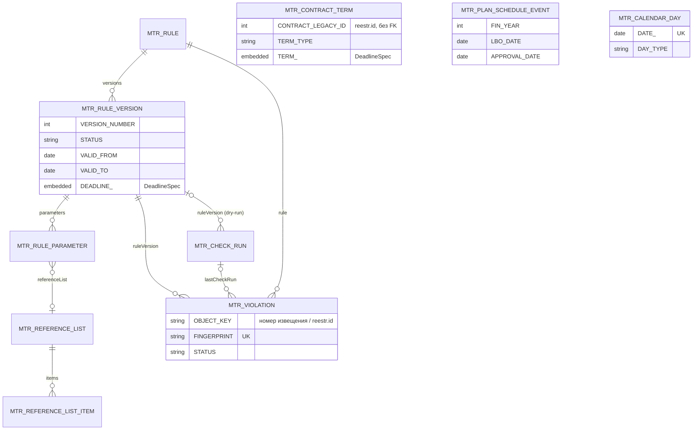
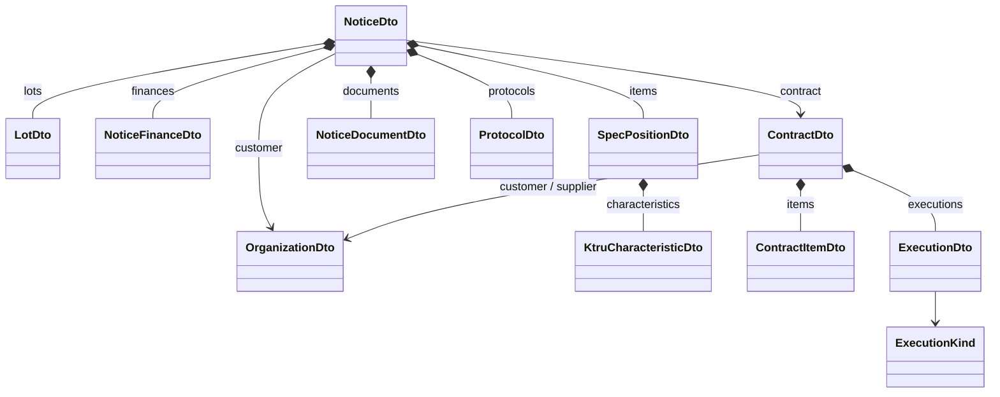

# Модель данных MultiReestr (Jmix 3.0.3)

> Общая картина модели, диаграммы и ключевые решения описаны в [OVERVIEW.md](OVERVIEW.md).

Документация сущностей и перечислений для создания в Jmix Studio (мастера *Entity* / *Enumeration*). Источники: `tech_solution_jmix.md`, `business_rules_solution.md`, `notice_lookup_spec.md`, `schema.sql` (типы legacy-столбцов сверены с копией БД).

## Соглашения

| Что | Правило |
|---|---|
| Базовый пакет | `com.digitilius.multireestr`; JPA — `…entity`, DTO legacy — `…entity.legacy`, перечисления — `…entity` |
| projectId | `mtr` → имя сущности `mtr_<Class>`, таблица `MTR_<SNAKE_CASE>` (Studio делает сама) |
| Атрибуты | camelCase; колонки — UPPER_SNAKE; зарезервированные слова Studio дополняет `_` (DATE_, VALUE_, MODE_) |
| Id JPA | UUID, `@JmixGeneratedValue` (по умолчанию в мастере) |
| Id DTO | legacy-ключ `Integer` с `@JmixId` (вместо UUID из мастера); исключение — CheckResultDto (UUID) |
| Трейты JPA | по умолчанию **Versioned + Audit of creation + Audit of modification** — это трейты ядра Jmix (`@CreatedBy`/`@LastModifiedBy` и т.п.), **не** add-on Jmix Audit (entity log), который в проекте не используется; **Soft delete не используем** (уникальные коды, история нарушений; отключение — флаг `enabled`/статус) |
| Перечисления | Большинство — `EnumClass<String>`, id = имя константы (UPPER_SNAKE), в БД строка. **Исключение — три статуса с `EnumClass<Integer>`**: [ViolationStatus](enums/ViolationStatus.md) (NEW=10, ACKNOWLEDGED=20, FALSE_POSITIVE=30, FIXED=40), [CheckRunStatus](enums/CheckRunStatus.md) (RUNNING=10, SUCCESS=20, PARTIAL=30, FAILED=40), [RuleVersionStatus](enums/RuleVersionStatus.md) (DRAFT=10, ACTIVE=20, ARCHIVED=30); в БД число. Заголовки на русском — в `messages_ru.properties` |
| Даты | дата без времени — `LocalDate`; момент события в приложении — `OffsetDateTime` (тип Studio *DateTime*); legacy timestamp без зоны (МСК) — `LocalDateTime` |
| Деньги/количества | `BigDecimal` с точностью legacy (18,2; 21,2; 29,11) |
| Main-БД | Jmix 3 не работает с PostgreSQL 9.6 → в продуктиве отдельный инстанс **PostgreSQL 16+** на той же машине, другой порт (`localhost:5435`, БД `multireestr`; см. [../deploy-windows.md](../deploy-windows.md)); в разработке — HSQLDB или `postgres:16`. Liquibase и JPA — только здесь. См. [OVERVIEW §8](OVERVIEW.md#8-развёртывание-и-базы-данных) |
| Legacy-БД | `reestrdb` на PostgreSQL 9.6 (`localhost:5432`), обычный JDBC (`legacyJdbc`), read-only на трёх уровнях (драйвер, Hikari, роль `reestr_ro`); приложение стартует и без неё (предупреждение). Параметры подключения (с урока 1) задаются в UI ([LegacyConnectionSettings](entities/LegacyConnectionSettings.md)), свойства `legacy.datasource.*` остаются запасным вариантом. **Не моделируется JPA** и не является data store: DTO заполняются из `NamedParameterJdbcTemplate` (read-only). Ссылки из JPA на legacy — только по значению (`contractLegacyId`, `objectKey`), без FK |
| Строки без длины | «unlimited» = тип *String* с пустой длиной → `@Lob` / `text` |
| Связи | composition — для подчинённых (versions, parameters, items); association many-to-one — для остальных |

> `OrganizationDto` в ранних версиях проектных документов назывался `SupplierDto`: переименован, т.к. используется и для заказчика.

> План уроков — [../LESSONS.md](../LESSONS.md) (10 уроков, нумерация совпадает с колонкой «Урок» ниже).

## Уроки

| № | Урок | Сущности | Перечисления |
|---|---|---|---|
| 1 | Проект и подключение legacy-БД (read-only); настройка подключения из UI; развёртывание на Windows | [LegacyConnectionSettings](entities/LegacyConnectionSettings.md) | — |
| 2 | DTO-модель извещения, поиск и экран поиска | [OrganizationDto](entities/OrganizationDto.md), [NoticeCandidateDto](entities/NoticeCandidateDto.md), [NoticeDto](entities/NoticeDto.md), [LotDto](entities/LotDto.md), [SpecPositionDto](entities/SpecPositionDto.md), [KtruCharacteristicDto](entities/KtruCharacteristicDto.md), [NoticeDocumentDto](entities/NoticeDocumentDto.md) | — |
| 3 | DTO протоколов, контракта и исполнения; карточка извещения и Excel | [ProtocolDto](entities/ProtocolDto.md), [ContractDto](entities/ContractDto.md), [ContractItemDto](entities/ContractItemDto.md), [ExecutionDto](entities/ExecutionDto.md) | [ExecutionKind](enums/ExecutionKind.md) |
| 4 | Производственный календарь | [CalendarDay](entities/CalendarDay.md) | [DayType](enums/DayType.md), [CalendarSource](enums/CalendarSource.md) |
| 5 | Движок сроков (ст.191–193 ГК) | [DeadlineSpec](entities/DeadlineSpec.md) | [DayCountUnit](enums/DayCountUnit.md), [ShiftRule](enums/ShiftRule.md), [DeadlineAnchor](enums/DeadlineAnchor.md), [CompareOperator](enums/CompareOperator.md) |
| 6 | Справочники и правила (шаблоны, версии, параметры), редактор правил, роли | [ReferenceList](entities/ReferenceList.md), [ReferenceListItem](entities/ReferenceListItem.md), [Rule](entities/Rule.md), [RuleVersion](entities/RuleVersion.md), [RuleParameter](entities/RuleParameter.md) | [ReferenceListKind](enums/ReferenceListKind.md), [RuleTemplateType](enums/RuleTemplateType.md), [RuleObjectType](enums/RuleObjectType.md), [RuleVersionStatus](enums/RuleVersionStatus.md), [ParameterType](enums/ParameterType.md), [Severity](enums/Severity.md) |
| 7 | Проверка по запросу и реестр нарушений | [CheckResultDto](entities/CheckResultDto.md), [CheckRun](entities/CheckRun.md), [Violation](entities/Violation.md) | [CheckRunMode](enums/CheckRunMode.md), [CheckRunStatus](enums/CheckRunStatus.md), [ViolationStatus](enums/ViolationStatus.md) |
| 8 | Ручные данные: условия контрактов, даты ЛБО/ПГ | [PlanScheduleDto](entities/PlanScheduleDto.md), [ContractTerm](entities/ContractTerm.md), [PlanScheduleEvent](entities/PlanScheduleEvent.md) | [ContractTermType](enums/ContractTermType.md) |
| 9 | Плановое сканирование (Quartz); оповещение в приложении — реестр нарушений + счётчик NEW в меню | — | — |
| 10 | Dry-run правил на исторических данных | — | [DryRunDiff](enums/DryRunDiff.md) |

Урок 1 — конфигурация (main на HSQLDB / PostgreSQL 16, legacy DataSource read-only) и одна сущность `LegacyConnectionSettings` для настройки подключения из UI. Урок 9 добавляет Quartz add-on со своими таблицами; новых сущностей не требует. Email-уведомления **не реализуем, только рассказываем** (возможное расширение — Email Sending add-on `io.jmix.email`). Add-on'ы Jmix Notifications (платный) и Jmix Audit не используются: история правил — RuleVersion, жизненный цикл нарушения — Violation.status, «кто/когда» — трейты аудита ядра. Урок 10 новых сущностей не требует (CheckRun с режимом DRY_RUN, CheckResultDto, RuleVersion в статусе DRAFT).

## Сущности

| Сущность | Тип | Таблица | Урок | Назначение |
|---|---|---|---|---|
| [LegacyConnectionSettings](entities/LegacyConnectionSettings.md) | JPA | MTR_LEGACY_CONNECTION_SETTINGS | 1 | Параметры подключения к legacy-БД, задаваемые администратором в UI (одна запись, пароль зашифрован) |
| [OrganizationDto](entities/OrganizationDto.md) | DTO | — (не хранится) | 2 | Организация из `owners`: заказчик извещения/контракта и поставщик (`reestr |
| [NoticeCandidateDto](entities/NoticeCandidateDto.md) | DTO | — (не хранится) | 2 | Строка поиска: в гриде оригинал номера (фрагмент/маска, интервал дат) |
| [NoticeDto](entities/NoticeDto.md) | DTO | — (не хранится) | 2 | Карточка извещения 44-ФЗ (Q3–Q11 из notice_lookup_spec |
| [LotDto](entities/LotDto.md) | DTO | — (не хранится) | 2 | Лот извещения |
| [NoticeFinanceDto](entities/NoticeFinanceDto.md) | DTO | — (не хранится) | 3 | Финансирование извещения (КБК, год, сумма) |
| [SpecPositionDto](entities/SpecPositionDto.md) | DTO | — (не хранится) | 2 | Позиция спецификации извещения; вход для правил ПП 1875, КТРУ, описания (замечания 3, 4, 5, 7) |
| [KtruCharacteristicDto](entities/KtruCharacteristicDto.md) | DTO | — (не хранится) | 2 | Характеристика позиции (КТРУ или заказчика) со значением; вход для правила «доп |
| [NoticeDocumentDto](entities/NoticeDocumentDto.md) | DTO | — (не хранится) | 2 | Документ извещения (ссылка на filestore ЕИС) |
| [ProtocolDto](entities/ProtocolDto.md) | DTO | — (не хранится) | 3 | Протокол закупки |
| [ContractDto](entities/ContractDto.md) | DTO | — (не хранится) | 3 | Контракт из `reestr`; вход для правил по исполнению (замечания 9, 10) |
| [ContractItemDto](entities/ContractItemDto.md) | DTO | — (не хранится) | 3 | Позиция контракта |
| [ExecutionDto](entities/ExecutionDto.md) | DTO | — (не хранится) | 3 | Документ исполнения: приёмка или оплата (с данными этапа) |
| [PlanScheduleDto](entities/PlanScheduleDto.md) | DTO | — (не хранится) | 8 | Версия плана-графика из legacy — подсказка для ввода PlanScheduleEvent |
| [CheckResultDto](entities/CheckResultDto.md) | DTO | — (не хранится) | 7 | Результат проверки в памяти: показывается в окне «Проверить» и в dry-run; при сохранении проверки превращается в Violation |
| [CalendarDay](entities/CalendarDay.md) | JPA | MTR_CALENDAR_DAY | 4 | День производственного календаря РФ |
| [DeadlineSpec](entities/DeadlineSpec.md) | Embeddable | — (колонки во владельце) | 5 | Декларативное описание срока: якорь + смещение + единица + перенос + сравнение |
| [ReferenceList](entities/ReferenceList.md) | JPA | MTR_REFERENCE_LIST | 6 | Справочный список, редактируемый пользователем (ОКПД2 ПП 1875 прил |
| [ReferenceListItem](entities/ReferenceListItem.md) | JPA | MTR_REFERENCE_LIST_ITEM | 6 | Элемент справочного списка |
| [Rule](entities/Rule.md) | JPA | MTR_RULE | 6 | Правило — экземпляр шаблона (RuleTemplateType), созданный специалистом |
| [RuleVersion](entities/RuleVersion.md) | JPA | MTR_RULE_VERSION | 6 | Версия параметров правила с периодом действия (историческая проверка по нормам на дату) |
| [RuleParameter](entities/RuleParameter.md) | JPA | MTR_RULE_PARAMETER | 6 | Параметр версии правила (ключ-значение, тип задаётся шаблоном) |
| [CheckRun](entities/CheckRun.md) | JPA | MTR_CHECK_RUN | 7 | Журнал запусков проверок (по запросу, плановых, dry-run) |
| [Violation](entities/Violation.md) | JPA | MTR_VIOLATION | 7 | Реестр нарушений: срабатывание правила по объекту, со статусом и квитированием |
| [ContractTerm](entities/ContractTerm.md) | JPA | MTR_CONTRACT_TERM | 8 | Условие контракта, введённое вручную (срок поставки, приёмки, оплаты), которого нет в legacy-БД |
| [PlanScheduleEvent](entities/PlanScheduleEvent.md) | JPA | MTR_PLAN_SCHEDULE_EVENT | 8 | Даты доведения ЛБО и утверждения плана-графика (замечание 1) — в legacy их нет |

## Перечисления

| Перечисление | Значения | Урок |
|---|---|---|
| [ExecutionKind](enums/ExecutionKind.md) | ACCEPTANCE, PAYMENT | 3 |
| [DayType](enums/DayType.md) | WORKING, SHORTENED, WEEKEND, HOLIDAY, WORKING_TRANSFER | 4 |
| [CalendarSource](enums/CalendarSource.md) | XMLCALENDAR, LEGACY, GENERATED, MANUAL | 4 |
| [DayCountUnit](enums/DayCountUnit.md) | CALENDAR_DAYS, WORKING_DAYS, MONTHS | 5 |
| [ShiftRule](enums/ShiftRule.md) | NONE, NEXT_WORKDAY, PREVIOUS_WORKDAY | 5 |
| [DeadlineAnchor](enums/DeadlineAnchor.md) | LBO_DATE, PLAN_APPROVAL_DATE, NOTICE_PUBLISHED, NOTICE_CHANGE_PUBLISHED, APPLICATIONS_END, CONTRACT_SIGNED, DELIVERY_DOCUMENT, ACCEPTANCE, PAYMENT, STAGE_END | 5 |
| [CompareOperator](enums/CompareOperator.md) | NOT_LATER, NOT_EARLIER | 5 |
| [ReferenceListKind](enums/ReferenceListKind.md) | OKPD2, KTRU, KEYWORD, TEXT | 6 |
| [RuleTemplateType](enums/RuleTemplateType.md) | OKPD2_FOREIGN_BAN, KTRU_REQUIRED, KTRU_EXTRA_CHARACTERISTICS, NON_KTRU_NO_DESCRIPTION, CONTRACT_KIND_MISMATCH, DEADLINE, LATE_DELIVERY_PENALTY, DOCUMENT_STRUCTURE_MISMATCH | 6 |
| [RuleObjectType](enums/RuleObjectType.md) | NOTICE, CONTRACT, PLAN_SCHEDULE | 6 |
| [RuleVersionStatus](enums/RuleVersionStatus.md) | DRAFT, ACTIVE, ARCHIVED | 6 |
| [ParameterType](enums/ParameterType.md) | STRING, INTEGER, DECIMAL, BOOLEAN, DATE, LIST | 6 |
| [Severity](enums/Severity.md) | ERROR, WARNING, INFO | 6 |
| [CheckRunMode](enums/CheckRunMode.md) | ON_DEMAND, SCHEDULED, DRY_RUN | 7 |
| [CheckRunStatus](enums/CheckRunStatus.md) | RUNNING, SUCCESS, PARTIAL, FAILED | 7 |
| [ViolationStatus](enums/ViolationStatus.md) | NEW, ACKNOWLEDGED, FALSE_POSITIVE, FIXED | 7 |
| [DryRunDiff](enums/DryRunDiff.md) | NEW, UNCHANGED, DISAPPEARED | 10 |
| [ContractTermType](enums/ContractTermType.md) | DELIVERY, ACCEPTANCE, PAYMENT | 8 |

## ER-диаграмма (main store)

## DTO-модель (legacy, в памяти)

Отдельно: NoticeCandidateDto (поиск), PlanScheduleDto (урок 8), CheckResultDto (уроки 7, 10).

## Как правила используют модель

| Замечание | Шаблон | Данные |
|---|---|---|
| 1 ПГ позже 10 раб. дн. после ЛБО | DEADLINE | PlanScheduleEvent + CalendarDay |
| 2 ТЗ ≠ форма | DOCUMENT_STRUCTURE_MISMATCH | NoticeDocumentDto.url (файлы вне БД) |
| 3 ПП 1875 | OKPD2_FOREIGN_BAN | SpecPositionDto + ReferenceList PP1875_ANNEX1 |
| 4 КТРУ не применён | KTRU_REQUIRED | SpecPositionDto + ReferenceList (KTRU, внешний справочник) |
| 5 доп. характеристики | KTRU_EXTRA_CHARACTERISTICS | KtruCharacteristicDto.fromEis |
| 6 срок не продлён | DEADLINE | NoticeDto.modifVersion/publishedAt/applicationsTo |
| 7 нет описания | NON_KTRU_NO_DESCRIPTION | SpecPositionDto.characteristics |
| 8 вид договора | CONTRACT_KIND_MISMATCH | NoticeDto + ReferenceList (KEYWORD/OKPD2) |
| 9 неустойка | LATE_DELIVERY_PENALTY | ContractDto, ExecutionDto, ContractTerm DELIVERY |
| 10 приёмка | DEADLINE | ExecutionDto, ContractTerm ACCEPTANCE |

## Начальные данные

Начальные данные загружаются Liquibase-ченджсетами из CSV в репо (`loadData`), без обращения в интернет.

| Данные | Урок | Вид | Источник |
|---|---|---|---|
| `CalendarDay` за годы тестового набора данных | 4 | обязательные | CSV, сгенерированный скриптом из xmlcalendar.ru; дальше кнопка «Загрузить год» |
| `ReferenceList` / `ReferenceListItem`: ПП 1875 прил. 1 (ОКПД2), КТРУ | 6 | обязательные | CSV; дальше импорт из Excel в UI |
| `Rule` / `RuleVersion` / `RuleParameter`: стартовый набор под 10 замечаний аудита | 6 | обязательные | CSV / ченджсет |
| Пользователи: admin, специалист, администратор правил | 6 | обязательные (кроме демо-пользователей) | ченджсет |
| `ContractTerm`, `PlanScheduleEvent` для «золотых» извещений | 8 | демо | ченджсет с `context="demo"` |

Правило: обязательные данные — ченджсеты без контекста; демо-данные — ченджсеты с `context="demo"`, на проде контекст `demo` не включается.

Не требуют начальных данных: все DTO (читаются из legacy), `Violation`, `CheckRun` (создаются при работе), перечисления (в коде).
